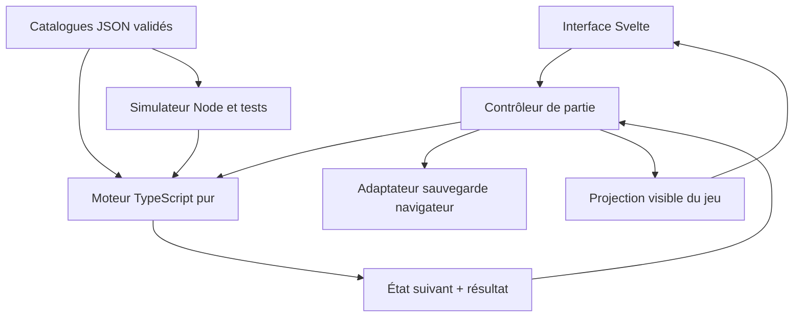

# La République, c’est moi ! — Architecture technique

**Version 0.1 — 24 novembre 2026**  
**Statut :** proposition d’implémentation avant prototype  
**Référence fonctionnelle :** [GAME_DESIGN.md](GAME_DESIGN.md)  
**Assistants de développement :** Codex et Claude Code, sans dépendance à l’un ou l’autre dans le jeu.

## 1. Objectifs et décisions

Construire un jeu solo de gestion narrative de carrière politique, jouable dans un navigateur desktop, déployable comme site statique. Le moteur doit permettre une carrière complète, une simulation accélérée, des tests reproductibles et l’ajout régulier d’événements sans modifier son code. La cible de durée est 45–60 minutes de jeu actif, à valider par playtests.

| Décision | Choix |
|---|---|
| Frontend | SvelteKit + TypeScript strict + Tailwind CSS + Lucide |
| Moteur | TypeScript pur, sans Svelte, DOM, stockage ni réseau |
| Déploiement | SvelteKit adapter-static, page racine prérendue, assets statiques ; hébergement GitHub Pages (sous-répertoire ou domaine personnalisé) |
| Contenu | JSON validé par schémas et contrôles de références |
| État | Un seul état de partie sérialisable, transitions explicites |
| Sauvegarde | localStorage versionné, export/import JSON recommandé |
| Tests | Vitest, Playwright pour parcours critiques, simulations Node |
| Dépendances | npm, lockfile Git, version Node LTS fixée à l’initialisation |
| IA | Assistance au développement uniquement ; aucune API IA en jeu |

Les versions exactes des bibliothèques seront sélectionnées ensemble lors de l’initialisation, puis verrouillées. Pas de backend, base distante, compte utilisateur, progression hors ligne, multijoueur, gestion de pays exhaustive ni méta-progression V1. Ne pas introduire de serveur Node en production pour une fonctionnalité locale. Les valeurs numériques de gameplay restent provisoires ; le GDD est la référence en cas d’écart fonctionnel.

## 2. Architecture et frontières



Le moteur reçoit les données, l’état précédent et une commande. Il renvoie un nouvel état et un résultat de transition, sans modifier ses arguments. Le contrôleur valide, persiste, publie l’état puis expose une projection à l’interface. Les composants n’écrivent jamais directement dans les ressources ni dans l’historique. Les règles de simulation n’existent qu’à un seul endroit. Les tests et le simulateur importent exactement ce moteur.

L’interface de jeu sera une application à onglets plutôt qu’une multitude de routes ; les onglets ne changent pas le temps. L’écran d’accueil propose nouvelle partie, reprise et import. Les détails du design sont dans DESIGN.md.

## 3. Structure cible du dépôt

```text
/
  AGENTS.md                 # règles communes aux assistants
  CLAUDE.md                 # import des règles communes (compatibilité)
  GAME_DESIGN.md
  ARCHITECTURE.md
  DESIGN.md
  ROADMAP.md
  README.md                 # commandes et démarrage
  package.json
  package-lock.json
  .nvmrc
  src/
    routes/
      +layout.svelte
      +page.svelte          # coque accueil / partie / bilan
    lib/
      game/
        engine/
          index.ts          # API publique du moteur
          state.ts          # état et types fondamentaux
          commands.ts       # commandes et résultats
          calendar.ts
          random.ts
          turn.ts
          conditions.ts
          effects.ts
          actions.ts
          events.ts
          health.ts
          economy.ts
          selectors.ts      # calculs dérivés purs
          invariants.ts
          # Modules ajoutés au fur et à mesure :
          characters.ts, relations.ts, delegation.ts
          elections.ts, mandates.ts, world.ts
          promises.ts, justice.ts, institutions.ts, media.ts, assets.ts
        content/
          schemas.ts
          validate.ts
          load.ts
          data/
            actions.json
            upgrades.json
            events/
            world/
            balance.json
        app/
          controller.ts
          view-model.ts
          session.svelte.ts # état réactif (si Svelte 5 retenu)
        persistence/
          envelope.ts
          migrations.ts
          local-storage.ts
          import-export.ts
      components/
        shell/
        dashboard/
        agenda/
        events/
        common/
  scripts/
    validate-content.ts
    simulate.ts
  tests/
    unit/
    scenarios/
    fixtures/
    e2e/
  static/                   # portraits et illustrations facultatifs
```

### 3.1 Écarts avec l’arborescence cible (état après P2-01)

- `engine/actions.ts` est devenu `engine/plan.ts` (plan d’actions et d’achats : prévision et exécution) ; `characters.ts` et suivants viendront avec l’alpha.
- Ajouts : `content/types.ts` (types sans dépendance, seul module de contenu lisible par le moteur), `content/version.ts` (empreinte des catalogues), `content/load-node.ts` (frontière fichier des outils Node), `content/data/cast.json` (distribution fictive) ; `engine/acceleration.ts` ; `simulation/index.ts` ; `persistence/state-schema.ts` et `persistence/index.ts` ; `app/format.ts` et `app/browser.ts` (frontière navigateur) ; `components/organisation/`, `components/journal/` et `components/world/` ; `engine/world.ts` (monde autonome et effets politiques, P2-01), `engine/characters.ts` (personnages, P2-04) ; `content/data/traits.json` ; `components/people/` ; `scripts/base-path.ts`, `scripts/serve-static.ts` et `scripts/simulate.ts` ; `tests/e2e/support/`.
- Le monde tient en un seul catalogue `content/data/world.json` (axes, partis, noms des dirigeants) plutôt qu’un dossier `content/data/world/` ; l’actualité nationale est `content/data/events/national.json`.
- Tests non colocés : `tests/unit`, `tests/scenarios`, `tests/fixtures`, `tests/e2e`.

Arborescence cible et non exigence de créer des dossiers vides : commencer par les modules utiles au prototype. Les fichiers séparés par virgules ci-dessus sont des fichiers distincts. Les tests peuvent aussi être colocés si convention unique documentée. Pas de dépendance circulaire : types et utilitaires → règles métier → orchestrateur ; le moteur ne dépend jamais de l’application ou de l’UI. Le catalogue ne dépend pas du navigateur.

## 4. Modèle de données

### 4.1 État central

Les contrats suivants illustrent la cible ; le prototype utilise un sous-ensemble. Les structures finales sont définies dans le code et couvertes par tests, sans imposer les valeurs de départ.

```ts
type Id = string;
type Turn = number; // 0 = T1 2000
interface GameState {
  schemaVersion: number;
  turn: Turn;
  rng: { seed: string; state: number }; // PRNG choisi et versionné
  phase: 'planning' | 'decision' | 'ended';
  playerId: Id;
  resources: Resources;
  player: PlayerState;
  world: WorldState;
  characters: Record<Id, Character>;
  relationships: Record<Id, Relationship>;
  organization: Organization;
  mandates: Record<Id, MandateInstance>;
  elections: Record<Id, ElectionInstance>;
  campaigns: Record<Id, Campaign>;
  promises: Record<Id, PromiseRecord>;
  assets: Record<Id, AssetInstance>;
  cases: Record<Id, LegalCase>;
  events: EventState;
  history: HistoryEntry[];
  stats: CareerStats;
  end: EndState | null;
}
interface Resources {
  influence: number;
  politicalBudgetCents: number;
  personalCashCents: number;
}
```

`player` contient notamment la date de naissance, la santé, le stress, la notoriété, les soutiens, l’affiliation, les contraintes d’éligibilité et les convictions internes. Pas de score moral présenté au joueur. Les actes et leurs conséquences restent dans l’historique. `personalCashCents` représente la liquidité ; la valeur nette du patrimoine est dérivée de la liquidité, des actifs et des dettes si celles-ci sont introduites. Les fonds détournés cumulés sont une statistique historique distincte, pas une monnaie ni un synonyme de fortune.

Les personnages ont des identifiants stables, un nom fictif, une naissance, des rôles, des compétences, des traits réels et des informations connues par le joueur. Les liens sont orientés (A peut faire confiance à B sans réciprocité). Les souvenirs retiennent les faits importants et leurs dates. Les proches et adversaires utilisent le même modèle. Les employés non nommés sont agrégés. Ne jamais confondre identifiant d’une définition (`role.mayor`) et identifiant d’une instance (`mandate.42`).

Les `CareerStats` conservent les agrégats nécessaires au bilan (plus haute fonction, argent détourné, promesses, etc.). Les faits durables — décisions, affaires et relations — sont conservés même si les nouvelles ordinaires sont compactées. Pas besoin d’event sourcing intégral ni de reconstruire l’état depuis tout le journal.

### 4.2 Monde et politique

`WorldState` contient les instances des partis, médias et règles institutionnelles, ainsi que les indicateurs nationaux abstraits. Les définitions initiales sont stables entre parties ; les noms, traits et relations des dirigeants sont tirés à la création. Les évolutions sont déclenchées par le moteur et des événements, même sans action du joueur. Les calendriers sont représentés par des instances d’élection dotées d’une échéance et d’une clôture de candidature. Une élection anticipée ne réécrit pas silencieusement une instance passée.

Un mandat référence son titulaire, sa fonction, son début, sa fin et son mode d’accès. La fonction principale est dérivée des mandats actifs selon une priorité de présentation (à définir), distincte des droits. Les incompatibilités sont évaluées par les règles institutionnelles actuelles. Une réforme précise explicitement son moment d’application et le sort des mandats existants. Les nominations et mandats électifs sont distincts.

### 4.3 Unités et invariants

- Dates métier : entiers en trimestres ; année = 2000 + floor(turn / 4), trimestre = turn % 4 + 1. Âge calculé depuis la naissance ; pas de compteur d’âge indépendant susceptible de dériver.
- Argent : centimes entiers sûrs JavaScript ; convention d’arrondi unique documentée ; aucune fusion implicite entre budget politique et patrimoine. Coûts validés avant achat. Insuffisance de trésorerie : suspension des charges non payées et alerte dans le prototype ; dette éventuelle traitée explicitement plus tard.
- Jauges bornées : par exemple 0–100 pour santé et stress ; convention unique pour probabilités 0–1. Aucun NaN, Infinity ou nombre hors plage. L’influence n’est pas nécessairement une jauge bornée.
- Budget de temps : 100 points indicatifs par trimestre, entier et non cumulable ; les actions manuelles ne dépassent jamais la disponibilité. Le temps délégué possède une capacité distincte.
- Références stables, acteurs actifs et éligibles, mandats compatibles, une seule résolution par événement, état terminal immuable, et aucun tour avancé avec choix bloquant en suspens.
- Utiliser une seule fonction de contrôle des invariants après chaque transition en tests et aux frontières de chargement ; ne pas masquer des bugs par des clamps indiscriminés.

## 5. API du moteur et résolution des tours

```ts
// Signatures de principe, non du code déjà implémenté.
createGame(config: NewGameConfig, content: Content): GameState;
previewPlan(state: GameState, plan: TurnPlan, content: Content): PlanPreview;
transition(state: GameState, command: GameCommand, content: Content): TransitionResult;
projectView(state: GameState, content: Content): PlayerView;
```

Signatures réellement implémentées (P1-08) : `createGame(config, content)`, `previewPlan(state, plan, content)` et `transition(state, command, content)` dans `engine/` ; la projection est `projectView(state, plan, content)` dans `app/view-model.ts`, car elle intègre le brouillon de plan de l’interface et le formatage français, qui ne relèvent pas du moteur.

Les commandes sont des unions discriminées : `commitTurn(plan)`, `chooseEvent(instanceId, choiceId)`, et ultérieurement changements de missions, candidatures et nominations lorsqu’elles sont permises. Les opérations de planification sont modifiables avant validation ; leurs previews ne consomment aucun aléatoire. Un plan contient actions ordonnées, cibles, achats, consignes et coûts dérivés du catalogue. Validation et exécution réutilisent les mêmes règles, sur un état de travail simulant les prérequis déterministes du plan. Aucun effet partiel sur commande rejetée. Les effets aléatoires des actions sont résolus seulement à la validation et ne financent pas d’autres actions du même plan dans le prototype.

### 5.1 Ordre de résolution proposé, à verrouiller par tests

1. Vérifier la phase `planning`, les références, l’éligibilité, les coûts et les limites ; refuser sans modifier l’état ni le PRNG en cas d’erreur.
2. Capturer les producteurs, mandats et charges déjà actifs au début de T ; réserver temps et coûts. Appliquer les actions planifiées dans l’ordre annoncé, y compris achats et recrutements. Les producteurs nouvellement recrutés ou acquis ne démarrent qu’en T+1, sauf effet ponctuel explicite.
3. Résoudre la délégation des équipes actives et leurs productions ; appliquer les revenus, charges et effets récurrents prévus pour T. Les règles d’insolvabilité et de départ d’un acteur s’appliquent explicitement. Pas de production d’un acteur devenu inactif avant sa mission ; les droits déjà acquis sont distingués des tâches non exécutées.
4. Actualiser le contexte national, les relations et les personnages ; appliquer stress, récupération et vieillissement à la frontière T/T+1. Vérifier les décès et autres causes terminales avant d’attribuer un nouveau mandat au joueur. Les événements terminaux découlant des choix sont également vérifiés après leur application.
5. Résoudre les échéances arrivant à la fin de T (scrutin, mandat, affaire, promesse), selon un ordre fixe : fins de droits/mandats, scrutins et nominations, autres échéances. Des réformes différées deviennent actives à la frontière prévue. Les candidats sont revalidés à la date de l’échéance.
6. Passer à T+1 exactement une fois ; produire le journal du trimestre T. Sélectionner les événements éligibles à la frontière, créer leurs instances, figer leurs acteurs et les mettre en file selon priorité. Une conséquence future porte un `dueTurn` explicite. Une fin de partie interrompt immédiatement les opérations ultérieures et clôt le bilan.
7. Publier l’état `decision` s’il existe un choix bloquant, sinon `planning`. La résolution d’un choix ne réexécute jamais les étapes 1–6. Elle applique les effets, actualise la file, vérifie la fin, puis retourne en phase `planning` lorsque les décisions sont traitées. Les événements suivants sont revalidés après tout changement ; une instance devenue impossible est annulée avec motif de journal.

Convention : si un effet terminal arrive pendant la résolution de T avant la frontière, le bilan enregistre le tour de décès/fin T ; après la frontière, T+1. Le moteur conserve explicitement la date de fin. Les actions institutionnelles narratives sont des choix à la frontière, pas une réécriture rétroactive du scrutin déjà résolu. Une décision prévue avant scrutin doit donc être présentée au plus tard au tour précédent. Les alertes calendaires sont calculées avant chaque engagement de tour.

### 5.2 Accélération

L’accélérateur est une boucle de `commitTurn` utilisant un plan récurrent valide (ou un plan vide si autorisé) et les mêmes règles qu’un tour manuel. Il s’arrête **avant** une échéance exigeant préparation selon sa fenêtre configurée, **après** un tour produisant un choix bloquant, une alerte critique ou une fin, ou à la limite demandée. Le résultat contient `turnsAdvanced` et `stopReason`. Les alertes déjà reconnues sont identifiées pour éviter un blocage infini. Une décision bloquante n’est jamais choisie automatiquement dans le jeu interactif. Le simulateur de tests peut la choisir selon sa stratégie explicite.

L’UI exécute des lots courts et rend la main au navigateur pour permettre l’annulation ; sauvegarder chaque tour validé ou chaque lot borné avec état cohérent. Pas de temps réel ni de progression hors ligne. Un Web Worker n’est envisagé que si un profilage démontre un besoin.

### 5.2 bis Décisions de P1-09 : accélération minimale (24 novembre 2026)

- **Moteur :** `engine/acceleration.ts` expose `accelerate(state, { plan, maxTurns }, content)`. La fonction est pure et répète exclusivement `transition(state, commitTurn(plan), content)` ; elle n’a aucun raccourci de résolution. Le résultat contient l’état cohérent atteint, `turnsAdvanced`, `stopReason`, les alertes nouvelles et les éventuels problèmes du plan.
- **Arrêts :** limite demandée, décision bloquante, nouvelle alerte, fin de carrière ou plan récurrent devenu invalide. Les alertes métier sont les avertissements de `previewPlan` (stress élevé, charges menacées) et la santé sous le seuil de fragilité. Les alertes déjà visibles au lancement sont considérées comme reconnues ; si elles disparaissent puis reviennent pendant le même lot, elles redeviennent nouvelles.
- **Contrôleur :** l’interface exécute des lots d’un seul trimestre. Après chaque lot, le contrôleur sauvegarde l’état complet, publie l’avancement puis cède une frame au navigateur (`requestAnimationFrame`) avant de poursuivre. Un échec de sauvegarde ou un conflit d’onglets interrompt immédiatement la boucle ; sans stockage, le comportement explicite de P1-08 reste inchangé.
- **Annulation :** un jeton d’exécution invalide la boucle entre deux trimestres ; aucun tour commencé n’est partiellement annulé. Le plan reste dans le brouillon après l’accélération afin d’être compris, corrigé ou relancé.
- **Interface :** « Année suivante » demande au plus quatre tours ; « Jusqu’à une alerte » utilise une borne de sécurité de quarante tours ; « Interrompre » remplace les commandes d’avance pendant l’exécution. Le motif d’arrêt et le nombre de trimestres simulés sont annoncés dans la barre permanente.
- **Versions et tests :** `RULES_VERSION = '0.7.0'`. `GameState` et l’enveloppe de sauvegarde ne changent pas (`SAVE_VERSION = 1`). Les scénarios comparent accélération et tours unitaires et couvrent décision, alerte, fin et plan invalide ; le contrôleur couvre sauvegarde par tour, annulation et échec d’écriture ; Playwright couvre année, annulation et reprise d’une décision.

### 5.2 ter Décisions de P2-09 : accélération complète et interface (25 novembre 2026)

- **Arrêts motivés :** `accelerationAlerts` porte désormais un genre (`plan`, `health`, `deadline`, `career`, `staff`, `finance`) et ajoute aux alertes de P1-09 : candidatures ouvertes à une élection accessible (`filing:<ballot>`, à `alertLeadTurns` trimestres au plus de la clôture, seulement si `candidacyIssue` ne s’y oppose pas : une élection inaccessible n’arrête pas le temps), dernier trimestre d’une campagne du joueur (`vote:`), résultat d’une campagne (`result:`), nomination (`mandate:`) ou fin de mandat (`mandate_end:`), élections anticipées (`early:`), départ d’un collaborateur (`staff_left:`, poste vacant), candidatures reçues (`shortlist:`) et budget politique inférieur aux salaires de l’entourage (`payroll_at_risk`). Les alertes de carrière et d’entourage sont lues dans le trimestre qui vient d’être résolu : elles ne valent que pour lui. La règle des alertes reconnues est inchangée.
- **Plan reconduit (dette du playtest P1-10, avancée de P3-08 ; règle remplacée par P3-11, §8.4 duodecies) :** `carryOverPlan` reporte le plan au trimestre suivant, avec la même règle après un tour manuel, un choix et chaque trimestre accéléré : les achats sont ponctuels et retirés ; une action dont la cible n’a plus d’objet (`invalid_target`, par exemple candidat recruté, candidature déposée) ou dont l’action ou l’amélioration a disparu est retirée ; les autres étapes restent même invalides (ressources, temps, condition) et le joueur corrige. Conséquence : une accélération n’achète plus la même amélioration à chaque trimestre. Le contrôleur signale les étapes retirées par une notice d’information. Le brouillon reste non sauvegardé.
- **Résumé groupé :** `summarizeSpan(from, to, content)` (projection) résume les trimestres simulés : période, variations nettes (ressources, santé, stress, popularité), nombre d’événements et de décisions, faits marquants (lignes de carrière, de personnes, de décision et de fin, huit au plus) et journal détaillé de la période. Le contrôleur le calcule à la fin d’une accélération (`AccelerationStatus.summary`, avec les messages des alertes nouvelles) ; le tableau de bord l’affiche en tête jusqu’à ce que le joueur le masque ou avance de nouveau. Le résumé survit à la réponse à la décision qui a arrêté le temps.
- **Journal :** les départs de collaborateurs, présélections, héritages, veuvages, dépenses des enfants et famille délaissée de la frontière ont désormais leurs lignes ; les indemnités des mandats passent en ligne économique.
- **Alertes du tableau de bord :** les alertes de carrière, d’entourage et de budget du moteur s’y ajoutent ; une échéance s’affiche dès que la clôture des candidatures entre dans la fenêtre d’alerte, même si le scrutin est plus loin.
- **Versions :** `RULES_VERSION = '0.16.0'`, format d’état inchangé (version 1) ; rapport de simulation v10 (les épisodes d’alerte incluent les nouvelles alertes).
- **Mesure :** 500 carrières (seed `p2-09`) : aucune erreur ni violation ; 175 trimestres, 32,8 décisions et 1,4 épisode d’alerte par an en moyenne. Accélération « Jusqu’à une alerte » avec un plan vide sur le catalogue réel (30 carrières, premier choix disponible) : un arrêt tous les 5,2 trimestres en moyenne, dont 764 arrêts de candidature (≈ 25 par carrière), 418 décisions, 9 alertes de santé. Le nombre d’arrêts électoraux est à juger en playtest : piste si trop fréquent, ne s’arrêter que pour les élections où le joueur a déjà été candidat ou que son parti peut lui confier.
- **Tests :** `tests/unit/acceleration-alerts.test.ts` (arrêt avant la clôture d’une élection accessible et pas d’une inaccessible, candidature retirée du plan, dernier trimestre de campagne, résultat, départ et présélection, salaires, résumé de période) ; scénarios (plan invalide par ressources, achat unique et équivalence avec les tours manuels reportés) ; contrôleur (plan reconduit, notice, résumé, masquage) ; E2E (arrêt avant les législatives, résumé et détail, année complète, annulation, décision).

## 6. Aléatoire et reproductibilité

Choisir un PRNG simple à état 32 bits avec algorithme et conversion seed→état documentés, par exemple Mulberry32 ; tester avec vecteurs de référence. Toute opération aléatoire passe par ce module, avec état sérialisé. Seed de nouvelle partie issue de `crypto.getRandomValues` à la frontière navigateur, ou fournie explicitement pour tests. Le moteur n’utilise jamais `Math.random()`, `Date.now()` ni des UUID aléatoires externes. Les identifiants de simulation proviennent d’un compteur d’instances sauvegardé (ou d’une dérivation déterministe équivalente).

Trier les candidats par identifiant stable avant un tirage pondéré ; fixer l’ordre de parcours des entités. Préviews, sélecteurs, rendu et actualisations n’avancent pas le PRNG. Même seed + mêmes commandes + mêmes versions moteur/contenu = même état et même journal métier. Ce contrat n’implique pas qu’un changement de catalogue reproduise une ancienne carrière. Sauvegarder la version de règles et la version de contenu ; les tests de régression utilisent des fixtures de contenu figées.

### 6.1 Décisions de P1-01 (24 novembre 2026)

- **PRNG :** Mulberry32, état entier non signé 32 bits sérialisé `{ seed, algorithm: 'mulberry32', state }`. Seed → état : FNV-1a 32 bits des octets UTF-8 de la seed. Fonctions pures `nextUint32`, `nextFloat` ([0, 1)) et `nextInt` (bornes incluses), qui renvoient `{ value, rng }`. Vecteurs de référence dans `tests/unit/random.test.ts` ; les modifier impose une nouvelle version de règles.
- **Seed :** chaîne de 1 à 64 caractères, sans espace en bordure ni caractère de contrôle. `createGame` exige une seed explicite ; la frontière navigateur la tirera de `crypto.getRandomValues` (P1-08).
- **Calendrier :** `Turn` entier, 0 = T1 2000, tours négatifs pour les dates antérieures. La naissance est un tour (`player.birthTurn`) ; l’âge en années révolues est dérivé (`ageAt`) et l’anniversaire tombe au trimestre de naissance. Profil fixe du prototype : 25 ans, né au T1 1975.
- **État :** `STATE_SCHEMA_VERSION = 1`, `RULES_VERSION = '0.1.0'`. Sous-ensemble actuel : `schemaVersion`, `turn`, `rng`, `phase`, `player.birthTurn`, `history`, `end`. Objet JSON pur, immuable par convention (`readonly`) ; ressources, santé et événements arrivent avec P1-02 à P1-05.
- **Commandes :** `transition(state, command)` pure. Seule `commitTurn(plan)` existe ; faute de catalogue (P1-02), seul un plan vide est accepté. Refus typés (`game_ended`, `decision_pending`, `invalid_phase`, `unknown_command`, `invalid_plan`, `unknown_action`) avec message français, et état d’entrée renvoyé à l’identique, PRNG compris. Un succès avance d’exactement un trimestre et ajoute `{ type: 'turn.resolved', turn: T }` au journal.
- **Invariants :** `checkInvariants` / `assertInvariants` dans `invariants.ts` (tour, phase, PRNG, seed, naissance, un journal par trimestre écoulé, cohérence de fin). Appelés après chaque transition dans les scénarios.
- **Reproductibilité :** aucun tirage n’est encore consommé par un tour (pas de règle aléatoire avant P1-02). Les scénarios vérifient déjà l’égalité structurelle à seed et commandes identiques, et la reprise depuis JSON.

## 7. Contenu déclaratif et moteur d’événements

Utiliser JSON et un validateur runtime (Zod recommandé) avec unions discriminées ; la validation des références croisées, templates, fenêtres temporelles et poids est une seconde étape. Le catalogue est importé au build puis indexé par identifiant. Séparer données fonctionnelles et textes seulement si le volume le justifie. Identifiants stables, français pour les textes, anglais pour les clés et le code. Pas de JavaScript embarqué, `eval`, expression libre ou script téléchargé.

### 7.1 Contrat indicatif d’événement

```json
{
  "id": "personal.rest_request",
  "category": "personal",
  "title": "Un agenda bien rempli",
  "text": "Votre médecin vous conseille de lever le pied.",
  "availableFromTurn": 0,
  "weight": 10,
  "priority": 20,
  "blocking": true,
  "cooldownTurns": 8,
  "unique": false,
  "when": { "op": "gte", "stat": "player.stress", "value": 70 },
  "choices": [
    {
      "id": "rest",
      "label": "Lever le pied",
      "preview": ["Moins de stress", "Influence en baisse"],
      "effects": [
        { "op": "addStat", "stat": "player.stress", "value": -12 },
        { "op": "addResource", "resource": "influence", "value": -3 }
      ]
    },
    {
      "id": "continue",
      "label": "Maintenir le cap",
      "preview": ["Stress en hausse"],
      "effects": [
        { "op": "addStat", "stat": "player.stress", "value": 5 }
      ]
    }
  ]
}
```

Chiffres fictifs de prototypage, non calibrés. La version finale du schéma est validée dans le dépôt. Les conditions supportent `all`, `any`, `not`, comparaisons typées et prédicats métier autorisés ; les effets supportent additions de ressources, variations de jauges, faits historiques, relations et suites différées. Ajouter une opération seulement quand plusieurs situations concrètes la justifient. Ne pas autoriser des chemins arbitraires vers l’état. Un registre typé des statistiques autorisées remplace tout accès dynamique non vérifié.

### 7.1 bis Décisions de P1-02 : actions, conditions et effets (24 novembre 2026)

- **Fichiers :** `content/types.ts` (types et vocabulaire, sans dépendance, seul module de contenu importable par le moteur), `content/schemas.ts` (Zod, typé contre `types.ts`), `content/validate.ts` (schémas puis contrôles croisés : identifiants uniques, coûts non dupliqués, temps ≤ budget trimestriel ; tous les problèmes sont renvoyés), `content/load.ts` (import au build, validation au chargement), `content/data/actions.json` et `balance.json`. Zod 4.6.7 ajouté en dépendance.
- **Action :** `id` stable `famille.nom`, `label`, `description`, `timeCost`, `maxPerTurn`, `costs` certains (payés avant les effets), `requires` facultatif accompagné obligatoirement d’un `unavailableReason`, `effects` (au moins un). Objets stricts : tout champ inconnu est refusé.
- **Conditions :** `all`, `any`, `not`, `gte`, `lte`, `eq` sur le registre `STAT_IDS` (`resources.*`, `player.age`, `calendar.year`, `calendar.quarter`), lu par un switch exhaustif. **Effets :** `addResource` (valeur fixe non nulle) et `addResourceRandom` (entier tiré dans [min, max] à la validation du trimestre, un tirage par effet dans l’ordre du plan).
- **Ressources :** `influence`, `politicalBudgetCents`, `personalCashCents` dans `GameState.resources`, entiers ≥ 0, jamais fusionnés ; valeurs de départ et budget de temps (100) dans `balance.json`.
- **Plan :** `previewPlan(state, plan, content)` pure (sans PRNG) ; `commitTurn` réutilise exactement la même validation. Simulation dans l’ordre sur un état de travail : les coûts et gains certains comptent pour la suite du plan ; un effet aléatoire ne compte que pour `min(0, min)`, il ne finance ni ne débloque jamais une autre action. Une action fautive est signalée (`unknown_action`, `repeat_limit`, `condition_not_met`, `time_exceeded`, `insufficient_resource`, `invalid_plan`) puis ignorée pour la suite, afin de lister tous les problèmes. Un plan invalide est refusé avec ces problèmes (`CommandError.issues`), sans modifier l’état.
- **Journal :** l’entrée `turn.resolved` porte les actions exécutées et leurs variations nettes réelles par ressource. `createGame(config, content)` et `transition(state, command, content)` reçoivent désormais le contenu. `RULES_VERSION = '0.2.0'` ; `STATE_SCHEMA_VERSION` reste 1 tant qu’aucune sauvegarde n’existe (figé à P1-07).
- **Tests :** le moteur est testé sur un contenu figé (`tests/fixtures/content.ts`) ; le catalogue réel a ses propres tests et un scénario de dix ans. Le catalogue initial (6 actions) et ses chiffres sont des hypothèses de prototypage. Les actions de recrutement, d’organisation et de repos arriveront avec les producteurs (P1-03) et la santé (P1-04).

### 7.2 Sélection et instances

Filtrer par date, phase, préconditions, acteurs valides, unicité et cooldown. Traiter les suites dues, puis événements exceptionnels, puis un nombre plafonné de tirages ordinaires ; priorité et règles de concurrence sont configurables. Une suite peut attendre une condition jusqu’à expiration si prévu, sinon être annulée avec motif. Chaque occurrence enregistre identifiant de définition, identifiant unique, tour, acteurs résolus, choix autorisés et données nécessaires. Les personnages décédés ou rôles perdus rendent les choix incohérents inéligibles ; prévoir un choix de repli lorsque nécessaire. Les templates n’accèdent qu’aux variables déclarées. Les textes sont échappés par Svelte, jamais injectés via HTML non fiable.

Les événements peuvent être non bloquants (effets automatiques et article) ou bloquants (choix). Le joueur voit tendances et fourchettes selon les compétences de ses conseillers, non l’état caché ni les tirages futurs. Les estimations utilisent une projection déterministe, éventuellement bruitée à la création d’une instance puis stockée ; les rafraîchir ne doit pas permettre de sonder le RNG. Les mêmes conditions et effets alimentent actions, améliorations et événements quand possible, sans créer de langage généraliste.

Le prototype cible 20–30 événements écrits, dont quelques suites.

### 7.3 Décisions de P1-05 : moteur d’événements (24 novembre 2026)

- **Catalogues :** chaque fichier `data/events/*.json` (`{ "events": [...] }`) et `data/cast.json`. Un événement a `id`, `category`, `title`, `text`, `trigger` (`random` ou `followUp`), `weight`, `priority`, fenêtre facultative `availableFromTurn`/`availableUntilTurn`, `cooldownTurns`, `unique`, condition `when` facultative, rôles `actors` ; puis soit `blocking: true` et `choices`, soit `blocking: false` et `effects` (liste éventuellement vide depuis P1-06 : simple brève). Un choix a `id`, `label`, `hints` (tendances rédigées), `costs` certains, prérequis facultatif, `effects` (éventuellement vides) et `followUp` facultatif (`eventId`, `delayTurns` ≥ 1).
- **Validation croisée :** identifiants uniques avec actions et améliorations ; variables `{rôle}` déclarées et aucune accolade isolée (titre, texte, libellés, tendances) ; suites existantes ; toute suite `followUp` atteignable par un choix ; au moins un choix de repli (sans prérequis ni coût) par événement bloquant ; chaque rôle pourvu par au moins un membre de la distribution.
- **Acteurs (prototype) :** une distribution fictive (`cast.json` : `id`, `name`, `tags`). Chaque rôle prend un membre distinct portant toutes ses étiquettes, tiré parmi les candidats triés par identifiant ; une suite réutilise l’acteur du même rôle. Ces personnages ne vieillissent ni n’ont de relations : le modèle complet arrive avec P2-04.
- **Frontière T/T+1 (étape 6, `events.ts`), sauf décès à l’étape 4 :** suites dues d’abord (créées si fenêtre et condition tiennent, sinon annulées avec motif), puis au plus `ordinaryDrawsPerTurn` tirages, chacun réussissant avec `ordinaryEventChance` puis choisissant au poids parmi les événements `random` éligibles triés par identifiant (fenêtre, condition, `unique`, `cooldownTurns` depuis la dernière occurrence, aucune instance en attente, acteurs disponibles, pas deux fois le même événement dans le trimestre). Paramètres dans `balance.json > events`.
- **Instances :** `event.N` (compteur commun avec les améliorations), acteurs figés, occurrences comptées par définition. Informatif : effets appliqués aussitôt. Bloquant : file `events.pending` triée par priorité décroissante puis ordre de création ; phase `decision`. Suites en attente dans `events.scheduled`.
- **Choix (`chooseEvent`)** : uniquement en phase `decision` et pour la tête de file ; prérequis et coûts vérifiés ; l’instance est retirée de la file en même temps que les effets sont appliqués (aucune double application possible) ; la suite est programmée ; les autres événements en attente sont revalidés (condition) et annulés avec motif si besoin ; retour en `planning` quand la file est vide. Nouveaux codes : `no_pending_decision`, `unknown_event_instance`, `not_next_event`, `unknown_choice`, `choice_unavailable`.
- **Effets automatiques** (événements, choix) : une ressource ne descend jamais sous zéro (perte limitée au disponible, variation réelle journalisée) ; les jauges restent bornées. Un décès dû à un événement de la frontière ou à un choix est daté du trimestre en cours (T+1) ; l’invariant devient `end.turn ≤ turn`.
- **Journal :** `turn.resolved.events` (instances `queued`, `applied` ou suites `cancelled`) et entrées `event.resolved` (choix, variations, suite programmée, annulations). Le journal est désormais une union `JournalEntry` ; `TransitionSuccess` n’a plus de `resolvedTurn`.
- **Vue :** `describePendingEvent` donne l’événement en tête de file avec textes résolus, acteurs, choix (tendances, coûts certains, disponibilité et motif). Elle n’expose ni effets, ni suites, ni probabilités.
- **Tests :** la fixture désactive les tirages ordinaires par défaut ; `withEvents` les active pour un sous-ensemble. Le scénario du catalogue réel répond aux événements par une politique déterministe (premier choix disponible). `RULES_VERSION = '0.5.0'`. Le catalogue réel de P1-05 ne contenait qu’un échantillon (4 événements) ; voir §7.4 pour P1-06. Les ajouts se font par fichiers et validation. Les exemples satiriques utilisent des personnages inventés ; les contenus ne sont pas une simulation de personnes réelles.

### 7.4 Décisions de P1-06 : premier catalogue narratif (24 novembre 2026)

- **Catalogue :** 30 événements dans `data/events/` (`personal`, `press`, `finance`, `organization`, `opportunity`, `world`) : 14 bloquants, 16 informatifs (dont 3 brèves sans effet), 5 suites. Chaînes : portrait → parution ; embauche familiale → rumeur ; note de frais → indiscrétion ; donateur généreux → service demandé → enquête (trois étapes). Distribution de 18 personnages fictifs (`cast.json`), médias fictifs (Courrier du Bocage, Radio Bocage FM, La Gazette fouineuse) et parti fictif. Aucun nom réel.
- **Principes d’écriture :** chaque événement bloquant garde un choix de repli neutre ; les choix opportunistes apportent un gain immédiat et une conséquence différée, sans garantie ; les tendances (`hints`) décrivent sans chiffres ; typographie française. La carrière honnête reste jouable.
- **Moteur (`RULES_VERSION = '0.6.0'`) :** nouvelle statistique `upgrades.owned` (taille de l’organisation), utilisée par plusieurs événements d’organisation et de famille ; un événement informatif peut n’avoir aucun effet.
- **Validation automatisée :** en plus de `content:validate`, `tests/unit/narrative-catalog.test.ts` vérifie la taille (20–30), les thèmes, les chaînes, des textes résolus pour **toutes** les distributions d’acteurs possibles, un choix de repli partout, des longueurs lisibles et la typographie ; `tests/scenarios/real-catalog.test.ts` vérifie que chaque événement est réellement atteint au fil de 60 carrières simulées (3 stratégies, politique de choix variée).
- **Mesure (40 carrières par stratégie, provisoire) :** prudente → ≈ 201 trimestres, 82 événements et 40 décisions par carrière ; organisatrice → ≈ 206, 88 et 52 ; surmenage → ≈ 94, 41 et 26. Un même événement revient au plus 13 fois dans une carrière (8 en moyenne pour le plus fréquent) après allongement des délais de réapparition (18 auparavant). La répétition et le nombre de décisions par carrière sont à revoir avec le simulateur (P1-10) et des playtests, au regard de la cible de 45–60 minutes.

## 8. Économie, santé, personnages et systèmes futurs

### 8.1 Économie et temps

Calculer les flux par producteur et par trimestre, avec détail pour l’interface. Une dépense est imputée à sa trésorerie autorisée ; les transferts entre budgets sont des effets explicitement définis par une situation de jeu, pas un mécanisme comptable universel. Les coûts de fonctionnement et limites de capacité freinent la croissance. Les actifs possèdent définition, instance, prix, charges et revenus ; la valeur nette reste dérivée. Toutes les constantes ajustables résident dans `balance.json` ou les définitions de contenu, pas dispersées dans les composants.

### 8.1 bis Décisions de P1-03 : économie, producteurs et améliorations (24 novembre 2026)

- **Catalogue :** `upgrades.json` validé comme les actions. Une amélioration a une famille (`organization`, `communication`, `network`, `personal`), une **trésorerie** (`politicalBudgetCents` ou `personalCashCents`), un coût en temps (0 autorisé), un nombre maximal d’exemplaires, un `price`, des charges `upkeep` et une `production` (au moins une) par trimestre, et un prérequis facultatif. Le prix et les charges monétaires ne peuvent utiliser que la trésorerie déclarée (contrôle croisé) : budget politique et patrimoine ne se mélangent jamais. Actions et améliorations partagent un même espace d’identifiants.
- **Plan :** `TurnPlan = { steps: PlanStep[] }`, avec `PlanStep = { kind: 'action' | 'purchase', id }`, exécuté dans l’ordre. Un achat vérifie le prérequis, le temps, le prix et `maxOwned` (exemplaires possédés + achats précédents du plan). Nouveaux codes : `unknown_upgrade`, `owned_limit`.
- **État :** `upgrades: OwnedUpgrade[]` (`instanceId`, `upgradeId`, `acquiredTurn`) dans l’ordre d’acquisition, et `nextInstanceNumber` (identifiants `upgrade.N`, jamais réutilisés).
- **Résolution (étape 3) :** un exemplaire acheté en T est en attente pendant T et produit à partir de T+1. Toutes les charges sont prélevées d’abord, exemplaire par exemplaire dans l’ordre d’acquisition ; un exemplaire dont les charges ne sont pas entièrement couvertes est **suspendu** pour le trimestre (rien prélevé, rien produit, statut au journal ; pas de dette). Les exemplaires actifs produisent ensuite : une production ne paie pas les charges du même trimestre. Les étapes du plan passent avant les charges.
- **Prévision :** `previewPlan` calcule aussi l’économie du trimestre sur le pire cas du plan (`producers` actifs, suspendus ou en attente, instance prévue pour chaque achat) et émet un avertissement non bloquant `upkeep_at_risk`. `resourceChanges` inclut charges et production.
- **Journal :** `turn.resolved` contient `steps` (actions et achats, avec l’instance créée) et `economy` (producteurs actifs ou suspendus et variation nette). Les invariants contrôlent les instances (format, unicité, compteur, date d’acquisition antérieure au tour, ordre) et, avec le contenu, les références et `maxOwned`. `RULES_VERSION = '0.3.0'`.
- **Provisoire :** catalogue de 5 améliorations et chiffres non calibrés. Coût de la vie : train de vie depuis P3-02 (§8.4 quater).

### 8.1 ter Départ d’un élément de l’organisation et affichage regroupé (25 novembre 2026)

Demandé par le créateur après le premier essai de l’alpha publiée : une carte par militant rendait l’écran Organisation illisible et la base militante ne pouvait pas être réduite.

- **Règle :** action ciblée `organization.release` (`target: 'upgrade'`, effet `releaseUpgrade`), gratuite, 2 points de temps (le schéma exige un coût en temps positif), au plus dix par trimestre. Elle vise un exemplaire possédé avant le trimestre (pas un achat du même plan) ; l’exemplaire quitte l’organisation pendant l’exécution du plan, donc sans charge ni production ce trimestre, et peut être racheté ensuite. Les effets propres du départ sont déclarés par amélioration (`releaseEffects`, limités aux ressources, jauges et soutiens) : un militant bénévole parti retire 2 points de soutien des militants (décision du créateur : départ gratuit, petit effet militant) ; les autres départs n’ont pas d’effet propre. La prévision montre ces effets ; l’étape sort du plan reconduit (`invalid_target`).
- **État :** l’exemplaire est retiré de `upgrades` ; format d’état inchangé, les sauvegardes existantes restent lisibles. Le journal retrouve le nom d’un exemplaire parti grâce à son achat.
- **Contenu :** chaque amélioration a un `ownedLabel` (« Militant bénévole », « Permanence »…) pour les exemplaires possédés, distinct du libellé d’achat.
- **Interface :** l’écran Organisation regroupe les exemplaires par type (« Militant bénévole × 3 »), avec statuts comptés, charges et production cumulées du trimestre, effet d’un départ et bouton « Se séparer d’un exemplaire » (le plus récent part en premier ; départ annulable dans le plan).
- **Versions et tests :** `RULES_VERSION = '0.17.0'`. `tests/unit/organisation.test.ts` (départ sans charge ni production, effet militant, journal, cibles refusées, prévision, plan reconduit, regroupement, validation) ; E2E du départ d’un militant.

### 8.2 Stress, santé et fin

La santé et le stress sont mis à jour une fois par trimestre, avec des contributions identifiables : charge de travail, mandats, événements, repos, confort et âge. L’âge affecte la vulnérabilité ; décès et fins sont testés par une règle commune qui produit un motif explicite et un bilan. Les probabilités et courbes sont des hypothèses de tuning. Le modèle n’a pas de prétention médicale. Toute transition terminale interdit de poursuivre la carrière, mais permet de consulter le bilan et démarrer une nouvelle partie indépendante.

### 8.2 bis Décisions de P1-04 : santé, stress, vieillissement et fin (24 novembre 2026)

- **Jauges :** `player.health` et `player.stress`, entiers de 0 à 100, lisibles par les conditions (`STAT_IDS`). Nouvel effet `addStat` (variation fixe non nulle) : la jauge est maintenue dans ses bornes et le journal retient la variation réellement appliquée (`StepRecord.gauges`). Ce maintien est propre aux jauges ; les ressources restent contrôlées sans écrêtage.
- **Résolution (étape 4, `health.ts`)**, avec l’âge atteint en T, dans cet ordre : stress + charge de travail (`floor((temps − seuil) / 10) × pas`) puis − récupération ; santé − perte si stress ≥ seuil élevé, sinon + gain si stress < seuil de calme, sans dépasser le plafond de la tranche d’âge ; vieillissement (tirage, perte selon la tranche) ; décès si santé nulle (`health_failure`), sinon tirage du risque de la tranche, multiplié si la santé est sous le seuil de fragilité (`natural_causes`). Un tirage n’a lieu que si la probabilité est non nulle. Chaque contribution non nulle est journalisée (`WellbeingRecord`).
- **Paramètres :** `balance.json > wellbeing` (valeurs de départ, seuils, pas, tranches d’âge triées commençant à 0 avec `maxHealth`, `ageingChance`, `ageingHealthLoss`, `mortalityChance`), validés par schéma. Probabilités en [0, 1], jamais exposées.
- **Fin :** un décès clôt la carrière au trimestre T : entrée de journal de T, `end = { turn: T, reason: 'death', cause }`, phase `ended`, compteur à T+1 ; toute commande est ensuite refusée (`game_ended`). Invariants : jauges bornées, santé > 0 pour un personnage vivant, `end.turn < turn`. `careerSummary` (`selectors.ts`) produit le bilan minimal depuis l’état et le journal.
- **Prévision :** `previewPlan` donne `wellbeing` : stress certain de fin de trimestre et fourchette de santé (perte de vieillissement possible), avec l’avertissement `stress_high`. Aucune probabilité n’y figure (test dédié).
- **Tests :** les tests d’actions et d’économie utilisent un modèle de santé neutre (`neutralWellbeing`) ; les tests de santé activent chaque mécanisme via `withWellbeing`. `RULES_VERSION = '0.4.0'`.
- **Tuning provisoire et première mesure (200 seeds, stratégies naïves sur le catalogue réel) :** prudente (avec repos) → âge médian au décès 80 (p10–p90 : 61–90), environ 210 trimestres ; équilibrée (≈ 65 % du temps) → 82 ; surmenage sans repos → 49. Une première version (seuil 50, +3 par tranche, perte 2) faisait mourir la stratégie prudente vers 51 ans ; elle a été adoucie. À recalibrer avec le simulateur (P1-10) et des playtests.

### 8.3 Alpha : personnages et élections

Les personnages nommés sont peu nombreux et simulés via règles, traits et événements, pas via agents IA autonomes. Les postes clés confèrent une capacité de délégation, des flux et une qualité de conseil ; la loyauté est relationnelle et évolutive. Les actions déléguées passent par des missions persistantes et des prérequis. Les adversaires utilisent le même modèle de personnage, avec des transitions simples de rôle et de carrière. Les groupes de soutien distinguent électeurs et acteurs d’influence, sans double comptage dans la popularité agrégée.

Les candidatures sont librement initiées avant la clôture si éligible. Une campagne conserve sa date de déclaration, son financement, sa préparation, ses promesses et ses adversaires. Une déclaration précoce augmente à la fois le temps de préparation et l’exposition ; une tardive réduit les possibilités. L’algorithme fictif de scrutin sera documenté avec tests de sensibilité et d’incertitude bornée. Pas de prévisions électorales réelles. La défaite ne termine pas automatiquement le jeu. Les règles précises restent ouvertes dans le GDD.

### 8.3 bis Décisions de P2-01 : partis et contexte national (24 novembre 2026)

- **Catalogue :** `world.json` décrit trois axes (économie, société, souveraineté ; adjectifs qualitatifs), huit partis fictifs satiriques (identifiant `party.*`, nom, sigle, famille, description, positions internes de -100 à 100, force de référence) et le parti au gouvernement en 2000 ; il fournit aussi les prénoms et noms des dirigeants générés. Validation : identifiants uniques, forces de référence dans les bornes, gouvernement existant, au moins dix combinaisons de noms par parti.
- **État :** `GameState.world` (indicateurs `economy`, `socialClimate`, `stability` de 0 à 100 ; force et dirigeant de chaque parti ; parti au gouvernement), `GameState.characters` (dirigeants minimaux : nom, naissance, parti ; enrichis en P2-04) et, dans `player`, `partyId` et l’historique `affiliations` (une seule adhésion en cours, chronologie contrôlée). Les personnages sont numérotés `character.N` par rang de création, sans compteur séparé, pour ne pas décaler les identifiants d’instance existants ; ils ne sont jamais supprimés.
- **Création :** le paysage est identique à chaque partie ; seuls les dirigeants (nom, âge de 42 à 66 ans) sont tirés avec le PRNG de la partie, avant tout trimestre. Un dirigeant n’a jamais l’homonyme d’un dirigeant en place.
- **Évolution autonome (étape 4 bis de l’ordre de tour, après la santé, avant les événements ; rien après un décès en 4) :** indicateurs puis forces dans l’ordre du catalogue — retour partiel vers la référence (`…ReversionPercent`) et variation bornée (`…Volatility`) ; la référence du parti au gouvernement est corrigée par l’écart de l’économie et du climat social (`governingIndicatorDivisor`), d’où l’usure ou l’état de grâce. Puis les directions : retraite d’office à `leaderRetirementAge`, sinon renouvellement avec `leaderChangeChance` par parti et par trimestre. Le journal du trimestre porte un `WorldRecord` (variations et changements de direction). Le gouvernement ne change pas encore : les alternances viendront avec les élections (P2-02).
- **Contenu politique :** conditions `world.*`, `player.affiliated`, `player.partyStrength`, `player.partyGoverning` et `memberOf` ; effets déterministes `addIndicator`, `addPartyStrength` (parti ou référence `governing`, `player`, `opposition`), `joinParty` et `leaveParty`. Une action peut déclarer `target: 'party'` : l’étape du plan porte alors un identifiant de parti, validé (`invalid_target`), et `joinParty` avec `target` l’utilise. Adhérer à un autre parti fait d’abord quitter le parti actuel. Prévision et exécution appliquent les mêmes effets politiques, visibles des étapes suivantes du plan. Les journaux d’étapes, d’événements et de choix portent leurs variations politiques (`politics`).
- **Textes :** variables du monde `{governing_party}`, `{governing_leader}`, `{opposition_party}`, `{opposition_leader}`, `{player_party}`, `{player_party_leader}`, figées dans les acteurs de l’instance comme les rôles (une suite conserve les valeurs héritées). Les variables `player_party*` exigent une condition imposant l’adhésion ; un rôle ne peut porter le nom d’une variable du monde.
- **Interface :** onglet « Monde politique » (contexte national, étiquette du joueur, partis avec intentions de vote, direction, positions qualitatives et bouton d’adhésion qui ajoute l’étape ciblée au plan) ; étiquette dans l’en-tête ; carte « Contexte national » au tableau de bord ; changements de direction et variations politiques au journal. Les actions ciblées n’apparaissent pas dans l’agenda générique.
- **Versions :** `RULES_VERSION = '0.8.0'`. Format d’état et `SAVE_VERSION` inchangés à 1 (politique de l’alpha, ROADMAP §4.1) : une sauvegarde de développement antérieure est refusée comme `invalid_state`, jamais réparée ni effacée.
- **Simulateur (rapport v2) :** les ambitieux adhèrent au parti le plus fort, les profils mixtes au parti au gouvernement, l’aléatoire à un parti tiré de la seed ; prudents et patrimoniaux restent sans étiquette. Nouvelles mesures : parti final, adhésions, trimestres encartés, changements de direction, extrêmes des indicateurs.
- **Mesure (500 carrières, seed `p2-01`) :** 500 fins, aucun plafond, aucune erreur ni violation ; 188,7 trimestres et 31,5 décisions en moyenne (35,8 avant P2-01 : l’actualité nationale, souvent informative, dilue les décisions). Indicateurs observés entre 16 et 84 ; environ 26 changements de direction par carrière (tous partis confondus). Réglages provisoires : volatilité des indicateurs 4, retour 5 %, `leaderChangeChance` 0,012 (0,02 donnait près de 40 changements, jugé trop bavard).
- **Tests :** `tests/unit/world.test.ts` (paysage, reproductibilité, évolution bornée, usure, retraite, épuisement des noms, adhésion ciblée, transfuge, conditions, variables de texte, validation, invariants, projection) ; scénario du catalogue réel avec un militant encarté ; refus d’une sauvegarde du prototype ; E2E d’adhésion depuis le monde politique.

### 8.3 ter Décisions de P2-04 : personnages nommés et relations (24 novembre 2026)

- **Modèle commun :** `Character` réunit la distribution initiale (identifiant `cast.*`, nom, étiquettes et âge du catalogue), les dirigeants de parti et les successeurs générés (`character.N`, rang de création). Champs : fonction affichée (`epithet`), étiquettes, fonction transmise au successeur (`renewal`), traits réels et traits connus, statut (`active`, `retired`, `dead`), date de départ et prédécesseur. Un personnage n’est jamais supprimé ; seul un personnage actif peut être acteur.
- **Traits :** catalogue `traits.json` (dix traits : quatre publics, six cachés), substantifs sans accord de genre. Deux traits tirés par personnage avec le PRNG de la partie ; les traits publics sont connus d’emblée. Un trait caché se révèle par l’effet `revealTraits` ou, à chaque décision concernant un acteur actif, avec la probabilité `revealChancePerEncounter` (0,3). Les traits modulent les variations d’attitude (`positiveRelationPercent`, `negativeRelationPercent`) : la rancune double les vexations, la loyauté amplifie la gratitude.
- **Vieillissement (étape 4 bis, avant le monde) :** par identifiant trié, décès selon les tranches d’âge du modèle de santé ; retraite à `retirementAge` (70 ans) pour les personnages professionnels ; successeur généré (26 à 55 ans) qui reprend étiquettes et fonction. La famille et les amis ne sont pas remplacés. Le monde remplace ensuite un dirigeant décédé (motif `death`) ; un dirigeant parti à la retraite prend le statut `retired`. Journal : `CharactersRecord` (départs et arrivées) ; l’interface ne cite que les personnages déjà rencontrés.
- **Relations :** `GameState.relationships` ne contient que les personnages rencontrés (acteurs d’un événement créé). Attitude du personnage envers le joueur de -100 à 100, jamais affichée en chiffre (tendance : très favorable, favorable, neutre, réservée, hostile). Effet `addRelation` (rôle, valeur, souvenir facultatif à variables) ; seuls les `maxMemories` (6) souvenirs les plus récents sont gardés, avec leur date et leur tonalité. Les journaux d’événements et de choix portent `people` (rencontres, variations, révélations).
- **Acteurs :** un rôle peut exiger des traits réels, une attitude minimale ou maximale et une rencontre préalable (`met`). L’attribution choisit, rôle par rôle, parmi les candidats qui laissent une distribution complète possible pour les rôles suivants (recherche avec retour arrière) ; la validation du contenu vérifie de même qu’une distribution complète existe avec la distribution initiale.
- **Contenu :** souvenirs et variations d’attitude ajoutés aux choix existants qui mettent en scène un personnage ; sept événements `relations.*` (rancune d’un journaliste, avertissement amical, ami fidèle, donateur vénal, bénévole indiscret, pique d’un rival, promotion en section avec enquête préalable).
- **Interface :** onglet « Relations » (personnages rencontrés, rôle, âge, statut, tendance, traits connus avec leur description, nombre de traits encore inconnus, souvenirs). Aucun trait caché ni attitude chiffrée n’est projeté (test dédié).
- **Versions :** `RULES_VERSION = '0.9.0'`, format d’état toujours en version 1 (politique de l’alpha) ; rapport de simulation v3 (personnages rencontrés, départs, traits révélés).
- **Mesure (500 carrières, seed `p2-04`) :** 500 fins, aucune erreur ni violation ; 187,8 trimestres et 31,7 décisions en moyenne ; environ 17 personnages rencontrés, 7 traits cachés révélés et 42 départs (dirigeants compris) par carrière.
- **Tests :** `tests/unit/characters.test.ts` (distribution, traits, attribution non gloutonne, retraite et succession, décès et dirigeants, relations, souvenirs bornés, révélations, filtres d’acteurs, projection sans fuite, invariants) ; E2E de l’onglet Relations.

### 8.3 quater Décisions de P2-02 : calendrier électoral et mandats (24 novembre 2026)

- **Catalogue `career.json` :** élections (calendrier régulier fictif : premier scrutin, cycle, clôture des candidatures, échelle, effet sur le gouvernement), mandats (rang, élection qui y met fin ou fin avec le gouvernement, prérequis, temps réservé, revenus, stress) et règles du cumul (paires incompatibles, nombre maximal). Valeurs provisoires : municipales T1 2001 tous les 6 ans, sénatoriales T3 2001 tous les 6 ans, législatives T2 2002 tous les 5 ans (elles désignent le gouvernement), régionales T1 2004 tous les 6 ans ; six fonctions (conseil municipal, mairie, conseil régional, Assemblée, Sénat, ministère) ; Assemblée et Sénat incompatibles, ministère incompatible avec les deux, trois mandats au plus, mairie réservée aux membres du conseil municipal.
- **État :** `ballots` (échéances `ballot.N` : programmées, tenues avec parts de voix et vainqueur, ou annulées), `mandates` (exemplaires `term.N` : début, mode d’accès, fin et motif) et `institutions` (règles du cumul copiées du catalogue, prérequis compris, pour qu’une réforme puisse les modifier). Les rangs de création servent d’identifiants : aucun compteur partagé, les autres identifiants d’instance ne bougent pas. Les libellés de fonction sont des noms de sièges, sans accord de genre.
- **Ordre de tour :** étape 3 bis, revenus et stress des mandats exercés pendant T (une démission du plan les arrête aussitôt) ; le temps réservé par les mandats en début de trimestre est retiré du temps disponible et compte dans la charge de travail. Étape 5, après santé, personnages et monde : fins des mandats liés aux scrutins de T, puis scrutins dans l’ordre du catalogue (parts tirées autour des forces avec un aléa borné, plus forts restes pour totaliser 100), élan du vainqueur, sanction du gouvernement battu à une élection intermédiaire, alternance éventuelle (stabilité d’un nouveau gouvernement, fin des fonctions ministérielles), puis échéance suivante un cycle plus tard. Rien après un décès en étape 4.
- **Effets et conditions :** `grantMandate` (événements seulement ; avec `replaceIncompatible`, les mandats incompatibles passent aux suppléants), `endMandate` (définition, ou `target` pour l’action ciblée de démission ; la perte d’un prérequis entraîne celle du mandat qui en dépend), `callEarlyElection` (événements seulement : annule l’échéance régulière si elle est plus lointaine, crée une échéance anticipée et relance le cycle à partir d’elle) ; conditions `holdsMandate`, `canHoldMandate` et statistique `player.mandates`. Un choix dont l’attribution enfreindrait le cumul est indisponible, avec la raison.
- **Contenu :** cooptation au conseil municipal, succession à la mairie, siège régional, appel au gouvernement, remaniement, surcharge du cumul et dissolution (élection anticipée). Les candidatures aux élections arrivent en P2-03 : d’ici là, un mandat électif prend fin à son scrutin.
- **Interface :** onglet « Carrière » (fonction principale, mandats avec temps, indemnités, échéance et démission, règles du cumul, calendrier avec clôture des candidatures, derniers résultats, mandats passés) ; fonction principale dans l’en-tête ; temps réservé dans le plan ; alerte d’information dans les `alertLeadTurns` trimestres précédant une échéance ; scrutins, alternances et fins de mandat au journal.
- **Versions :** `RULES_VERSION = '0.10.0'`, format d’état toujours en version 1 (politique de l’alpha) ; rapport de simulation v4 (mandats exercés, plus haute fonction, scrutins, alternances) : les mandats ne sont plus déclarés indisponibles.
- **Mesure (500 carrières, seed `p2-02`) :** 500 fins, aucune erreur ni violation ; 184,2 trimestres et 33,5 décisions en moyenne ; environ 3 mandats exercés et 3 alternances par carrière ; plus haute fonction : conseil municipal 267, aucune 118, ministère 54, conseil régional 39, mairie 22.
- **Tests :** `tests/unit/career.test.ts` (calendrier, scrutin, alternance et fin des ministères, terme des mandats, élection anticipée, reproductibilité, cumul, conditions, temps réservé, indemnités, démission en cascade, nomination indisponible ou avec remplacement, alerte, validation, invariants) ; E2E de l’onglet Carrière.

### 8.3 quinquies Décisions de P2-07 : groupes de soutien et popularité (24 novembre 2026)

- **Catalogue `supports.json` :** six groupes provisoires (GDD §4.4). Électoraux, pondérés dans la popularité : classes populaires (40), classes moyennes (40), électeurs aisés (20). D’influence, sans voix : militants, appareil du parti, milieux d’affaires. Chaque groupe a un soutien de départ (qui sert aussi de référence pour un inconnu sans étiquette), des attentes sur les trois axes, et des bonus de référence : affinité avec le parti du joueur (`judgesParty`), adhésion (`affiliationBonus`) et mandats exercés (`mandateBonus`).
- **État :** `player.supports` (entiers de 0 à 100, publics comme des sondages) et `player.popularity`, moyenne pondérée des seuls groupes électoraux, recalculée à chaque variation (invariant de cohérence). Aucun soutien ne dépend des traits des personnages : le détail affiché ne peut donc rien révéler de caché.
- **Évolution (étape 4 ter, après le monde, avant les échéances) :** chaque soutien résorbe `reversionPercent` (6 %) de l’écart à sa référence, au moins un point tant qu’un écart subsiste, sans tirage. Référence = départ + affinité de parti (au plus ±12 : 1 − écart moyen de positions / 100) + bonus d’adhésion + bonus par mandat + notoriété pour les groupes électoraux (un point par tranche de 5 d’influence, au plus 30). Une action ou un choix (`addSupport`) peut porter un soutien au-delà de sa référence ; il y revient ensuite progressivement.
- **Contenu :** effets sur les groupes ajoutés aux actions (tracts, réunion publique, collecte, rencontre d’élus, adhésion, réunion de section, départ du parti) et aux choix qui opposent des groupes (donateurs, embauche familiale, réforme impopulaire, congrès, nomination) ; trois événements `supports.*` (sondage flatteur, dîner du patronat, base qui gronde). Conditions `support` (groupe, comparaison, valeur) et `player.popularity`.
- **Interface :** jauge de popularité dans l’en-tête ; carte « Soutiens et popularité » dans l’onglet Carrière (électorat avec poids, appuis d’influence séparés, descriptions) ; variations de soutien dans la prévision et le journal.
- **Versions :** `RULES_VERSION = '0.11.0'`, format d’état toujours en version 1 ; rapport de simulation v5 (popularité finale et maximale).
- **Mesure (500 carrières, seed `p2-07`) :** 500 fins, aucune erreur ni violation ; 186 trimestres et 34,5 décisions en moyenne ; popularité maximale médiane 50 (prudente 44, ambitieuse 62). Une première version sans notoriété plafonnait vers 29 : trop bas pour donner du sens aux scrutins de P2-03.
- **Tests :** `tests/unit/supports.test.ts` (popularité pondérée, effets bornés, conditions, affinité, référence, retour sans tirage, projection sans fuite, validation, invariants) ; E2E de la carte Soutiens.

### 8.3 sexies Décisions de P2-03 : candidatures, campagne et scrutin (24 novembre 2026)

- **Éligibilité (catalogue des élections) :** âge minimal au jour du scrutin (18 ans pour les municipales et régionales, 23 pour les législatives, 30 pour les sénatoriales), mandat brigué (`grants`), mandat supplémentaire au-delà d’un score (la tête de liste municipale devient maire à partir de 55 %), mandats exigés (un siège local pour les sénatoriales, grands électeurs) et force de l’adversaire principal. Une candidature se dépose par l’action ciblée « Déclarer sa candidature » (cible : échéance) jusqu’au trimestre de clôture inclus ; les règles du cumul s’appliquent au mandat brigué, les mandats qui s’achèvent à ce scrutin étant réputés libérés (un sortant peut se représenter).
- **Investiture :** un candidat encarté est investi si le soutien de l’appareil du parti atteint `investitureMinApparatus` (15) ; sinon il part sans investiture (dissident). Un indépendant n’a jamais la part du parti.
- **Campagne (`campaigns`, instances `campaign.N`) :** préparation accumulée par les actions de campagne (porte-à-porte, meeting) et chaque trimestre (`passivePreparation`), stress d’exposition chaque trimestre ; trois événements réservés aux candidats (vieille photo, débat télévisé, tract anonyme). Se déclarer tôt donne plus de temps de préparation mais allonge l’exposition. Une élection anticipée reprend les candidatures déposées pour l’échéance annulée, préparation comprise.
- **Sondage :** fourchette publiée du score face à l’adversaire principal, calculée sans aléa ni information cachée (popularité, part actuelle du parti si investi, préparation, prime de sortant), élargie de l’aléa maximal du scrutin.
- **Scrutin (étape 5, après les parts des partis) :** candidature revalidée (mandats exigés, cumul) ; sinon invalidée. Score = popularité × 40 % + part du parti au scrutin × 60 % si investi + préparation plafonnée à 30 × 50 % + prime de sortant 6, plus un aléa de ±8 ; l’adversaire a sa force ±8. Le joueur l’emporte au-delà de 50 % des deux scores. Victoire : mandat(s) et influence ; défaite : un peu d’influence (notoriété) et du stress, jamais une fin de carrière.
- **Interface :** dans le calendrier de l’onglet Carrière, l’enjeu de chaque scrutin, le bouton « Se présenter » ou la raison d’inéligibilité, puis la campagne en cours (investiture, préparation, sondage) ; historique « Vos campagnes » ; alerte de clôture des candidatures ; résultat au journal.
- **Versions :** `RULES_VERSION = '0.12.0'`, format d’état toujours en version 1 ; rapport de simulation v6 (candidatures, victoires, défaites). Les politiques automatiques se présentent selon leur profil (prudente : municipales ; mixte : municipales et législatives ; ambitieuse et aléatoire : tout). Le repos passe désormais en tête des politiques prudente et mixte : une fois élu, le temps manque et une politique qui sacrifiait le repos mourait de surmenage vers 60 ans, ce qui ne reflète pas une stratégie prudente.
- **Mesure (500 carrières, seed `p2-03`) :** 500 fins, aucune erreur ni violation ; 171,7 trimestres et 32,2 décisions en moyenne ; victoires de 35 % (aléatoire) à 69 % (mixte, parti au gouvernement) ; plus haute fonction : Assemblée 172, mairie 124, conseil municipal 110, ministère 49, Sénat 37, aucune 8. Âge médian de fin : prudente 83, mixte 82, ambitieuse 46.
- **Tests :** `tests/unit/campaigns.test.ts` (éligibilité, déclaration et investiture, préparation, sondage, victoire et mairie, défaite non terminale, réélection du sortant, invalidation, report sur une élection anticipée, reproductibilité, invariants) ; scénario du catalogue réel avec un candidat ; E2E de candidature et de sondage.

### 8.3 septies Décisions de P2-06 : adversaires récurrents (24 novembre 2026)

- **Attribution (étape 5, avant les scrutins) :** toute campagne en cours sans adversaire actif en reçoit un : d’abord celui déjà affronté au même type d’élection s’il reste éligible (rival récurrent), sinon un personnage portant l’étiquette `rival` tiré au sort, sinon un nouveau personnage politique généré (étiquettes `politician` et `rival`, membre du parti le plus fort hors celui du joueur). Éligible : actif, d’un autre parti que le joueur, âge entre le minimum de l’élection et `opponentMaxAge` (72) au jour du scrutin, pas déjà adversaire dans une autre campagne en cours. L’adversaire apparaît donc au trimestre qui suit la déclaration ; un adversaire parti à la retraite ou décédé est remplacé avant le scrutin (invariant : aucune campagne en cours face à un personnage parti).
- **Force :** force de base de l’élection, plus `rivalExperienceBonus` (2) par victoire passée contre le joueur (au plus `rivalExperienceCap`, 2), plus le `campaignBonus` de ses traits (charisme +4, carnet d’adresses +3, ambition et opportunisme +2, vénalité −2…). Le sondage publié n’utilise que les traits connus du joueur : un trait caché peut fausser l’estimation.
- **Relation :** l’adversaire devient un personnage rencontré ; chaque affrontement baisse son attitude (`rivalryAttitude`, −8, modulée par ses traits) et laisse un souvenir daté (« Élections municipales (T1 2001) : votre victoire. »). L’événement « Une poignée de main au marché » permet d’apaiser une rivalité ou de l’envenimer.
- **Réglages :** forces de base abaissées de 2 points pour compenser le bonus moyen des traits ; expérience réduite de 3 à 2 points et plafonnée à deux victoires après mesure (l’effet boule de neige faisait tomber la stratégie prudente de 48 à 25 % de victoires).
- **Interface :** adversaire, étiquette et bilan des affrontements dans la carte de campagne ; adversaire cité dans « Vos campagnes » et le journal. Correction au passage : le journal et le plan nomment désormais l’élection ou le mandat ciblé au lieu de leur identifiant technique.
- **Versions :** `RULES_VERSION = '0.13.0'`, format d’état toujours en version 1 ; rapport de simulation v7 (adversaires distincts, plus grand nombre d’affrontements avec un même rival).
- **Mesure (500 carrières, seed `p2-06`) :** 500 fins, aucune erreur ni violation ; 177 trimestres et 33 décisions en moyenne ; 99 % des carrières candidates retrouvent au moins deux fois le même adversaire (4 affrontements au plus en médiane) ; victoires de 31 % (aléatoire) à 68 % (mixte), prudente 38 %, ambitieuse 48 %.
- **Tests :** `tests/unit/rivals.test.ts` (attribution et rencontre, adversaire généré d’un autre parti, rival récurrent, remplacement d’un adversaire décédé, force et sondage sans traits cachés, attitude et souvenir) ; E2E de l’adversaire affiché.

### 8.3 octies Décisions de P2-05 : entourage et délégation (24 novembre 2026)

- **Catalogue `entourage.json` :** cinq postes clés (direction de cabinet, communication, trésorerie, conseil politique, affaires juridiques), chacun avec un salaire trimestriel sur le budget politique, une condition de déblocage (influence, étiquette, mandat), les catégories d’événements sur lesquelles il conseille et deux missions ; trois profils de candidats (parcours solide au franc-parler, piston peu qualifié au carnet d’adresses, brillant ambitieux) avec une fourchette de compétence et des traits imposés, connus d’emblée.
- **Personnages :** tout personnage a désormais une compétence (0–100, tirée entre 20 et 80, ou selon le profil pour un candidat), visible sur le CV ; loyauté (attitude) et traits non imposés restent cachés.
- **Présélection (frontière, après le monde) :** pour chaque poste débloqué, vacant et sans candidat encore disponible, des candidats générés selon les profils, dans l’ordre du catalogue. Les candidats non retenus ne sont pas comptés dans les relations.
- **Embauche et renvoi :** actions ciblées du plan (`target: 'candidate'` et `'staff'`). On ne recrute que sur un poste débloqué et vacant, et si le budget couvre le premier salaire (règle ajoutée après mesure : sans elle, les impayés provoquaient des démissions en chaîne, jusqu’à 76 embauches par carrière). Depuis P3-09, il doit couvrir deux trimestres de toute la masse salariale, nouveau venu compris (§8.4 undecies). L’embauche donne l’étiquette du poste (pour les événements), une attitude de départ (+10) et un souvenir ; le renvoi en laisse un autre (−20).
- **Production (étape 3 ter) :** collaborateurs embauchés avant T, dans l’ordre d’embauche : salaire, sinon mission suspendue et loyauté en baisse ; puis effets de la mission proportionnels à la compétence (référence 60) — ressources, soutiens, stress, préparation de campagne. Une mission peut rendre du temps au joueur (direction de cabinet) ou resserrer la fourchette des sondages selon la compétence (conseil politique).
- **Missions :** commande hors tour `assignMission` (phase de planification, sans coût ni tirage), persistante. **Départs (frontière) :** collaborateur décédé ou retraité, ou attitude tombée sous `resignAttitude` (−30) ; débauchage par événement (`staffLeaves`).
- **Conseils :** sur un événement de sa catégorie, le collaborateur le plus compétent donne son avis par choix, sur les seuls effets chiffrables (ressources, jauges, soutiens, indicateurs, forces de parti ; jamais relations ni traits). Compétence ≥ 70 : chiffres exacts ; ≥ 45 : tendances ; en dessous, des tendances qui se trompent de sens dans 35 % des cas, de façon déterministe (empreinte de l’instance et du choix : aucun tirage).
- **Événements autonomes :** initiative d’un conseiller opportuniste, comptabilité créative d’un trésorier vénal, confidence d’un communicant indiscret, direction de cabinet loyale qui protège, offre concurrente pour un collaborateur mal considéré. La validation du contenu admet les rôles réservés aux étiquettes attribuées en cours de partie (postes, `staff`, `candidate`, `party_leader`).
- **Interface :** onglet « Entourage » (postes, titulaires avec compétence, traits connus, attitude, missions à cocher et départ, candidats avec CV et recrutement, anciens collaborateurs) ; avis des collaborateurs dans la fenêtre de décision.
- **Versions :** `RULES_VERSION = '0.14.0'`, format d’état toujours en version 1 ; rapport de simulation v8 (recrutements, départs). Le test de couverture du catalogue réel joue désormais 40 carrières par stratégie (au lieu de 20) : chaque nouvelle règle décalait le PRNG et rendait instable l’atteinte des événements rares.
- **Mesure (500 carrières, seed `p2-05`) :** 500 fins, aucune erreur ni violation ; 171 trimestres et 31,4 décisions en moyenne ; recrutements par carrière de 4 (patrimoniale) à 16 (mixte).
- **Tests :** `tests/unit/staff.test.ts` (présélection, embauche et production en T+1, refus, impayés et démission, mission et temps rendu, renvoi, débauchage, décès, conseils précis, indicatifs ou trompeurs) ; E2E de l’onglet Entourage.

### 8.3 nonies Décisions de P2-08 : origines, professions et famille (24 novembre 2026)

- **Catalogue `profiles.json` :** quatre origines (milieu populaire, classe moyenne, grande bourgeoisie, dynastie politique) et six professions (usine et chantiers, enseignement, barreau, presse, entreprise, haute administration), chacune avec une description et des effets de départ limités à `addResource`, `addSupport` et `addStat`. Profil par défaut : classe moyenne et enseignement. L’origine décrit aussi la famille générée (parents, fratrie, attitudes et étiquettes, par exemple un parent `politician` dans une dynastie) et un héritage total. L’âge de départ reste fixé à 25 ans.
- **Création :** `createGame` applique les effets de l’origine puis de la profession (ressources bornées à 0, stress borné, soutiens via la popularité), puis génère la famille. `NewGameConfig` reçoit `origin` et `profession` facultatifs. Écran « Qui êtes-vous ? » avant le premier trimestre ; aucune option n’est présentée comme meilleure.
- **Famille (`player.family`) :** partenaire, enfants, parents, fratrie et anciens partenaires, tous des personnages du moteur de relations, avec l’étiquette `kin` et leur lien (`parent`, `sibling`, `partner`, `child`), distincte de la famille élargie de la distribution (`family`). Effets réservés aux événements : `familyJoins` (rencontre, naissance — sans effet si déjà en couple ou sans partenaire), `separate` ; `familyAttitude` est aussi permis dans les actions (vacances). Conditions `origin` et `profession`, statistiques `player.hasPartner` et `player.children`.
- **Frontière (après le personnel, avant les soutiens) :** héritage au décès d’un parent (part de l’héritage total), veuvage, dépense par enfant à charge de moins de 20 ans (400 € par trimestre, sans descendre sous zéro), famille délaissée si temps utilisé et réservé ≥ 90 (attitude −2), puis partenaire qui apaise (attitude ≥ 15 : stress −1) ou stresse (≤ −15 : +1). Résultat consigné dans `HistoryEntry.family`.
- **Contenu :** six actions de profession (`requires: profession`) et six événements familiaux (rencontre, naissance, dispute et séparation, adoubement dynastique, déjeuner du dimanche, réunion parents-professeurs).
- **Interface :** carte « Profil » du tableau de bord ; les proches ouvrent la liste des relations avec le libellé « Famille — … ».
- **Versions :** `RULES_VERSION = '0.15.0'`, format d’état toujours en version 1 ; rapport de simulation v9 (origine, profession, enfants, séparations ; profil tiré de l’empreinte du seed). Le test de couverture du catalogue réel fait tourner origines et professions.
- **Mesure (500 carrières, seed `p2-08`) :** 500 fins, aucune erreur ni violation ; 175 trimestres et 33,2 décisions en moyenne ; par origine, 6,5 à 7,1 victoires par carrière et âge médian de fin de 67 à 72 ans (aucune origine ne domine). Vie de famille encore rare dans les stratégies automatiques : 0,10 enfant et 0,01 séparation par carrière — à revoir en P2-10 et par playtest (fréquence des rencontres et naissances).
- **Tests :** `tests/unit/family.test.ts` (profil par défaut, effets et famille générée, options de création, couple, naissance et séparation, action familiale, héritage, enfants à charge, négligence et stress du partenaire, veuvage, invariants, projection du profil et des relations) ; E2E de l’écran de création.

### 8.3 decies Décisions de P2-10 : contenu et tests de l’alpha (25 novembre 2026)

- **Contenu :** nouveau fichier `events/mandates.json`, douze événements sur la vie des mandats et des campagnes (rond-point et poubelles du marché pour les élus municipaux, amendement de nuit, questions au gouvernement et buvette pour les parlementaires, TER régional, petit-déjeuner de lobby et gaffe télévisée pour les ministres, commission des fêtes, marché du dimanche en campagne, pétition locale, plateau régional) ; catégories `career`, `campaign` et `supports`, sans nouveau mécanisme. Catalogue : 86 événements. `entourage.creative_accounting` passe à un poids 5 : il restait trop rare pour être atteint par le test de couverture.
- **Sauvegardes :** politique de l’alpha confirmée (format en version 1, aucune version publiée) et rendue explicite : une enveloppe dont les règles (`rulesVersion`) diffèrent des règles courantes et dont l’état ne passe plus le schéma, les invariants ou les références au catalogue est refusée avec le code `outdated_rules` et un message qui nomme les deux versions, au lieu de « endommagée ». Elle reste conservée telle quelle (aucun effacement) et n’est remplacée qu’après confirmation. Une sauvegarde invalide des règles courantes reste `invalid_state`. Dès la première publication, toute modification de format incrémentera `SAVE_VERSION` avec une migration testée.
- **Critères de sortie testés (`tests/scenarios/alpha.test.ts`, catalogue réel) :** 30 carrières (cinq stratégies × six seeds) sans erreur ni violation, toutes distinctes (durée, âge, sommet, parti, victoires, ressources), avec au moins quatre sommets de carrière, trois étiquettes finales et toutes les origines ; écarts de stratégie vérifiés (le patrimonial ne fait pas campagne, le mixte plus que le prudent, l’ambitieux s’use plus vite, le mixte délègue davantage). Cumul vérifié après chaque trimestre et chaque choix de 18 carrières : plafond de trois mandats, aucune paire incompatible, invariants respectés, et au moins trois combinaisons de cumul effectivement rencontrées. Lecture d’une sauvegarde courante, refus explicite d’un état du prototype sans effacement. E2E : refus affiché à l’accueil, sauvegarde intacte.
- **Mesure (500 carrières, seed `p2-10`) :** 500 fins, aucune erreur ni violation ; 174 trimestres, 33,8 décisions et 56,5 événements par carrière ; un même événement revient au plus 8 fois (9 en P2-09). Âge médian de fin : 46 ans (ambitieuse), 62 (aléatoire), 81–82 (prudente, patrimoniale, mixte). Sommets les plus fréquents : mairie (prudente), Assemblée (ambitieuse, mixte), Sénat (aléatoire), conseil municipal (patrimoniale).
- **Interface :** la barre d’état de l’accueil indique « Alpha ».

### 8.3 undecies Correction du playtest : mairie et cumul (26 novembre 2026)

- **Règle :** une fonction qui exige un autre mandat (prérequis du catalogue) s’exerce au sein de ce mandat et ne compte pas à part dans le cumul : la mairie, élue par le conseil municipal parmi ses membres, n’occupe pas de place au cumul (`countsTowardCumul`, `cumulatedMandates`). Le plafond, les invariants et la statistique `player.mandates` utilisent ce décompte ; un maire seul ne déclenche donc plus la « surcharge du cumul ». Temps réservé, indemnités et stress restent cumulés. La règle se lit dans les prérequis copiés dans l’état : format inchangé, sauvegardes lisibles.
- **Interface :** l’onglet Carrière range la mairie sous le conseil municipal (« Exercée au sein du mandat… : ne compte pas à part dans le cumul ») et affiche le décompte (« Cumul : 2 mandats sur 3 au plus »).
- **Versions et tests :** `RULES_VERSION = '0.18.0'` ; `tests/unit/career.test.ts` (plafond, mairie hors cumul, statistique, projection), scénario alpha (cumul contrôlé à chaque trimestre selon ce décompte), E2E du décompte. Lot de 200 carrières (seed `cumul-mairie`) : aucune erreur ni violation.

### 8.3 duodecies Correction du playtest : budget politique (26 novembre 2026)

Le playtest a jugé le budget politique trop difficile à faire grossir ; le créateur a retenu trois pistes (`PLAYTEST.md`).

- **Moyens des mandats locaux** (catalogue) : conseil municipal 50 €, mairie 600 €, conseil régional 300 € de budget politique par trimestre, en plus des indemnités existantes.
- **Remboursement forfaitaire des frais de campagne** : chaque élection déclare un forfait (`campaignRefundCents` : municipales 800 €, sénatoriales 500 €, législatives 1 500 €, régionales 1 000 €), versé sur le budget politique après le scrutin si la candidature a été jugée avec au moins `refundMinPercent` (5 %) des voix ; jamais après une invalidation. Forfait plutôt que remboursement des dépenses réelles : les campagnes ne suivent pas leurs dépenses, et le forfait se déduit du résultat (`campaignRefund`) sans changer l’état ni le tirage. Le journal note le remboursement ; le calendrier de l’onglet Carrière l’annonce.
- **Gala de levée de fonds** (`organization.gala`) : influence 20, 40 points de temps, 200 € de location ; rapporte 1 000 à 3 000 €, mais stress + 3, milieux d’affaires + 2, militants − 1. L’événement « La table d’honneur » (influence 20, milieux d’affaires ≥ 30) en est le revers : un donateur demande un service.
- **Tests du catalogue** : le plafond de 30 événements dans les catégories du prototype (P1-06) est levé, le minimum de 20 reste.
- **Simulateur** (rapport v11) : les stratégies patrimoniale et mixte organisent un gala seulement sous 1 000 € de budget ; à chaque trimestre, le gala épuisait la stratégie patrimoniale (94 % de morts d’épuisement).
- **Mesure (500 carrières, seed `p2-10`, avant → après)** : aucune erreur ni violation. Trimestres de charges impayées : patrimoniale 196 → 36, aléatoire 100 → 62, mixte 14 → 2. Budget final médian : prudente 46 000 → 86 000 €, ambitieuse 44 000 → 99 000 €, mixte 135 000 → 255 000 €. Âge médian de fin inchangé, sauf patrimoniale 81 → 74 et aléatoire 62 → 58. **Points ouverts (traités en P3-09, §8.4 undecies) :** le budget des carrières élues déborde davantage (surtout par les 5 000 € trimestriels de l’Assemblée) ; les stratégies patrimoniale et aléatoire recrutent puis perdent leurs collaborateurs en boucle (29,5 recrutements et 27,2 départs par carrière pour la patrimoniale, contre 4,4 et 4,3) : un pic de budget permet d’embaucher, puis le salaire n’est plus payé.
- **Versions et tests :** `RULES_VERSION = '0.19.0'` ; `tests/unit/campaigns.test.ts` (seuil, invalidation, élection sans forfait, versement sans effet sur le tirage, journal, calendrier) ; scénario alpha ajusté (le patrimonial se distingue par son organisation).

### 8.3 terdecies Correction du playtest : agenda par thèmes (26 novembre 2026)

- **Catalogue :** `actions.json` déclare des thèmes ordonnés (`categories` : militantisme, parti, campagne, réseau et influence, finances politiques, métier et revenus, vie personnelle, organisation et entourage, mandats) ; chaque action porte un `category` validé (thème inconnu ou en double refusé). Une action sans thème tombe dans « Autres actions ».
- **Projection :** `actionGroups` regroupe les actions non ciblées de l’agenda par thème, en séparant celles à portée et celles hors de portée (`outOfReach` : la prévision signale `condition_not_met`). Une action seulement bloquée ce trimestre (temps, coût, limite de répétition) reste à portée, non ajoutable, avec son motif. Les actions ciblées restent dans leurs écrans (Monde, Carrière, Entourage, Organisation).
- **Interface :** groupes repliables avec le nombre d’actions et d’occurrences au plan ; lignes compactes, détail dépliable ; compteur « − n + » (retire la dernière occurrence) ; actions hors de portée masquées derrière « Afficher les actions hors de portée (n) », sans bouton d’ajout. Aucune règle de jeu ni format d’état modifié.
- **Tests :** `tests/unit/agenda.test.ts` (thèmes connus, ordre, actions ciblées absentes, hors de portée avec motif, blocage du trimestre visible, validation, groupe par défaut) ; E2E (compteur, actions masquées puis affichées).

### 8.4 V1 : médias, justice, patrimoine et institutions

Les dossiers judiciaires sont des machines à états avec échéances, références aux faits et issues, plutôt qu’un tirage de condamnation à chaque tour. Les transitions permises sont explicites ; des dossiers simultanés peuvent concerner le joueur ou son entourage. Une enquête et une culpabilité sont des états distincts. Les médias génèrent des articles à partir de faits et du contexte ; les actifs médias n’annulent pas les autres médias. Les promesses sont des objets historisés et réutilisables dans les événements. Les réformes institutionnelles modifient des paramètres du monde et persistent après changement de gouvernement. Aucun de ces modules n’est requis pour commencer le prototype.

### 8.4 bis Décisions de P3-01, préalables : registre des faits et jauges (25 novembre 2026)

Premier incrément de P3-01 (préalables 1, 2 et 4 de ROADMAP §5.1) ; les dossiers judiciaires à étapes suivent. Toutes les valeurs sont des **hypothèses provisoires** de `justice.json`.

- **Catalogue `justice.json`** (obligatoire, validé) : cinq infractions fictives (`offense.fictitious_job`, `illegal_financing`, `favoritism`, `conflict_of_interest`, `misuse_of_assets`) et les règles des jauges (`balance`). Un mandat inconnu dans `mandateExposure` ou une infraction en double est refusé.
- **Effet `recordFact`** (événements seulement ; refusé dans une action, une amélioration, une mission ou un profil) : `offense`, `severity` de 1 à 3, `divertedCents` facultatif, `author` (rôle de l’événement ; absent : le joueur est l’auteur, présent : le joueur est complice) et `accomplices` (rôles). Rôles inconnus ou cités deux fois refusés.
- **Registre `GameState.facts`** : faits `fact.N` dans l’ordre d’inscription, jamais supprimés ; date, gravité, fonds détournés, auteur (`null` = joueur), autres protagonistes, événement d’origine. Un rôle sans acteur est omis. Le journal du choix porte un changement politique `{ kind: 'fact', factId, offenseId }`. Un fait n’est ni une enquête ni une culpabilité : ces états viendront avec les dossiers.
- **Rattachement du catalogue** : huit choix opportunistes existants inscrivent un fait (chèque du donateur, coup de fil pour le permis, note de frais, appel d’offres de la médiathèque, comptabilité créative du trésorier, note du lobby, embauche du proche, soutien au lotissement). Fonds détournés : note de frais (150 €) et subvention détournée par le trésorier (600 €).
- **Exposition médiatique** (`player.exposure`, jauge 0–100 de `GAUGE_IDS`, effet `addStat`) : départ à `baseExposure` (5) ; à la frontière, étape 4 quater (après les soutiens, avant les échéances), elle revient vers sa référence de 25 % de l’écart, arrondi au supérieur (`exposureDriftPercent`). Référence : base + la plus exposée des fonctions exercées (conseil municipal 10, mairie 20, conseil régional 15, Assemblée 30, Sénat 20, ministère 50) + 10 pendant une campagne. Variation journalisée (`HistoryEntry.exposure`, `null` après une fin de carrière). Quatre actions (réunion publique, gala, meeting, tribune) et quatorze choix d’événements publics (presse, débats, congrès…) l’augmentent de 3 à 8.
- **Risque judiciaire** (`currentJudicialRisk`, dérivé, jamais stocké) : chaque fait non prescrit et pas encore révélé (§8.4 ter) apporte `gravité × 8` points (50 % si le joueur est complice), décroissant linéairement jusqu’à la prescription (24 trimestres) ; le total est majoré de `50 % × exposition / 100`, puis borné à [0, 100]. Les contributions par fait et la majoration sont exposées à l’interface. Pas encore de statistique de condition (`player.judicialRisk`) : la lecture exigerait le contenu dans `ConditionContext` ; les conditions disposent de `player.exposure` et `player.facts`.
- **Bilan** : `divertedFunds(facts)` cumule les fonds détournés (GDD §12), statistique distincte de la fortune.
- **Interface** : carte « Exposition et justice » du tableau de bord (deux jauges expliquées, registre du plus récent au plus ancien avec rôle, gravité, points de risque ou « prescrit », fonds détournés cumulés) ; le journal mentionne « fait inscrit au registre ». Aucune jauge morale.
- **Performance** : mesure de référence au §15.3 (`npm run benchmark`).
- **Sauvegarde** : format inchangé en version 1 (alpha jetable, §15.1) ; une sauvegarde antérieure, sans `facts` ni `exposure`, est refusée comme `outdated_rules`.
- **Mesure (20 carrières par stratégie, catalogue réel, aucune violation d’invariant) :** faits par carrière en médiane (maximum) — prudente 7 (12), patrimoniale 7 (16), mixte 2 (7), aléatoire 1 (5), ambitieuse 0 ; pic de risque médian 28 à 32 pour les prudente et patrimoniale (maximum 47) ; pic d’exposition médian de 21 (patrimoniale) à 58 (ambitieuse). La stratégie « prudente » du simulateur accepte volontiers les offres douteuses : ses choix suivent les indices affichés, pas une morale. À revoir avec les politiques de simulation en P3-09.
- **Versions et tests :** `RULES_VERSION = '0.20.0'` ; `tests/unit/justice.test.ts` (inscription, auteur et complice, choix honnête, numérotation, sauvegarde, invariants, risque, prescription, majoration, borne, exposition et dérive, journal, validation, projection) ; E2E de la carte du tableau de bord.

### 8.4 ter Décisions de P3-01 : dossiers judiciaires (25 novembre 2026)

Suite de P3-01 : les faits deviennent des affaires. Valeurs **provisoires** de `justice.json`, à régler en P3-09.

- **Révélation** (étape 5 bis, après les scrutins, avant le tirage des événements) : chaque fait encore inconnu de la justice, plus ancien que le trimestre résolu et non prescrit, est révélé avec une chance de `2 % × gravité × (100 + exposition) / 100` par trimestre. Un fait dont l’auteur (un proche) a quitté la vie publique n’est plus poursuivi. La révélation ouvre un dossier `case.N` (un par fait), dont la personne poursuivie est l’auteur du fait (le joueur, ou le proche qui en est l’auteur, le joueur n’étant alors que complice). Elle programme pour le trimestre suivant un événement bloquant (`justice.revelation`, ou `justice.entourage_revelation` avec le rôle `defendant`) : complot, ténor du barreau (5 000 €), « erreur administrative », silence ; défendre ou lâcher le proche. Elle coûte aussitôt exposition (+ 10 × gravité), stress (+ 4 × gravité) et soutiens électoraux (− 2 × gravité), à moitié pour l’affaire d’un proche.
- **Étapes** (`LegalCase.stage`, échéance `dueTurn` résolue à la fin de son trimestre, dans l’ordre d’ouverture) : enquête préliminaire (2 à 6 trimestres) → classement sans suite (`45 % − 10 % × gravité + 20 % × défense / 100`) ou mise en examen (stress + 3 × gravité, soutiens − 1 × gravité) → procès (2 à 4 trimestres) : condamnation avec une probabilité de 40, 55 ou 70 % selon la gravité, diminuée de `30 % × défense / 100` ; sinon relaxe (stress − 5). Le joueur condamné en première instance fait toujours appel (4 à 8 trimestres) : la peine attend la décision définitive, tirée avec la même probabilité. Un proche est jugé sans appel. Enquête et culpabilité restent distinctes ; un dossier n’est jamais supprimé.
- **Peines** (condamnation définitive du joueur ; stress + 5, soutiens − 3 × gravité) : gravité 1, amende de 2 000 à 8 000 € ; gravité 2, amende de 10 000 à 30 000 €, inéligibilité de 4 à 16 trimestres, prison avec sursis ; gravité 3, amende de 30 000 à 100 000 €, inéligibilité de 12 à 40 trimestres, prison ferme une fois sur deux, sinon avec sursis. L’amende est prélevée sur l’argent personnel, sans le rendre négatif. L’inéligibilité (`player.ineligibleUntil`) met fin à toutes les fonctions (`removed`), invalide les candidatures au jour du scrutin, interdit d’en déposer (`candidacyIssue`), d’en recevoir par événement (`grantMandate`, `canHoldMandate`). Seule la prison ferme met fin à la carrière : `EndState` devient une union (`death` ou `prison` avec le dossier). Un proche condamné démissionne de l’entourage ; le joueur n’est pas sanctionné.
- **Défense** (`player.defense`, jauge 0–100) : choix de la révélation, action « Préparer sa défense » (thème « Justice », 20 points de temps, 1 500 €, + 15, visible seulement avec un dossier ouvert : `player.openCases`) et mission « Désamorcer les ennuis » du conseil juridique (+ 5, modulée par la compétence). Elle perd 10 % par trimestre avec un dossier ouvert et retombe à 0 sans dossier. Elle ne joue que pour les dossiers du joueur.
- **Statistiques de condition** : `player.openCases`, `player.ineligible`.
- **Catalogue** : l’appel d’offres de la médiathèque (`finance.gala_table`, `help`) devient une affaire de gravité 3, seule voie actuelle vers la prison ferme.
- **Journal, alertes et interface** : `HistoryEntry.justice` (étapes franchies, amende, jauges, soutiens, fins de mandat, départs) ; chaque étape après la révélation est une alerte « justice » qui interrompt l’accélération ; la carte « Exposition et justice » ajoute la défense (dossier ouvert), l’inéligibilité et la liste des dossiers (infraction, personne poursuivie, étape ou issue, échéance, peine) ; un fait révélé est marqué « en justice » au registre. Le bilan de fin indique les dossiers du joueur, les condamnations, les fonds détournés et « Incarcéré au » pour une fin en prison.
- **Validation** : délais d’au moins un trimestre, événements de révélation existants, bloquants, de type `followUp` (atteignables par le moteur), rôle `defendant` pour l’affaire d’un proche ; invariants des dossiers (séquence, un dossier par fait, personne poursuivie = auteur, dates, clôture, échéance non échue tant que la partie continue, peine si et seulement si condamnation, pas d’appel d’un proche, fin en prison liée à une peine ferme).
- **Mesure (40 carrières par stratégie, catalogue réel, aucune violation d’invariant) :** dossiers par carrière ≈ 4 pour les stratégies prudente et patrimoniale (qui acceptent toutes les offres douteuses), ≈ 1 pour la mixte, ≈ 0,5 pour l’aléatoire, 0 pour l’ambitieuse ; sur l’ensemble, environ un tiers de classements, la moitié de relaxes et 14 % de condamnations définitives (un peu plus de la moitié avec inéligibilité) ; durée médiane d’un dossier 6 à 7 trimestres ; prison ferme 2 carrières sur 40 pour la stratégie mixte, aucune ailleurs. La double chance de relaxe (procès puis appel) rend la condamnation rare : à revoir avec le playtest et en P3-09.
- **Tests :** `tests/unit/justice.test.ts` (révélation et événement, fait trop récent ou prescrit, parcours complet jusqu’à la peine avec appel, amende et inéligibilité, classement, relaxe par la défense, usure de la défense, prison ferme et bilan, affaire d’un proche, inéligibilité et mandats, projection des dossiers et journal). Le test d’atteinte du catalogue passe de 40 à 60 carrières par politique (l’événement réservé aux ministres devenait rare) ; le test de diversité de l’alpha exige deux étiquettes finales au lieu de trois (la troisième ne tenait qu’au hasard d’une carrière aléatoire). `RULES_VERSION = '0.21.0'`.

### 8.4 quater Décisions de P3-02 : patrimoine et train de vie (25 novembre 2026)

Lot B de la phase 3. Toutes les valeurs sont des **hypothèses provisoires** (`upgrades.json`, `wealth.json`), à régler en P3-09.

- **Actifs = améliorations** (GDD §9.2) : une amélioration de la famille `personal`, payée et entretenue sur l’argent personnel, avec un bloc `asset` (rendement annuel, tendance annuelle, aléa trimestriel, sensibilité à la conjoncture, risque de perte totale en ‰, part récupérée à la revente, effet sur le stress). Validation : famille personnelle, trésorerie personnelle, prix unique en argent personnel, pas d’effets de départ ; une amélioration sans `asset` doit toujours produire quelque chose.
- **Valeur** (`OwnedUpgrade.valueCents`, `null` hors actifs) : le prix d’achat au départ. À chaque frontière (étape 5 ter, après la justice, avant les événements), dans l’ordre d’acquisition, sauf l’exemplaire acheté pendant le trimestre : tirage de perte totale, puis variation `tendance / 4 + sensibilité × (économie − 50) / 10 + aléa`, en % de la valeur, arrondie à l’euro. Un bien tombé à zéro reste possédé, sans revenu ni réévaluation. Journal : `HistoryEntry.wealth` (variation totale, biens perdus).
- **Revenu** : chaque trimestre où l’actif est actif (à partir de T+1, charges payées), le quart du rendement annuel de sa valeur, arrondi à l’euro inférieur, versé sur l’argent personnel par l’étape économique. La prévision le connaît exactement.
- **Revente** : action `wealth.sell`, nouveau type de cible `asset` (l’ancienne cible `upgrade` exclut désormais les actifs) ; le bien part aussitôt et rapporte `valeur × part de revente`, arrondi à l’euro inférieur, connu dans la prévision.
- **Catalogue** : appartement en location (60 000 €, 4 %/an de loyer, revente 92 %), résidence secondaire (120 000 €, aucun revenu, stress − 2), portefeuille boursier par tranches de 10 000 € (2 %/an, aléa ± 8 %, revente 99 %), parts de PME (30 000 €, 8 %/an, aléa ± 10 %, faillite 0,5 % par trimestre, revente 85 %), vignoble (200 000 €, 5 %/an, grêle 0,2 %, stress − 1). Le média local du lot B viendra avec P3-03.
- **Train de vie** (`player.lifestyle`, `wealth.json`) : modeste (gratuit), confortable (4 000 € par trimestre, stress − 3), fastueux (10 000 €, stress − 5, exposition de référence + 8). Il est payé au début de l’étape économique, avant les charges de l’organisation, en entier ou pas du tout : faute d’argent personnel, rien n’est prélevé, le joueur revient au plus sobre et prend 6 de stress ; la prévision l’annonce (`lifestyle_unpaid`). Changement par action (`lifestyle.adopt_*`, effet `setLifestyle`, condition `lifestyle`), pris en compte dès le trimestre. **Décision du créateur (25 novembre 2026) :** le train de vie modeste est gratuit, faute de salaire modélisé pour les professions ; le coût de la vie ne pèse que sur un train de vie plus élevé.
- **Confort** : nouvelle contribution de stress `comfort` (train de vie payé ou impayé, biens qui apaisent), calculée à l’étape 4 et dans la prévision.
- **Valeur nette** (`netWorth`, dérivée) : argent personnel et valeur des biens, sans le budget politique ; statistiques de condition `player.assets` et `player.netWorthCents` ; bilan de fin « Valeur nette (argent et biens) ».
- **Interface** : onglet « Patrimoine » (valeur nette, train de vie et changements possibles, biens avec valeur, revenu, revente, biens à acheter) ; les actifs disparaissent de l’écran Organisation et du décompte du tableau de bord.
- **Simulation** : la stratégie patrimoniale investit (portefeuille, appartement, PME, résidence) et adopte un train de vie confortable avec dix trimestres d’avance. Mesure, 20 carrières par stratégie, aucune violation d’invariant : valeur nette finale médiane ≈ 345 000 € pour la patrimoniale (maximum ≈ 7 M€) ; les autres stratégies n’achètent rien et thésaurisent (médiane ≈ 1 M€ pour l’ambitieuse, 2,6 M€ pour la mixte) : l’argent personnel manque de débouchés, à revoir en P3-09.
- **Tests :** `tests/unit/wealth.test.ts` (achat à la valeur, revenu et tendance, conjoncture, perte totale, aléa borné et reproductible, revente prévue exactement, cibles distinctes, sauvegarde, écran et bilan, train de vie payé, impayé, exposition, validations). `RULES_VERSION = '0.22.0'`.

## 9. Interface, projection et informations cachées

L’état réactif de session contient la partie courante, le brouillon de plan, les erreurs et la navigation. Une projection `PlayerView` fournit les valeurs publiques et prévisions autorisées. Les composants ne lisent pas les traits cachés, le RNG, les probabilités secrètes ou les issues futures. Les données existent localement et restent inspectables par un utilisateur technique : il s’agit d’une règle d’expérience de jeu, pas d’une protection anti-triche.

Afficher le temps restant, les coûts, la production prévue, les alertes et les boutons d’avance en permanence. Distinguer conséquences certaines d’une action et tendances incertaines d’un événement. Toute erreur de sauvegarde ou de validation est lisible ; le joueur peut réessayer ou exporter. Ne pas bloquer l’écran en simulant des centaines de tours synchrones. Navigation clavier et contrastes corrects ; pas d’indicateurs fondés exclusivement sur les couleurs.

### 9.1 Décisions de P1-08 : interface jouable (24 novembre 2026)

- **Couche application `src/lib/game/app/`** : `format.ts` (euros et nombres `fr-FR`, variations signées, jauges décrites par un mot), `view-model.ts` (`projectView(state, plan, content)` → `PlayerView`, pure), `controller.ts` (`GameController`, TypeScript pur à dépendances injectées), `session.svelte.ts` (`GameSession`, instantané réactif `$state.raw`) et `browser.ts` (seule frontière navigateur : stockage, horloge d’affichage, seed `crypto.getRandomValues`, événement `storage`, téléchargement).
- **`PlayerView`** : seule source des composants. Contient date, âge, ressources avec variation prévue, jauges, plan prévisualisé (étapes, erreurs localisées, avertissements, fourchettes, stress et santé de fin de trimestre), catalogues avec disponibilité et motif (évalués par `previewPlan`), producteurs et statut, décision en attente (tendances, coûts certains, disponibilité), journal groupé par trimestre, presse, alertes et bilan. Ne contient ni PRNG, ni seed, ni probabilités, ni effets ou suites des choix (test dédié).
- **Contrôleur** : le brouillon de plan reste local et non validé ; chaque transition réussie est sauvegardée aussitôt (nouvelle partie, trimestre, choix, fin) ; tant qu’une sauvegarde a échoué, aucune transition n’est permise, sauf « Continuer sans sauvegarder » explicite ; « Réessayer » et « Exporter » restent disponibles. Une sauvegarde existante, lisible ou non, n’est remplacée (nouvelle carrière, import) qu’après confirmation. Un événement `storage` sur la clé de sauvegarde (autre onglet) bloque écritures et transitions jusqu’au rechargement. Sans stockage utilisable, la partie reste jouable et exportable, avec un avertissement.
- **Écrans** (DESIGN.md §3–§6) : accueil (reprendre avec date du jeu et de sauvegarde, nouvelle carrière, import), puis coque à quatre onglets réels — Tableau de bord, Agenda, Organisation, Journal (cinquième onglet « Monde politique » ajouté en P2-01) — avec en-tête (date, âge, ressources, santé et stress), panneau Alertes et presse (replié dans le contenu sous 1 100 px) et barre d’avance permanente (temps, état de sauvegarde, motif de blocage, « Trimestre suivant »). Décision bloquante dans un `<dialog>` modal qu’Échap ne ferme pas ; bilan de fin sous forme de nécrologie avec « Nouvelle carrière ». Aucun écran ne modifie le moteur directement.
- **Paramètre d’essai** : `?seed=…` dans l’adresse impose la seed d’une nouvelle carrière (tests, reproduction) ; il n’a aucun effet sur une partie reprise.
- **Chargement** : la page reste prérendue ; le catalogue est chargé et validé côté client après montage (≈ 65 Ko compressés pour la page, Zod compris). Une validation au seul build pourra alléger le paquet si nécessaire.
- **Tests** : `tests/unit/controller.test.ts` (16 cas : accueil, confirmations, plan, refus lisibles, décisions, échecs et reprise de sauvegarde, onglets concurrents, import/export, absence d’informations cachées) ; `tests/e2e/game.e2e.ts` (planification et journal, achat actif au trimestre suivant, décision conservée au rechargement et choisie au clavier, import menant au bilan puis nouvelle carrière confirmée, fichier invalide, absence de défilement horizontal sur chaque onglet), à 1280 × 720 et 1440 × 900, à la racine et sous sous-répertoire.

## 10. Sauvegarde et compatibilité

```ts
interface SaveEnvelope {
  format: 'republique-save';
  saveVersion: number;
  rulesVersion: string;
  contentVersion: string;
  savedAt: string; // métadonnée UI, exclue de la simulation
  state: GameState;
}
```

Une clé localStorage dédiée au projet, préfixée pour éviter les collisions sur le même domaine : sur GitHub Pages, tous les sites de projet d’un même compte partagent l’origine `<compte>.github.io`, donc le même localStorage. Sauvegarder l’état complet, y compris RNG, compteurs, phase, instances d’événement en attente, effets différés, missions et historique. La planification non validée peut être perdue dans le prototype ; ne jamais la présenter comme validée. Autosave après nouvelle partie, tour, choix bloquant et fin. L’état en attente et le résultat d’un choix doivent être écrits dans une même enveloppe, pas dans plusieurs clés métier indépendantes. Le contrôleur persiste avant d’autoriser une nouvelle transition ; en cas d’échec, afficher un état non sauvegardé, proposer réessai/export et ne pas avancer silencieusement.

Garder une copie précédente valide si possible. Une écriture localStorage est synchrone et peut échouer (quota, restrictions) : capturer l’erreur, ne pas prétendre avoir sauvegardé. Validation stricte à l’import, taille maximale raisonnable, contrôle des références. Les migrations sont pures, séquentielles et testées ; rejeter les versions futures inconnues sans écraser l’existant. Le stockage est local à l’origine web et au navigateur, non synchronisé. Détecter si possible une session concurrente via événement `storage` et demander de recharger avant d’écraser ; le prototype n’a pas besoin de fusion multi-onglets.

Pour ajouter du contenu sans casser les sauvegardes : ne jamais recycler un identifiant, conserver les définitions historiques nécessaires ou des alias/migrations, sauvegarder les faits et paramètres des instances déjà créées. Un changement de règles qui invalide une ancienne partie nécessite une migration explicite ou un message de compatibilité, jamais une réparation silencieuse. Les nouveaux événements peuvent rejoindre les parties existantes au prochain tour compatible, sans promesse de reproduction avec l’ancienne version. Export/import manuel recommandé avant diffusion aux amis.

### 10.1 Décisions de P1-07 : sauvegarde locale (24 novembre 2026)

- **Module `src/lib/game/persistence/`** (hors moteur, sans dépendance au navigateur sauf `browserStorage()`) : `envelope.ts`, `migrations.ts`, `state-schema.ts`, `local-storage.ts`, `import-export.ts`, `index.ts`.
- **Enveloppe :** `format: 'republique-save'`, `saveVersion: 1`, `rulesVersion` (moteur), `contentVersion` (empreinte FNV-1a de la sérialisation canonique des catalogues, `content.version`, à titre informatif), `savedAt` (ISO 8601, métadonnée d’interface jamais lue par la simulation) et `state` complet (PRNG, compteur d’instances, décisions en attente, suites, occurrences, journal).
- **Lecture validée, dans l’ordre :** taille ≤ 5 Mo → JSON → format → version (future : refus `future_version` sans rien modifier ; ancienne : migrations pures et séquentielles `N → N+1`, refus `unsupported_version` si un maillon manque) → schéma Zod strict typé contre `GameState` (`invalid_state`) → invariants internes (`invalid_state`) → références au catalogue (`incompatible_content`). Depuis P2-10, un échec de ces trois contrôles sur une sauvegarde écrite par d’autres règles devient `outdated_rules`. Aucune réparation silencieuse. Les invariants sont désormais séparés en `checkInvariants(state)` (cohérence interne) et `checkContentReferences(state, content)` ; `checkInvariants(state, content)` combine les deux comme avant.
- **Stockage :** clés `la-republique-cest-moi:save` et `la-republique-cest-moi:save:previous` (origine partagée sur GitHub Pages). Avant écriture, la sauvegarde courante valide devient la copie précédente (son échec n’empêche pas d’enregistrer). Une sauvegarde existante illisible, endommagée, incompatible ou future n’est **jamais écrasée** sans `overwriteUnreadable: true`, décision explicite du joueur. Quota dépassé, stockage inaccessible ou échec d’écriture sont renvoyés (`quota_exceeded`, `storage_unavailable`, `write_failed`) : rien n’est présenté comme sauvegardé. À la lecture, une sauvegarde courante endommagée cède la place à la copie précédente valide, avec avertissement, sans être effacée.
- **Export / import :** fichier `la-republique-cest-moi-AAAA-Tn.json` (l’enveloppe JSON) ; l’import applique la même validation et n’écrit rien : l’interface décide ensuite.
- **Reprise :** un scénario joue trois carrières de 300 commandes en sauvegardant puis rechargeant depuis le stockage après chaque commande (décisions en attente comprises) et obtient l’état exact d’une partie sans rechargement ; une décision rechargée ne peut être appliquée qu’une fois. Taille mesurée d’une carrière complète : ≈ 250 Ko (max. 273 Ko sur 10 carrières).
- **Reporté au contrôleur et à l’interface (P1-08) :** autosauvegarde après nouvelle partie, tour, choix et fin ; persistance avant d’autoriser la transition suivante ; affichage des erreurs avec réessai et export ; détection d’un autre onglet via l’événement `storage`.

## 11. Tests et équilibrage

| Niveau | Ce qui doit être couvert |
|---|---|
| Unitaire (Vitest) | Calendrier, PRNG, validation, coût/production, bornes, santé, prédicats et effets |
| Scénario moteur | Carrière complète, événement bloquant/reprise, recrutement T+1, décès, délégation, élection, règles institutionnelles selon phase de développement |
| Contenu | Schémas, identifiants uniques, références, templates, choix de repli, poids et fenêtres |
| Sauvegarde | Round-trip, migration, données invalides, événement en attente, quota simulé, non-double application |
| E2E (Playwright) | Nouvelle partie, plan invalide, avance, choix, rechargement, accélération, fin ; ajouter les systèmes au fil de l’eau |
| Simulation Node | Rejouer une seed ; lancer des lots de carrières avec stratégies et rapport machine-readable |

Cas incontournables : même seed et commandes → égalité structurelle ; preview → aucun changement d’état ; plan rejeté → aucun coût ; 4 tours → un an ; achat T → production T+1 ; accélération = tours unitaires équivalents jusqu’à arrêt ; choix bloquant sauvegardé puis résolu une seule fois ; un personnage décédé n’est pas recruté ; impossibilité d’avancer après fin. Les modules futurs ajoutent cas d’incompatibilité de mandats, retrait de candidature, chaîne judiciaire et réformes non rétroactives.

### 11.1 Simulateur automatique

Exécutable Node via un script TypeScript (par exemple tsx) appelant `transition`. Entrées : seed ou plage de seeds, nombre de parties, stratégie, plafond de tours de sécurité. Stratégies simples : prudente/intègre, ambitieuse, patrimoniale, mixte, et aléatoire valide pour explorer les erreurs. Les stratégies n’accèdent pas aux informations cachées pour choisir, sauf mode de test explicitement séparé. Un tour sans choix reste valide si le jeu le permet. Les décisions bloquantes sont résolues par politique automatisée déterministe.

Rapport JSON/CSV : durée en tours, interventions significatives, causes de fin, ressources, mandats, promesses, fréquence/répétition des événements, violations d’invariants et seeds problématiques. Une carrière arrêtée par le plafond technique est un cas à analyser, pas une mort normale. Aucune estimation de durée humaine déduite uniquement de la vitesse CPU ; le rythme de 45–60 minutes est mesuré en playtests. Lancer un petit lot reproductible en CI et des lots plus larges à la demande.

### 11.1 bis Décisions et première mesure de P1-10 (24 novembre 2026)

- **Orchestration :** `simulation/index.ts` appelle exclusivement `createGame`, `previewPlan` et `transition` avec `commitTurn` ou `chooseEventCommand`. Le simulateur ne possède aucune résolution alternative. Les invariants sont contrôlés après chaque transition.
- **Politiques publiques :** `prudent`, `ambitious`, `patrimonial`, `mixed` et `random-valid`. Les plans sont assemblés gloutonnement depuis les catalogues et la prévision publique. Les choix narratifs ne reçoivent que `PendingEventView` ; le tirage de la politique aléatoire est dérivé de la seed du lot sans lire ni avancer le PRNG de la carrière.
- **Plafond :** une carrière qui atteint `maxTurns` reçoit le statut `capped`, sans cause de décès, et sa seed apparaît dans `problemSeeds`. Les erreurs de transition et violations d’invariants ont un statut distinct. Le CLI renvoie un code non nul dès qu’une seed problématique existe.
- **Rapports :** le JSON contient configuration, versions, agrégats par stratégie et détails par carrière ; le CSV contient une ligne par carrière. Tours, âge, décisions, épisodes d’alerte, fins, ressources, améliorations, suspensions et occurrences d’événements sont mesurés. Les promesses étaient déclarées indisponibles tant que ce système n’existait pas ; elles sont mesurées depuis P3-04 (les mandats depuis P2-02).
- **Exécution :** `npm run simulate -- --runs 100 --seed 42 --strategy all --max-turns 400 --format json`. `--format csv` fournit le second format et `--output` écrit dans un fichier. La CI lance 25 carrières réparties entre les cinq stratégies.
- **Mesure avant réglage :** 500 carrières (`p1-10-baseline`, 100 par stratégie) : 500 fins, aucun plafond, aucune erreur ni violation ; 188,52 trimestres et 47,18 décisions en moyenne. La stratégie prudente atteint un âge médian de 83 ans ; la stratégie ambitieuse finit à 94 % par défaillance de santé, vers 45 ans. Les stratégies patrimoniale et aléatoire accumulent environ 180 trimestres de producteurs suspendus : l’absence de revente ou licenciement rend leur plan naïf durablement inefficace.
- **Réglage provisoire :** `ordinaryEventChance` passe de `0,40` à `0,30`. À seeds identiques, la moyenne descend de 47,18 à 36,54 décisions sans plafond ni violation et sans changement significatif de la durée simulée. Un second lot de 500 carrières avec le catalogue réglé confirme 500 fins, 0 problème, 183,70 trimestres et 35,84 décisions en moyenne. Ce réglage réduit les interruptions répétitives ; il ne préjuge pas de la qualité des textes ou du temps de lecture.
- **Validation humaine :** une carrière complète a été jouée jusqu’au bilan sans bug fonctionnel ; voir `PLAYTEST.md`. L’interface est réactive, mais lourde et trop textuelle, et la conservation du plan diffère entre avance manuelle et accélération. P1-10 et la phase 1 sont validées ; la cible chiffrée de 45–60 minutes reste à mesurer avec chronométrage lors de P3-09.

## 12. Outils de développement, build et hébergement

Scripts npm cibles, à créer et documenter lors du bootstrap :

| Commande | Fonction |
|---|---|
| `npm ci` | Installation reproductible après création du lockfile |
| `npm run dev` | Serveur de développement local |
| `npm run check` | TypeScript/Svelte et diagnostics |
| `npm run lint` | Vérification des conventions |
| `npm run test` | Tests unitaires et scénarios |
| `npm run test:e2e` | Tests navigateur |
| `npm run content:validate` | Validation exhaustive des catalogues |
| `npm run simulate -- --runs 100 --seed 42` | Lance le simulateur seedé (JSON par défaut, CSV avec `--format csv`) |
| `npm run build` | Build statique dans `build/` |
| `npm run preview` | Vérification du résultat local |

Le bootstrap crée les scripts réellement disponibles ; ne pas annoncer un test effectué si le script n’existe pas. CI simple : installation verrouillée, check/lint, validation contenu, tests, build ; E2E avec navigateur installé et artefacts de diagnostic. Les outils de développement ne sont pas des dépendances serveur de production.

### 12.1 Décisions de bootstrap (phase 0, 24 novembre 2026)

- Node.js **26.13.1** (LTS active) fixé dans `.nvmrc` ; `engines` + `engine-strict=true` ; npm 11. Dépendances épinglées en versions exactes (`save-exact=true`) et `package-lock.json`.
- Versions retenues : SvelteKit 3.4, Svelte 5.59 (runes imposées), Vite 8.3, TypeScript 6.0, Tailwind CSS 4.3 (plugin Vite), `@lucide/svelte` 1.79, Vitest 5.1, Playwright 1.65, ESLint 10 + typescript-eslint, Prettier 3. Projet généré avec `sv create` 1.7.0 puis adapté.
- SvelteKit 3 : configuration (adapter compris) dans `vite.config.ts`, plus de `svelte.config.js` ; alias `#lib/*` via le champ `imports` de `package.json` (remplace `$lib`).
- TypeScript : `strict`, `noUncheckedIndexedAccess`, `exactOptionalPropertyTypes`, `noImplicitOverride`, `noFallthroughCasesInSwitch` ; `svelte-check --fail-on-warnings`.
- Tests : non colocés. `tests/unit` et `tests/scenarios` (`*.test.ts`, Vitest en environnement Node) ; `tests/e2e` (`*.e2e.ts`, Playwright Chromium à 1440 × 900 et 1280 × 720) exécutés contre `build/` servi par `scripts/serve-static.ts`, sans serveur SvelteKit.
- Frontières du moteur vérifiées par analyse statique (`tests/unit/engine-boundaries.test.ts`) : pas d’import Svelte/`$app`/UI, ni `Math.random`, `Date.now`, `new Date`, stockage, DOM, réseau ou `eval`.
- Scripts `scripts/*.ts` exécutés directement par Node (suppression native des types), sans `tsx` ; syntaxe TypeScript effaçable uniquement. `content:validate` ne vérifiait alors que la syntaxe JSON ; depuis P1-02, il applique la validation complète des catalogues (§7.1 bis, §7.3).
- Scripts ajoutés au tableau ci-dessus : `format`, `test:watch`, `test:e2e:install` (Chromium), `serve:static`. `npm run test` n’exécute pas les tests navigateur.
- CI : voir §12.2 (GitHub Actions, ajoutée en extension de phase 0).

### 12.2 Hébergement GitHub Pages (extension de phase 0, 24 novembre 2026)

- **Compatibilité.** GitHub Pages sert des fichiers statiques : adapter-static avec `prerender = true` sur toutes les routes, `strict: true` et sans page de repli SPA convient. Aucune route dynamique, aucun en-tête HTTP personnalisé ni réécriture n’est requis. Les liens profonds non prérendus renverraient le 404 de GitHub : toute route ajoutée doit donc être prérendue (ou une page de repli décidée explicitement).
- **Base path.** `paths.base` vient de la variable `BASE_PATH`, normalisée et validée par `scripts/base-path.ts` (`''` ou `/segment[/segment]`, sans `/` final). `''` pour un domaine personnalisé ou `<compte>.github.io` ; `/<dépôt>` pour un site de projet. En déploiement, la valeur provient de `actions/configure-pages` (`base_path`), qui suit automatiquement l’ajout ou le retrait d’un domaine personnalisé. Le domaine personnalisé se configure dans Settings → Pages (pas de fichier `CNAME` nécessaire avec un déploiement par Actions).
- **Chemins des ressources.** `paths.relative: true` : le HTML prérendu référence `./_app/…` et `./favicon.svg`, valides quel que soit le sous-répertoire. Dans les composants, les fichiers de `static/` passent par `asset('fichier')` de `$app/paths` et les liens internes par `resolve()` ; jamais de chemin absolu codé en dur (`/…`). `static/.nojekyll` empêche Jekyll d’ignorer `_app/` si le site est un jour publié depuis une branche.
- **Vérification.** `scripts/serve-static.ts --base /<dépôt>` imite GitHub Pages (préfixe, redirection `/<dépôt>` → `/<dépôt>/`, `404.html` éventuel). Les tests E2E utilisent des URL relatives (`./`) et contrôlent que toutes les ressources sont servies sous le base path, sans erreur, et que l’URL reste stable après hydratation. Ils sont exécutés à la racine et sous `BASE_PATH=/la-republique-cest-moi`.
- **CI/CD** (`.github/workflows/ci-pages.yml`). À chaque push sur `main` et pull request : `npm ci`, check, lint, validation de contenu, tests unitaires, build, E2E Chromium sous `/<nom du dépôt>` ; rapport Playwright en artefact en cas d’échec. Déploiement **uniquement manuel** (`workflow_dispatch` avec l’option `deploy`, sur `main`, après succès des vérifications) : build avec le base path de `configure-pages`, `upload-pages-artifact`, `deploy-pages`. Actions épinglées par SHA ; permissions minimales par job. Prérequis : Settings → Pages → Source « GitHub Actions ».
- **Retour arrière.** Relancer le workflow de déploiement sur un commit antérieur (réexécution d’un run précédent ou dispatch depuis une révision rétablie sur `main`).

### 12.3 Infrastructure GitHub (24 novembre 2026)

| Élément | Valeur |
|---|---|
| Dépôt | `https://github.com/BenCorb/la-republique-cest-moi`, public, offre gratuite, sans licence pour le moment |
| Branche principale | `main` ; travail sur branches de tâche et pull requests (conventions dans `AGENTS.md`) |
| CI | GitHub Actions, `.github/workflows/ci-pages.yml`, à chaque push sur `main` et pull request |
| Pages | Source « GitHub Actions » (`build_type: workflow`), environnement `github-pages` |
| URL publique | `https://bencorb.github.io/la-republique-cest-moi/` (base path `/la-republique-cest-moi`) |
| Déploiement | Manuel : `gh workflow run ci-pages.yml --ref main -f deploy=true` ou onglet Actions |

Domaine personnalisé futur : le déclarer dans Settings → Pages (enregistrement DNS chez le registraire), puis relancer un déploiement ; `configure-pages` fournira un base path vide et le localStorage disposera de sa propre origine. Les sauvegardes existantes sur `bencorb.github.io` ne seront pas transférées automatiquement vers la nouvelle origine (export/import manuel).

Configurer `adapter-static` avec prérendu des routes nécessaires. L’interface initiale peut être prérendue sans état de partie ; lire localStorage uniquement côté client après montage. Pas de routes dynamiques non prérendues pour la V1. Le sous-chemin éventuel est configuré dans les chemins SvelteKit et testé avec assets relatifs au base path (§12.2). Hébergement retenu : GitHub Pages (décision du créateur, 24 novembre 2026), qui remplace l’hypothèse initiale d’un serveur statique personnel ; le dossier `build/` reste déployable tel quel sur tout serveur de fichiers statiques. Construire en CI (ou sur la machine de développement) ; aucun processus Node ou Python en production. Ne pas exposer de secrets dans le bundle. Les sauvegardes ne quittent pas le navigateur par défaut.

## 13. Travail partagé Codex / Claude Code

`AGENTS.md` est la source commune des consignes de dépôt ; `CLAUDE.md` importe ce fichier pour compatibilité. Les documents métier sont agnostiques à l’assistant. Pas de MCP, plugin, skill propriétaire, clé API ou configuration d’agent obligatoire pour construire le jeu. Les deux assistants utilisent les mêmes commandes npm, le même Git, les mêmes tests et conventions. Vérifier côté Claude Code avec `/memory` si les consignes sont bien chargées.

- Travailler par tâche verticale courte, avec critères d’acceptation, tests et documentation adaptée. Ne pas implémenter toute la V1 en un prompt.
- Avant toute tâche, lire les consignes et les sections pertinentes du GDD et de l’architecture ; consulter ROADMAP.md dès qu’il existe.
- Avant de passer d’un assistant à l’autre, terminer ou documenter la tâche, inspecter `git status`, conserver un commit cohérent ou une note de reprise. Pas de travail simultané sur les mêmes fichiers ; worktrees/branches distincts si nécessaire, puis revue des conflits et tests avant fusion.
- Les décisions techniques durables appartiennent au dépôt (architecture et décisions documentées), pas à la mémoire personnelle d’un outil. Les changements de gameplay exigent mise à jour du GDD et accord du créateur ; les hypothèses restent identifiées comme telles.
- Aucun changement destructif, publication, déploiement ou écrasement du travail d’un autre sans demande explicite. Les agents rapportent les commandes réellement exécutées, leurs résultats, les limites et les prochaines étapes.

Références pour les fichiers d’instructions : [Codex — AGENTS.md](https://developers.openai.com/codex/guides/agents-md), [Claude Code — mémoire et instructions](https://code.claude.com/docs/en/memory). Les mécanismes de chargement peuvent évoluer ; la source commune reste portable.

## 14. Ordre d’implémentation et critères techniques

| Étape | Livraison technique | Sortie attendue |
|---|---|---|
| Bootstrap | Projet SvelteKit statique, TS strict, tests, layout minimal, scripts et CI | Build statique vérifié, aucun serveur nécessaire |
| Prototype | État, calendrier, PRNG, actions, économie, santé, événements, sauvegarde, bilan et accélération minimale si nécessaire pour le rythme | Carrière complète avec profil fixe, 20–30 événements, reprise fiable, tests de déterminisme |
| Alpha | Personnages, relations, missions, élections, mandats, monde autonome, famille et profils, accélération complète | Plusieurs trajectoires divergentes, règles communes et alertes pertinentes |
| V1 | Justice, médias, patrimoine, promesses, institutions, territoire et terrain d’engagement, contenu et UI aboutis | Carrières rejouables, équilibrage testé, catalogue extensible, build déployable |

Le plan de tâches détaillé sera dans ROADMAP.md. Les chiffres de gameplay, fréquences, conditions d’élection, liste des groupes et seuils de santé demeurent ouverts. Préférer une implémentation simple à une abstraction spéculative. Les choix techniques qui touchent les invariants (ordre de tour, RNG, schémas, migrations) doivent être fixés avant de multiplier les systèmes.

DESIGN.md et ROADMAP.md sont rédigés ; l’avancement réel est suivi dans ROADMAP.md, l’état technique dans les sections « Décisions » et au §15.

### 8.4 quinquies Décisions de P3-04 : promesses et gouvernement (25 novembre 2026)

Lot C de la phase 3. Toutes les valeurs sont des **hypothèses provisoires** de `promises.json`, à régler en P3-09.

- **Catalogue `promises.json`** (obligatoire, validé) : huit promesses types (baisser les impôts, policiers dans la rue, transition écologique, hôpital et bureau de poste, moraliser la vie publique, logements abordables, sauver l’usine, rouvrir la ligne de train), chacune avec un thème, les élections où elle peut être prise, un dilemme, et des effets certains (ressources, jauges, soutiens) à l’annonce, tenue, partiellement tenue ou abandonnée. Règles : 3 engagements par campagne, 3 points de préparation par engagement, 8 trimestres de réalisation après l’élection, dilemme 2 à 4 trimestres après, partiellement tenue à partir de 50 d’avancement, rappel 25 % par trimestre de campagne, 2 rappels au plus par promesse.
- **Registre `GameState.promises`** (`pledge.N`, jamais supprimées) : promesse type, campagne, date d’annonce, état (`announced`, `in_progress`, `kept`, `partial`, `abandoned`, GDD §7.5), avancement 0–100, compromis, échéance, date d’issue, rappels. Une promesse annoncée lors d’une campagne perdue reste `announced`, close à la date du scrutin (« sans lendemain ») : pas de sixième état. Au plus une promesse ouverte par promesse type, ce qui permet aux événements de la désigner par son identifiant de définition. Les promesses font partie de `CareerParts` (rattachées aux campagnes).
- **Effets** : `makePromise` (action ciblant une promesse type, `target: 'promise'`, rattachée à la campagne en cours d’échéance la plus proche dont l’élection l’admet ; ajoute les effets d’annonce, visibles dans la prévision), `advancePromise` (action ciblant une promesse en cours, `target: 'pledge'`, ou événement de sujet `promise`), `amendPromise` et `abandonPromise` (événements de sujet `promise` ; un renoncement applique aussitôt les effets d’abandon). Actions « Prendre un engagement de campagne » (10 points de temps) et « Préparer une réforme » (40 points, + 35, thème Mandats, GDD §5). Statistiques `player.promisesInProgress`, `player.promisesKept`, `player.promisesBroken`.
- **Événements de sujet `promise`** (`subject: 'promise'`) : programmés par le moteur (`followUp`), ils reçoivent la promesse type dans l’acteur réservé `promise`, cité par `{promise}` ; une suite sans promesse est annulée. Quatre dilemmes (comptes publics, délégation de lobbyistes, riverains dans la rue, collègues qui freinent) : tenir (avancement), transiger (au mieux partiellement tenue) ou renoncer. Deux rappels : promesse abandonnée brandie par l’adversaire (bloquant), promesse tenue saluée par un reportage (informatif). Validation : `{promise}`, compromis et renoncement réservés à ces événements, rôle `promise` réservé, suite de sujet `promise` seulement depuis un événement de même sujet.
- **Ordre de tour** : étape 5 quater, après le patrimoine, avant les événements : promesses des campagnes jugées (en cours et dilemme programmé après une victoire, closes sinon), puis échéances de réalisation (tenue à 100 sans compromis, partiellement tenue à partir de 50, abandonnée en dessous) et leurs effets, puis au plus un rappel par trimestre pendant une campagne déclarée avant ce trimestre (promesse tenue ou abandonnée d’une autre campagne, pas encore rappelée pendant celle-ci). Journal : `HistoryEntry.promises`.
- **Invariants** : séquence, campagne connue, état cohérent avec la campagne, issue datée, échéance non échue tant que la partie continue, une seule promesse ouverte par type, élection admise, plafonds par campagne et de rappels, acteur `promise` connu.
- **Interface** : carte « Promesses » de l’onglet Carrière (engagements possibles en campagne avec leurs effets d’annonce et « S’engager » ; registre avec état, origine, barre d’avancement, échéance et seuils, « Préparer la réforme ») ; promesses au journal ; ligne « Promesses » au bilan.
- **Simulation** (rapport v12, les promesses ne sont plus déclarées indisponibles) : engagements par campagne — prudente 1, mixte et aléatoire 2, ambitieuse 3, patrimoniale aucun ; toutes préparent leurs réformes sauf l’ambitieuse. Mesure, 200 carrières (seed `p3-04`), aucune erreur ni violation : promesses prises par carrière 10 (prudente), 35 (ambitieuse), 27 (mixte), 30 (aléatoire) ; tenues 0, 0, 5,4 et 2,8 ; abandonnées 3,8, 20,8, 6,9 et 5,4. La stratégie prudente ne tient rien : elle choisit le renoncement au dilemme. À revoir avec les politiques de simulation en P3-09.
- **Versions et tests** : `RULES_VERSION = '0.23.0'`, format d’état toujours en version 1 (alpha jetable) ; `tests/unit/promises.test.ts` (engagement et effets d’annonce, refus, victoire et dilemme programmé, défaite, dilemme nommant la promesse et tranché une fois, promesse tenue, abandonnée, partiellement tenue après compromis, sauvegarde, rappel unique par campagne, projection, validation) ; le test d’atteinte du catalogue réel prend des engagements et prépare les réformes ; E2E d’un engagement dans l’onglet Carrière.

### 8.4 sexies Décisions de P3-03 : médias et relations (25 novembre 2026)

Lot D de la phase 3. Toutes les valeurs sont des **hypothèses provisoires** de `media.json`, à régler en P3-09.

- **Catalogue `media.json`** (obligatoire, validé) : cinq médias fictifs (GDD §9.1, lot D) — *L’Horizon* (quotidien de référence), *Le Petit Populaire* (quotidien populaire), *Info Non-Stop* (chaîne d’information continue, effets amplifiés de 25 %), *La Gazette fouineuse* (hebdomadaire satirique, relation de départ −10) et *Le Courrier du Bocage* (presse régionale, avec Radio Bocage FM, relation de départ +10). Chacun a une ligne éditoriale, une audience (1–100), ses groupes lecteurs, un goût par sujet et une portée : le média régional suit le joueur dès le début ; les médias nationaux seulement à partir de 30 d’exposition, sauf pour les affaires judiciaires et un rachat. Titres de presse : gabarits par sujet et tonalité, éventuellement réservés à une famille de médias, à une précision (`revealed`, `kept`, `won`…) ou à une année (`fromYear`) ; un titre générique obligatoire pour chaque sujet et tonalité ; variables `{subject}` et `{media}` seulement.
- **Joueur jamais nommé** : le jeu n’a ni nom ni genre de personnage joueur. Les titres restent impersonnels (« Affaire de favoritisme : l’étau se resserre ») ; le joueur sait qu’un article le concerne par le fil (« Critique », « Neutre », « Favorable » ; « Ambiance » sinon). Un nom de personnage reste une question ouverte (à trancher plus tard ; P3-06, qui pouvait l’aborder, est abandonnée).
- **État** : `WorldState.media` (relation −100 à 100 envers le joueur, dernière interview). La relation revient chaque trimestre vers celle du catalogue de 10 % de l’écart (arrondi au supérieur). Aucun chiffre n’est affiché : la carte donne « Hostile », « Réservé », « Neutre », « Bienveillant », « Très bienveillant » ou « Votre propriété ».
- **Effets et conditions** : `addMediaRelation` (média du catalogue, ou `target` pour une action ciblant un média) et `giveInterview` (action ciblant un média), effets politiques appliqués au monde ; condition `ownsUpgrade`. Actions « Accorder une interview » (15 points de temps, relation + 4, exposition + 3, une par trimestre, pas deux fois au même média en moins de 4 trimestres) et « Déjeuner avec une rédaction » (10 points, 300 € de budget politique, relation + 8), toutes deux refusées pour un média qui ne suit pas encore le joueur ou qui lui appartient. Thème d’agenda « Médias » ; ces actions ciblées passent par la carte « Médias ».
- **Rachat** : actif `wealth.local_media` « Racheter le Courrier du Bocage » (lot B : le média local activé par P3-03 ; 250 000 €, 2 000 € de charges, rendement 4 %, aléa 6 %, revente à 80 %, stress + 1), rattaché au média par `asset.media` (un exemplaire, un actif par média). Le rachat est couvert par un autre média (critique au départ) ; ensuite, le média possédé adoucit toujours sa tonalité d’un cran mais ses articles pèsent moitié moins ; les autres médias continuent d’écrire. Deux événements réservés au propriétaire : scoop maison contre l’adversaire en campagne, rédaction qui réclame une charte d’indépendance.
- **Fil de presse, étape 5 quinquies** (après les promesses, avant les événements) : sujets du trimestre par ordre de priorité — étapes des dossiers judiciaires du joueur (jamais un fait non révélé, jamais un dossier de l’entourage), issues des promesses, scrutins où le joueur était candidat, rachat d’un média, interviews accordées, train de vie fastueux (15 % par trimestre). Trois articles au plus, plus une nouvelle d’ambiance sans effet (60 %). Média tiré parmi ceux qui suivent le joueur, au prorata du goût × audience (imposé pour une interview). Tonalité du sujet (révélation, mise en examen, appel et condamnation critiques ; relaxe et classement favorables ; promesse tenue favorable, partielle neutre, abandonnée critique ; victoire favorable, défaite neutre ; interview neutre), décalée d’un cran par une relation ≥ 30 ou ≤ −30 ; jamais favorable dans la satire. Effet sur chaque groupe lecteur : base (−3 critique, + 2 favorable) × audience / 50 × (100 + exposition) / 100 × amplification, borné à ± 4 ; + 2 d’exposition par article critique. Aucun tirage aléatoire quand le choix est unique ou la chance nulle ou certaine. Journal : `HistoryEntry.press` (articles avec leurs effets, retour des relations).
- **Invariants** : relations entières bornées, interview datée d’un trimestre passé ; avec le contenu, médias de l’état identiques à ceux du catalogue.
- **Interface** : colonne « La presse » alimentée par les articles (date, média, tonalité ou « Ambiance », titre, effets ; bordure pour une information critique) au lieu des titres d’événements ; carte « Médias » de l’onglet Carrière (famille, audience, ligne, relation, « Accorder une interview », « Déjeuner avec une rédaction ») ; ligne « Presse — … » au journal pour chaque article ayant un effet. Quatre événements (plateau piégé d’Info Non-Stop, portrait dans L’Horizon, scoop maison, rédaction qui se rebiffe) agissent sur les relations.
- **Simulation** (rapport v13 : articles, critiques, favorables, interviews, média racheté) : l’ambitieuse accorde une interview chaque trimestre au média le mieux disposé qui l’accepte ; la mixte déjeune une fois l’an avec le moins bien disposé ; l’aléatoire tente une interview chez un média tiré au sort ; la patrimoniale rachète le Courrier quand elle le peut. Mesure, 200 carrières (seed `p3-03`), aucune erreur ni violation : articles consacrés au joueur par carrière 20 (prudente), 70 (ambitieuse, dont 59 interviews, 19 favorables, aucun critique), 11 (patrimoniale, 23 % rachètent le Courrier), 28 (mixte), 87 (aléatoire). Popularité maximale médiane comparée au même lot sans médias : ambitieuse 67 → 68, mixte 74 → 78, aléatoire 70 → 76 ; victoires presque inchangées. Une première version sans délai entre deux interviews au même média laissait l’ambitieuse enchaîner 78 interviews favorables (popularité maximale 90) : d’où le délai de 4 trimestres.
- **Versions et tests** : `RULES_VERSION = '0.24.0'`, format d’état toujours en version 1 (alpha jetable) ; la fixture n’a qu’un média sans effet et sans ambiance (PRNG des tests existants inchangé) ; `tests/unit/press.test.ts` (création, tonalité, effet, révélation et entourage, portée nationale, plafond, interview et retour de relation, délai entre deux interviews, refus, rachat et média possédé, absence de tirage, déterminisme, projection, validation) ; le test d’atteinte du catalogue réel rachète le Courrier ; E2E d’une interview et du fil de presse. Un E2E d’accélération change de seed : les tirages d’ambiance décalent le PRNG et une décision tombait dans l’année accélérée.

### 8.4 septies Décisions de P3-05 : institutions modifiables (25 novembre 2026)

Lot E de la phase 3. Toutes les valeurs sont des **hypothèses provisoires** de `institutions.json`, à régler en P3-09.

- **Catalogue `institutions.json`** (obligatoire, validé) : les cinq paramètres validés (lot E), trois niveaux ordonnés chacun. Cumul des mandats : non-cumul strict (2), cumul limité (3, départ), cumul élargi (4). Indépendance de la justice : parquet sous tutelle (condamnations × 0,7, classement + 15 points), indépendance encadrée (départ), parquet indépendant (× 1,2, − 10). Transparence financière : secret des affaires (révélations × 0,6), déclarations sur l’honneur (départ), Haute autorité (× 1,5). Mode de scrutin : majoritaire (départ ; popularité 40, parti 60, sortant + 6), dose de proportionnelle (33, 70, + 4), proportionnelle intégrale (25, 80, + 2). Liberté de la presse : surveillance (articles critiques × 0,5, presse nationale à 45 d’exposition), liberté encadrée (départ), presse protégée (× 1,5, dès 20). Chaque niveau porte des effets certains pour le joueur dont la proposition est adoptée (soutiens). Validation : identifiants uniques, niveau de départ existant, plafond de cumul de départ identique à `career.json`, effets limités aux ressources, jauges et soutiens, mandats connus, bornes d’adoption ordonnées.
- **Règles communes à tous** : un niveau ne modifie pas le catalogue mais les règles en vigueur, dérivées par `effectiveContent(catalogue, niveaux)` (mise en cache par combinaison ; toujours calculées depuis le catalogue d’origine, les modificateurs ne se cumulent jamais). La transition d’un trimestre, la prévision du plan et la projection utilisent ces règles : scrutins (score du joueur et donc rapport au rival), révélation et jugement de tous les dossiers (joueur et entourage), presse. Le plafond du cumul vit dans `InstitutionsState.maxMandates`.
- **État** : `InstitutionsState.parameters` (niveau en vigueur par paramètre) et `reforms` (`reform.N`, jamais supprimées : paramètre, niveau visé et de départ, origine `player` ou `government`, trimestre, statut `proposed` / `rejected` / `scheduled` / `enacted`, chance d’adoption, entrée en vigueur). Condition `institution` (niveau en vigueur), effet `proposeReform` (action ciblant un niveau, `target: 'reform'`).
- **Proposition** : action « Proposer une réforme institutionnelle » (thème Mandats, 40 points de temps, 10 d’influence, une par trimestre), réservée aux députés, sénateurs et ministres ; seulement vers un niveau voisin du niveau en vigueur, et une seule réforme en attente par paramètre.
- **Ordre de tour, étape 5 sexies** (après la presse, avant les événements) :
  1. vote des propositions : chance = 25 + 25 si le parti du joueur gouverne + 15 pour un ministre + 30 % de l’écart à 50 du soutien de l’appareil + 20 % de l’écart à 50 de la stabilité, bornée de 5 à 85 % ; adoptée, entrée en vigueur au 1er janvier suivant et effets du niveau ; rejetée, − 5 d’influence et + 3 de stress ;
  2. réforme du gouvernement seul (2 % par trimestre, paramètre et sens tirés au sort parmi les paramètres sans réforme en attente) ;
  3. entrée en vigueur des réformes datées du trimestre suivant. Un plafond de cumul plus bas met fin aux mandats en surnombre (le moins élevé d’abord, mais un siège qui conditionne un autre mandat part en dernier, puis fin en cascade des mandats privés de prérequis ; motif `removed`). Les réformes persistent après tout changement de gouvernement.
  Journal : `HistoryEntry.institutions`. Une fin de carrière avant le vote laisse une proposition `proposed` et une réforme datée `scheduled`.
- **Conséquences pour les adversaires** : en plus des règles communes, cinq événements dépendent du niveau en vigueur. Cumul élargi : un rival cumule, sa campagne en profite. Parquet sous tutelle : le dossier d’un rival est classé. Presse protégée : la presse fouille les comptes d’un rival. Proportionnelle : bataille des places sur la liste. Haute autorité : contrôle de la déclaration de patrimoine, avec un mensonge possible qui inscrit un fait au registre.
- **Invariants** : séquence, aucune proposition non votée ni entrée en vigueur échue tant que la partie continue, une seule réforme en attente par paramètre, dates cohérentes avec le statut ; avec le contenu, niveaux connus pour chaque paramètre et plafond du cumul égal à celui du niveau en vigueur.
- **Interface** : carte « Institutions » de l’onglet Monde politique : régime en vigueur et échelle de chaque paramètre, réforme en attente avec sa date, chance d’adoption, propositions vers les niveaux voisins avec leurs effets, historique des réformes. Lignes « Institutions — … » au journal.
- **Simulation** (rapport v14 : réformes proposées, adoptées, réformes du gouvernement). Préférences : l’ambitieuse vise cumul élargi, presse surveillée, parquet sous tutelle ; la mixte vise Haute autorité, puis dose de proportionnelle ; la patrimoniale vise le secret des affaires ; l’aléatoire tire une réforme possible. Mesure, 200 carrières, aucune erreur ni violation. Seed `p3-05` : propositions par carrière 4,4 (ambitieuse), 7,3 (mixte), 7,3 (aléatoire), dont 1,1, 2,2 et 1,5 adoptées ; 1,7 à 4,2 réformes du gouvernement par carrière. Même seed que P3-03 (`p3-03`) : popularité maximale médiane inchangée (48, 68, 45, 78 ; aléatoire 76 → 70), victoires de l’aléatoire 7,2 → 6,0 (40 points de temps par proposition), les autres stables.
- **Versions et tests** : `RULES_VERSION = '0.25.0'`, format d’état toujours en version 1 (alpha jetable) ; la fixture n’a que le cumul et la presse, sans réforme du gouvernement (PRNG des tests existants inchangé) ; `tests/unit/reforms.test.ts` (départ, mandats requis et cran unique, vote et entrée en vigueur au 1er janvier, condition, rejet, mandats en surnombre et prérequis, réforme du gouvernement, règles effectives sans cumul, projection, validation) ; le scénario alpha contrôle le plafond en vigueur ; le test d’atteinte du catalogue propose des réformes ; E2E de la carte « Institutions ». Corrigé en route : la prévision du plan utilisait le catalogue d’origine alors que le trimestre appliquait les règles en vigueur ; sous presse surveillée, une interview acceptée par la prévision était refusée à l’exécution. L’E2E d’accélération change encore de seed (`e2e-year-4`) : le tirage des réformes du gouvernement décale le PRNG.

### 8.4 octies Décisions de P3-07 : époques, chaînes et contenu (25 novembre 2026)

Lot G de la phase 3, premier volet. Valeurs et contenus **provisoires**, à éprouver au playtest et en P3-09.

- **Époques** (GDD §8.3) : `world.json` définit quatre époques par année de début : années 2000 (`era.decade_2000`), 2010, 2020, puis 2030 et au-delà (anticipation satirique). La première commence en 2000 (`START_YEAR`, désormais défini dans `content/types.ts` et repris par le calendrier), les suivantes par année strictement croissante. `engine/eras.ts` : époque d’un trimestre, époque atteinte, appartenance d’un événement à une époque. L’époque en cours s’affiche dans l’onglet Monde politique.
- **Événements d’époque** : champ facultatif `eras` (époques où un tirage ordinaire peut le choisir). Une suite déjà programmée survient même si l’époque a changé (un vieux message ressort trois ans plus tard). Validation : époques connues ; une suite réservée à une époque ultérieure ne peut partir d’un événement de toutes les époques.
- **Technologies** : champ `fromEra` des actions et améliorations. Avant leur époque, elles sont **invisibles** dans l’agenda et l’organisation (GDD §8.3 : pas d’outil d’une époque ultérieure avant l’heure) et refusées par la prévision (« n’existe pas encore à cette époque »). Années 2010 : vidéo sur le réseau Piaf, community manager. Années 2020 : réponses en direct, assistant de rédaction automatique. Années 2030 : meeting holographique, escadrille de drones d’affichage.
- **Répétitions contrôlées** : chaque occurrence passée divise le poids d’un événement ordinaire (poids × 100 / (100 + 50 × occurrences)) ; plafond de 6 occurrences (2 depuis P3-15, §8.4 quaterdecies) par carrière pour un événement ordinaire non unique (`balance.events.maxOccurrences`, 0 : sans plafond), ou plafond propre (`maxOccurrences` d’un événement). Les deux rappels de promesse (P3-04) sont plafonnés à 4 : le moteur n’en programme plus au-delà.
- **Catalogue** : `events/epochs.json`, 18 événements (années 2000 : fax égaré, campagne par texto, cédérom ; années 2010 : message malheureux, vérificateurs de faits, pétition en ligne, égoportrait ; années 2020 : vidéo truquée, canicule, citation inventée par l’assistant, séance en visioconférence ; années 2030 : mairie du métavers, assistant robotisé syndiqué, rationnement de l’eau, littoral qui recule). Trois chaînes, dont une sur plusieurs années : message malheureux → stagiaire qui raconte tout, ou vieux message qui ressort douze trimestres plus tard ; vidéo truquée → trucage démontré. Catalogue total : 122 événements (106 ordinaires, 16 suites, 69 bloquants ; 15 réservés à des époques), 38 actions et 14 améliorations, dont 6 technologies d’époque.
- **Références fictives** : un test parcourt tout le catalogue et refuse les marques, médias et réseaux réels (Twitter, Facebook, TikTok, ChatGPT, BFM, Le Monde, Libération, Mediapart…) ; les institutions françaises restent citables (GDD §8). Le réseau social du jeu s’appelle Piaf.
- **Mesure** (200 carrières, seed `p3-05`, avant → après), aucune erreur ni violation. Événements différents par carrière : prudente 40,6 → 50,0, patrimoniale 37,2 → 43,7, mixte 37,5 → 40,9. Occurrences maximales d’un même événement, en médiane : prudente 8 → 4, patrimoniale 5 → 4, aléatoire 7 → 5, mixte 12 → 9, ambitieuse 15 → 11. Hors événements de promesse, l’événement le plus répété revient au plus 2 à 4 fois en médiane (8 au plus, la révélation judiciaire, programmée par le moteur). **Point ouvert (P3-09)** : les dilemmes de promesse reviennent jusqu’à 11–16 fois pour les stratégies ambitieuse et mixte, qui prennent jusqu’à 35 engagements par carrière ; une promesse type n’a qu’un dilemme.
- **Versions et tests** : `RULES_VERSION = '0.26.0'`, format d’état inchangé (version 1, alpha jetable) ; la fixture a deux époques, sans pénalité ni plafond de répétition ; `tests/unit/eras.test.ts` (époques, tirage selon l’époque, action invisible puis disponible, plafonds, poids réduit, validation, références fictives, couverture des époques) ; le test d’atteinte du catalogue achète l’assistant de rédaction ; E2E de l’époque affichée. L’E2E d’adhésion règle désormais une éventuelle décision au lieu de dépendre de la seed.

### 8.4 nonies Décisions de P3-08, premier volet : bilan de fin de carrière (26 novembre 2026)

P3-08 est livrée en deux pull requests (décision du créateur, 26 novembre 2026) : le bilan d’abord, puis l’interface (épinglage des étapes du plan, allègement graphique, écran d’actualités). Textes et seuils **provisoires**.

- **Catalogue `epitaphs.json`** (obligatoire, validé) : nécrologies et distinctions. Une nécrologie vaut pour une ou plusieurs causes de fin (`health_failure`, `natural_causes`, `prison`) et peut exiger des critères. Distinctions : critères non exclusifs. Un critère compare une **mesure du parcours** (`LEGACY_METRICS` : âge, années, mandats exercés, rang de la plus haute fonction, années en fonction, cumul maximal, scrutins gagnés et perdus, partis, faits, dossiers, condamnations, fonds détournés, valeur nette, promesses tenues et abandonnées, médias possédés, réformes adoptées, enfants, alliés et ennemis déclarés à ± 40 d’attitude) à une valeur. Validation : identifiants uniques, variables `{age}`, `{years}` et `{office}` seulement, `{office}` réservé aux nécrologies exigeant un mandat, une nécrologie générique (sans critère) par cause.
- **Moteur** (`engine/legacy.ts`) : mesures recalculées depuis l’état final et le journal, distinctions méritées dans l’ordre du catalogue, nécrologie la plus spécifique (nombre de critères, plus un si elle est propre à une seule cause), départagée par un hachage de la seed : aucun tirage, PRNG inchangé. Rien n’est stocké ni transmis à la carrière suivante : pas de prestige ni de méta-progression.
- **Contenu** : 15 nécrologies (dont 3 pour la prison ferme ; une générique par cause) et 17 distinctions (L’Intègre, L’Indéboulonnable, La Baronnie, Le Maroquin, La Fortune faite, La Girouette, L’Insubmersible, La Disgrâce, Les Caisses noires, La Parole tenue, Les Promesses envolées, L’Éternelle Candidature, La Presse aux ordres, Les Institutions remodelées, Le Carnet d’adresses, Les Rancunes tenaces, La Vie à côté). Le joueur n’étant ni nommé ni genré, les textes restent épicènes (libellés au féminin grammatical d’un nom, tournures impersonnelles).
- **Bilan** : une de journal (bandeau « Nécrologie » ou « Chronique judiciaire », titre, chapeau avec lettrine), dates et cause, distinctions en pastilles, frise des moments marquants (dix au plus, les plus importants puis dans l’ordre chronologique : prises de fonction, condamnations et relaxes, révélations, réformes adoptées, promesses tenues ou abandonnées, rachat d’un média, vie de famille, défaites), parcours par rubriques (parcours, fortune, engagements et justice, vie et relations : plus fidèle soutien, rancune la plus tenace).
- **Correctif** : élision de « de » devant une voyelle dans les titres de presse et les moments (« affaire d’emploi fictif ») ; espace manquant dans la colonne de presse.
- **Simulation** (rapport v15 : nécrologie retenue, distinctions). Mesure, 300 carrières (seed `p3-08`), aucune erreur ni violation : 3,2 distinctions par carrière en moyenne, 13 carrières sans distinction ; 11 nécrologies différentes retenues. Aucune prison ferme dans ce lot : les trois nécrologies de prison ne sont couvertes que par les tests. « Le Carnet d’adresses » (3 alliés) reste rare (5 carrières sur 300).
- **Versions et tests** : `RULES_VERSION = '0.27.0'`, format d’état inchangé ; `tests/unit/legacy.test.ts` (mesures, nécrologie sans tirage, une de journal, élision, validation, catalogue réel épicène) ; E2E du bilan (nécrologie d’épuisement, distinction, moments marquants).

### 8.4 decies Décisions de P3-08, second volet : interface (26 novembre 2026)

- **Épinglage du plan** (décision du créateur, 26 novembre 2026 ; **remplacé par P3-11**, §8.4 duodecies) : une action du plan peut porter `once: true` (`PlanStep`, ponctuelle). `carryOverPlan` la retire après le trimestre, comme un achat ou une étape devenue sans objet : la règle vaut à l’identique pour le trimestre manuel et l’accélération. Sans marqueur, une action est épinglée (comportement antérieur inchangé). Le marqueur n’est accepté que sur une action ; le contrôleur le bascule (`togglePin`), le plan affiche une épingle (`aria-pressed`). Le brouillon de plan reste hors sauvegarde.
- **Instantané de fin de trimestre** : `HistoryEntry.snapshot` (ressources, popularité, santé, stress, exposition) ; la carte « Tendances » du tableau de bord en tire une courbe SVG par série sur les douze derniers trimestres, avec valeur actuelle, variation et description accessible ; la couleur dit seulement si la variation est favorable.
- **Écran « Actualités »** (onglet entre Monde politique et Entourage) : articles des vingt derniers trimestres groupés par trimestre, filtre « Seulement les articles vous concernant », information critique signalée par libellé et bordure.
- **Fin de carrière** : les alertes (santé, échéances) disparaissent au profit d’un renvoi au bilan.
- **Versions et tests** : `RULES_VERSION = '0.28.0'` (instantané dans le journal), format d’état toujours en version 1 (alpha jetable) ; `tests/unit/interface.test.ts` (épinglage au tour et en accélération, marqueur refusé sur un achat, contrôleur, tendances, alertes de fin, actualités) ; E2E de l’épinglage, des tendances et des actualités. Vérification visuelle sur captures (tableau de bord, actualités, bilan).

### 8.4 undecies Décisions de P3-09, premier volet : équilibrage par simulation (26 novembre 2026)

Lots de 500 carrières (seed `p3-09`, 100 par stratégie), avant puis après corrections : aucune erreur, aucune violation d’invariant, aucun plafond technique dans les deux cas. Les valeurs nouvelles sont des **hypothèses provisoires** à éprouver au playtest.

- **Anomalies corrigées dans les politiques du simulateur** (rapport v16, sans effet sur les règles) :
  - À coût égal, les politiques prudente et patrimoniale départageaient par identifiant : « drop » passant avant « hold », la prudente renonçait à toutes ses promesses (0 tenue sur 10,3 prises) et acceptait les offres douteuses (« accept » en tête). Le départage suit désormais l’ordre du catalogue.
  - La prudente devient la stratégie intègre de §11.1 : elle écarte les choix dont un indice public signale un risque judiciaire ou médiatique (`RISK_HINT_FRAGMENTS`), sauf si aucun autre n’est disponible. Elle ne lit que les indices, jamais les effets ; un test vérifie que les neuf choix du catalogue qui inscrivent un fait, et eux seuls, portent un tel indice. Tout nouveau choix opportuniste doit donc l’annoncer.
  - Garde-fou d’épuisement des politiques prudente et mixte : au-delà de 70 de stress (`BURNOUT_STRESS`), avec au moins deux mandats, elles démissionnent du mandat de plus bas rang dont aucun autre ne dépend (la mairie avant le siège de conseiller). Sans lui, le cumul mairie + Assemblée consommait tout le temps et la mixte mourait d’épuisement à 80 %.
- **Règles modifiées** :
  - *Réserve de recrutement* (`balance.entourage.hireReserveQuarters` = 2) : on ne recrute que si le budget politique couvre deux trimestres de la masse salariale de l’entourage en poste, nouveau venu compris (auparavant : le seul premier salaire du nouveau venu). Le motif de refus indique le montant (« il faut 5 400 € pour couvrir 2 trimestres de salaires de l’entourage »). Traite le second point ouvert de §8.3 duodecies.
  - *Moyens parlementaires* : budget politique trimestriel du député 5 000 → 2 500 €, du sénateur 3 000 → 2 000 € (premier point ouvert de §8.3 duodecies).
  - *Dilemmes de promesse plafonnés* : chacun des quatre dilemmes déclare `maxOccurrences: 6` ; une victoire ne programme plus le dilemme d’une promesse quand son événement a atteint son plafond, occurrences passées et suites déjà programmées comprises (même règle pour les rappels, qui ne comptaient jusqu’ici que les suites du trimestre). La promesse reste en cours et se réalise par l’action « Préparer une réforme ». Auparavant, un même dilemme revenait jusqu’à 17 fois par carrière (24 pour le seul « Les comptes ne sont pas d’accord »).
- **Mesures ajoutées au rapport** : faits inscrits, dossiers visant le joueur, condamnations, fonds détournés, démissions de mandat et durée active estimée, par carrière et par stratégie (avec recrutements, départs, promesses, mandats).
- **Durée active estimée** (`ACTIVE_TIME_MODEL`) : 30 s par décision, 40 s par arrêt d’accélération (reprise du plan), 3 s par trimestre. **Modèle provisoire**, déduit du nombre d’interventions et non de la vitesse CPU (§11.1), à calibrer avec les chronométrages du playtest (`PLAYTEST.md`, P3-09).
- **Mesure (médianes ou moyennes, avant → après)** :

| Mesure | Prudente | Ambitieuse | Patrimoniale | Mixte | Aléatoire |
| --- | --- | --- | --- | --- | --- |
| Âge de fin (méd.) | 80 → 82 | 46 → 46 | 74 → 77 | 61 → 75 | 51 → 51 |
| Morts d’épuisement (%) | 0 → 1 | 96 → 92 | 20 → 4 | 80 → 40 | 91 → 90 |
| Fins en prison (%) | 0 → 0 | 0 → 0 | 0 → 17 | 1 → 0 | 0 → 0 |
| Décisions (méd.) | 51 → 50 | 43 → 38 | 42 → 45 | 52 → 60 | 34 → 35 |
| Arrêts d’alerte (méd.) | 54 → 56 | 31 → 29 | 119 → 92 | 48 → 77 | 76 → 68 |
| Durée estimée (méd., min) | 73 → 74 | 47 → 43 | 110 → 93 | 65 → 93 | 72 → 68 |
| Budget politique final (méd., €) | 83 054 → 137 092 | 144 110 → 19 502 | 584 → 1 815 | 165 297 → 2 965 | 528 → 1 138 |
| Trimestres d’impayés (moy.) | 0 → 0 | 0 → 0 | 37 → 21,7 | 3,5 → 6,8 | 68,8 → 58,5 |
| Recrutements / départs (moy.) | 0 / 0 → 0 / 0 | 8,2 / 3,3 → 5,4 / 0,7 | 30,5 / 28,4 → 7,6 / 6,6 | 12,3 / 7,5 → 10,4 / 6,9 | 16,5 / 13,4 → 5,5 / 3,6 |
| Promesses tenues / prises (moy.) | 0 / 10,3 → 6,3 / 10,6 | 0 / 35 → 0 / 34,5 | — | 5,4 / 27,3 → 10,5 / 36,1 | 2,4 / 30,2 → 3,3 / 29,7 |
| Faits inscrits (moy., après) | 0 | 0 | 8,9 | 1,9 | 0,9 |
| Ministère atteint (%) | 0 → 33 | 0 → 0 | 0 → 41 | 20 → 31 | 1 → 0 |
| Dilemme le plus répété (max) | 8 → 6 | 16 → 6 | — | 17 → 6 | 13 → 6 |

- **Lecture** : une stratégie intègre est viable (aucun fait, 99 % de morts naturelles vers 82 ans, un tiers de carrières jusqu’au ministère) ; l’opportunisme systématique mène en prison une fois sur six. La boucle « recruter puis ne plus payer » disparaît pour l’essentiel. Le budget des élus de l’Assemblée ne déborde plus ; celui de la prudente s’accumule encore parce qu’elle ne recrute ni n’investit (mairie et collectes), sans débouché prévu pour un maire : à juger au playtest.
- **Points ouverts** : (1) d’après le modèle, la carrière médiane dépasse la cible de 45–60 minutes pour les stratégies longues (prudente 74, mixte et patrimoniale 93) ; leviers sans raccourcir la vie : arrêts « candidatures reçues » (≈ 7 par carrière, même sans intention de recruter), échéances de dépôt pour des scrutins jamais visés (≈ 36 pour la prudente), densité des décisions de carrière ; décision attendue après chronométrage. (2) Ambitieuse et aléatoire meurent d’épuisement vers 46–51 ans en ignorant les alertes de santé (2 par carrière) : comportement de politique, mais à confirmer au playtest. (3) `justice.revelation` atteint 11 occurrences dans une carrière très opportuniste (une par affaire, textes différenciés par infraction). (4) Les copies de synchronisation « nom 2.ext » présentes dans le dossier local faussent `npm run check` (§15.4) ; elles ne sont pas versionnées.
- **Versions et tests :** `RULES_VERSION = '0.29.0'`, format d’état inchangé (version 1) ; `tests/unit/simulation.test.ts` (départage par ordre du catalogue, choix risqués écartés par la seule prudente, correspondance indices–faits sur le catalogue réel, démission d’épuisement, modèle de durée, colonnes CSV) ; `tests/unit/staff.test.ts` (réserve de plusieurs trimestres, masse salariale comprise) ; `tests/unit/promises.test.ts` (dilemme au plafond, suites en attente comprises).

### 8.4 duodecies Décisions de P3-11 : agenda ponctuel et retrait automatique (26 novembre 2026)

Retours PT-P3-09-007 et 011 (`PLAYTEST.md`) ; décisions déléguées de ROADMAP §5.2. Remplace la règle d’épinglage de §8.4 decies et le report de §5.2 ter.

- **Marqueur** : `PlanStep` action porte `pinned?: true` (absent = ponctuelle) ; `once` disparaît. Le marqueur n’est accepté que sur une action (un achat épinglé rend le plan mal formé). Le brouillon reste hors sauvegarde : aucune migration.
- **`prunePlan(state, plan, content)`** (moteur, pur) : tant que la prévision signale un problème d’étape, la première étape fautive dans l’ordre d’exécution est retirée, avec son motif (`PlanRemoval { step, reason }`), puis le plan restant est revalidé. Une étape invalide ne consomme ni temps ni ressources, mais compte dans les limites de répétition : la boucle ne retire donc que les occurrences en trop. Les problèmes globaux (plan mal formé) ne sont pas corrigés. Sans effet hors de la planification.
- **`carryOverPlan`** : ne reconduit que les actions épinglées (`expired` : ponctuelles et achats), puis applique `prunePlan` (`removed`). Toute cause d’impossibilité retire l’étape (condition, cible, limite, temps, ressources), épinglée ou non ; elle perd son épinglage. Pendant une décision en attente, le report attend la décision (inchangé).
- **Accélération** : nettoie le plan au lancement puis le reporte à chaque trimestre ; elle ne s’arrête plus pour une étape devenue impossible. Nouveau motif d’arrêt `empty_plan` : le plan, non vide au lancement, est devenu entièrement vide (retraits ou activités toutes ponctuelles) ; une alerte nouvelle prime sur ce motif. Une accélération lancée avec un plan vide continue. `invalid_plan` ne subsiste que pour un plan mal formé. `AccelerationResult` expose `expired` et `removed` (au lieu de `dropped`). Le contrôleur rend la main après chaque trimestre : le même motif s’applique lot par lot.
- **Contrôleur** : `addStep` refuse une étape déjà impossible (notice d’avertissement avec le motif, rien n’est ajouté) et renvoie un booléen ; `moveStep`, les commandes hors tour (mission) et les transitions nettoient le plan. Les retraits produisent une notice groupée « Plan ajusté : » et sont consignés dans `PlanAdjustment[]`, par trimestre, transmis à `projectView` : le plan les affiche (`plan.adjustments`) et le journal les insère en tête du trimestre concerné (« Plan ajusté : … », rubrique Agenda). **Choix provisoire** : ces lignes appartiennent à la session, comme le brouillon, et ne survivent pas au rechargement ; les conserver dans l’état exigerait de faire entrer le plan dans la sauvegarde. L’expiration normale d’une activité ponctuelle n’est pas signalée.
- **Interface** : épingle inactive atténuée (« Épingler « X » : répéter chaque trimestre »), active pleine et encadrée (« « X » épinglée : répétée chaque trimestre ») ; aide du plan reformulée ; la barre d’avance annonce « n activités ce trimestre, dont m répétées ensuite ».
- **Versions et tests** : `RULES_VERSION` inchangé (`0.29.0`) : aucune transition ni donnée sauvegardée ne change, seul le report du brouillon ; format d’état inchangé. `tests/unit/interface.test.ts` (ajout ponctuel, épinglage puis reconduction, désépinglage et dernier passage, achat jamais épinglé, ajout impossible refusé, retraits en cascade et occurrences partielles, épinglée retirée qui ne revient pas, réordonnancement et journal, arrêt sur plan vide, équivalence manuel/accéléré, reprise sans brouillon) ; `tests/unit/controller.test.ts` et scénarios d’accélération (retraits puis `empty_plan`, achat unique) ; E2E de l’épinglage et du résumé avant accélération.

### 8.4 quaterdecies Décisions de P3-15 : anti-répétition et instrumentation du contenu (26 novembre 2026)

Retour PT-P3-09-016 (`PLAYTEST.md`), volet « règles et mesure » ; la production de contenu relève de P3-24.

- **Mémoire de presse** (`WorldState.press`, sauvegardée) : `usedHeadlines` (titres parus depuis le dernier recyclage de leur pool) et `recentAngles` (angles des derniers articles consacrés au joueur, au plus `angleRepeatLimit`).
- **Pioche sans remise** (`drawHeadline`) : le pool d’un article est celui de `headlineCandidates` (sujet, tonalité, précision, famille du média, date). Un titre déjà paru n’est repris qu’une fois tout le pool paru ; le pool est alors recyclé (ses titres quittent la mémoire), sans reprendre le dernier paru s’il en reste un autre. Aucun tirage pour un seul candidat. La mémoire est commune aux pools : un titre partagé par plusieurs familles de médias compte comme paru pour toutes.
- **Délai thématique** (`media.json` → `balance.angleRepeatLimit` = 2, provisoire) : un sujet dont l’angle (`sujet:précision`) a fait les deux derniers articles consacrés au joueur n’est pas couvert ce trimestre ; la pause est mémorisée (angle vide), si bien que le sujet revient ensuite (deux articles, une pause). La justice, les interviews et les rachats sont toujours couverts (`ALWAYS_COVERED_TOPICS`). Les nouvelles d’ambiance ne relèvent que de la pioche sans remise.
- **Plafonds d’événements** : `balance.events.maxOccurrences` 6 → 2 pour les scènes ordinaires tirées au sort. Plafonds propres plus hauts pour les formats conçus pour revenir : `campaign.tv_debate` 4, `career.council_vacancy` et `career.regional_list` 3 ; les dilemmes (6) et rappels (4) de promesse sont inchangés ; les suites programmées et la révélation judiciaire ne sont pas plafonnées. Choix provisoires.
- **Instrumentation** (rapport de simulation v17) : par carrière `repeatedEvents` (événements vus plus de deux fois), `repeatedHeadlines` (parutions d’un titre déjà paru) et `headlineOccurrences` ; agrégats `repeatedEvents`, `repeatedHeadlines`, `headlines` (occurrences et maximum par carrière) et `coverage` (événements jamais atteints, titres jamais parus, couverture par catégorie). Colonnes CSV `repeatedEvents` et `repeatedHeadlines`.
- **Pools trop petits** (`headlinePoolReport`, `MIN_HEADLINE_POOL` = 3, décision déléguée de ROADMAP §5.2) : pour chaque sujet, tonalité publiable, média qui le couvre et précision possible, la taille du pool en début de partie. `npm run content:validate` le signale sans bloquer (175 combinaisons sous trois titres au 26 novembre 2026 ; détail avec `-- --pools`). Liste de travail pour P3-24.
- **Mesure** (500 carrières, seed `p3-15`, avant → après) : aucune erreur ni violation ; scènes ordinaires vues plus de deux fois dans une carrière : médiane 1 → 0, maximum 15 → 0 ; occurrences maximales d’une scène ordinaire 5 → 2 ; décisions médianes 41 → 43 et durée estimée 70 → 73 min (les tirages se reportent sur d’autres événements éligibles) ; jamais atteint : `media.owner_scoop` ; parutions répétées de titres : médiane 121 par carrière, faute de titres (51 au catalogue). Le scénario de couverture laisse `entourage.loyal_chief` (≈ 1 % des carrières) à un test ciblé.
- **Versions et tests** : `RULES_VERSION = '0.31.0'` (état modifié : les sauvegardes antérieures sont refusées comme règles obsolètes, sans être effacées) ; `tests/unit/repetition.test.ts` (pioche sans remise et recyclage, déterminisme, pools trop petits, carrière réelle sans reprise prématurée ni angle triplé, plafonds, sauvegarde de la mémoire, délai thématique sur le fil, rapport de couverture, événement rare).

## 15. État après P1-08 : limites connues, dette technique et règles provisoires

Relevé du 24 novembre 2026, pendant P1-10. Rien de ce qui suit n’est un défaut bloquant connu : 381 tests unitaires et de scénarios et 28 tests E2E (racine et sous-répertoire) passent après installation propre.

### 15.1 Règles provisoires à confirmer

- **Format de sauvegarde.** `STATE_SCHEMA_VERSION = 1` et `SAVE_VERSION = 1`. Toute modification de `GameState` doit mettre à jour `persistence/state-schema.ts` (la compilation l’impose). **Décision du créateur (25 novembre 2026) : l’alpha publiée est jetable.** Pendant l’alpha et la phase 3, le format reste en version 1 et une sauvegarde écrite par d’autres règles devenue illisible est refusée explicitement (`outdated_rules`, §8.3 decies), jamais réparée ni effacée ; l’accueil prévient les joueurs. Les migrations testées (`SAVE_VERSION` incrémentée à chaque changement de format) commenceront avec la première version publiée dont les parties doivent survivre aux mises à jour (au plus tard la V1, P3-10).
- **Version des règles.** `RULES_VERSION = '0.31.0'` (anti-répétition, §8.4 quaterdecies), incrémentée à chaque changement de règle ; elle n’est qu’informative à la lecture d’une sauvegarde.
- **Paramètre `?seed=`.** Réservé aux essais et à la reproduction ; à masquer ou documenter auprès des joueurs avant diffusion large.

### 15.2 Limites fonctionnelles connues (alpha)

- Accélération complète (P2-09) et simulateur par lots disponibles. Depuis P3-09, le rapport estime la durée active d’après les interventions (modèle provisoire, §8.4 undecies : 43 à 93 minutes en médiane selon la stratégie) ; la durée de jeu de 45–60 minutes reste à chronométrer avec un joueur (protocole P3-09 dans `PLAYTEST.md`).
- Exposition médiatique, risque judiciaire, registre des faits et dossiers judiciaires modélisés en P3-01 (§8.4 bis et ter). Les affaires ne viennent que des huit choix opportunistes du catalogue ; la presse s’appuie sur les dossiers révélés (P3-03, §8.4 sexies) ; l’indépendance de la justice et la transparence sont réformables (P3-05, §8.4 septies). Pas de mandats ni de « fonction principale » dans l’en-tête (DESIGN §3).
- Libellé « Argent personnel » dans l’interface pour la ressource `personalCashCents` (GDD : « Fortune personnelle », DESIGN : « Fortune ») : la fortune au sens du GDD inclura plus tard les actifs (V1).
- Coût de la vie limité au train de vie choisi (le modeste est gratuit, §8.4 quater) ; l’argent personnel s’accumule sans débouché pour les stratégies qui n’investissent pas (P3-09).
- Mortalité de la première tranche d’âge non nulle : de rares carrières s’arrêtent dès 25–30 ans. Répétition des événements : plafonnée et pondérée depuis P3-07 (§8.4 octies), dilemmes de promesse compris depuis P3-09 (§8.4 undecies).
- Personnages : les dirigeants de parti figurent dans les textes (`{player_party_leader}`…) mais ne sont pas acteurs d’événements ni candidats contre le joueur ; les adversaires de scrutin sont des rivaux nommés (P2-06). Pas de présidentielle ni de cohabitation (le gouvernement suit les législatives) ; un seul adversaire principal par scrutin, sans second tour.
- Accueil : pas de réglages, seed non affichée (DESIGN §4.1). Bilan de fin de carrière avec nécrologies et distinctions depuis P3-08 (§8.4 nonies). Pas de message `<noscript>` : sans JavaScript, la page reste sur « Ouverture du cabinet… ».
- « Accueil » abandonne le brouillon de plan non validé sans confirmation (permis par §10, mais perceptible). L’accueil ne se rafraîchit pas si un autre onglet modifie la sauvegarde pendant qu’il est affiché (le blocage ne s’applique qu’en partie).
- Plan reconduit de la même façon après un trimestre manuel ou accéléré depuis P2-09 (§5.2 ter), avec épinglage par étape depuis P3-08 (§8.4 decies) ; depuis P3-11, activités ponctuelles par défaut et retrait automatique des étapes impossibles (§8.4 duodecies). Densité de texte et aide contextuelle restent à juger au playtest (P3-09).
- Mise en page vérifiée à 1280 × 720 et 1440 × 900 ; repli sous 1 100 px et zoom à 125 % non testés automatiquement. Accessibilité vérifiée par tests clavier et rôles ARIA, sans audit automatisé (axe) ni lecteur d’écran.

### 15.3 Dette technique

- **Attribution des acteurs** : soldée en P2-04 (recherche avec retour arrière, au chargement comme à l’exécution ; voir §8.3 ter).
- **Projection recalculée en entier** à chaque changement du contrôleur (journal complet, une prévision par élément de catalogue) ; recherche quadratique des acteurs d’un choix dans le journal. Acceptable aux tailles actuelles (≈ 250 entrées), à mémoriser si le journal grossit.
- **Écriture de sauvegarde** : chaque écriture relit et valide entièrement la sauvegarde existante (≈ 250 Ko) pour décider de la copie précédente.
- **Mesure avant la phase 3 (25 novembre 2026, `npm run benchmark`, poste local, dernier état en cours de partie, médianes sur 20 essais) :**

  | Stratégie (seed)                  | Trimestres | Entrées du journal | Sauvegarde | `projectView` | Sérialisation | `writeSave` |
  | --------------------------------- | ---------- | ------------------ | ---------- | ------------- | ------------- | ----------- |
  | ambitieuse (`bench-ambitious`)     | 82         | 100                | 271 Ko     | 0,7 ms        | 0,6 ms        | 2,6 ms      |
  | prudente (`bench-prudent`)         | 229        | 273                | 521 Ko     | 1,2 ms        | 1,1 ms        | 4,9 ms      |
  | mixte (`bench-mixed`)              | 262        | 322                | 1 204 Ko   | 2,7 ms        | 2,5 ms        | 10,4 ms     |
  | patrimoniale (`bench-patrimonial`) | 261        | 310                | 1 366 Ko   | 3,3 ms        | 2,7 ms        | 11,4 ms     |

  Le temps de calcul ne justifie pas de mémorisation. La **taille** est le vrai risque : avec la copie précédente, une carrière longue occupe ≈ 2,7 Mo du stockage local (quota usuel ≈ 5 Mo par origine, plafond `MAX_SAVE_BYTES` de 5 Mo). Le journal en représente plus de 90 %, dont plus de la moitié pour les relevés de production par exemplaire (`economy.producers`), puis les étapes du plan et la production de l’entourage. Piste, à traiter avant que les modules de la phase 3 ne fassent grossir le journal : compacter les relevés de production (agrégés par définition) ou les entrées anciennes, en gardant les faits durables (GDD §12, §4.1). À remesurer après chaque lot.
- **Journal économique compacté (25 novembre 2026).** `economy.producers` contient un relevé par définition d’amélioration, dans l’ordre de première acquisition, et non plus un par exemplaire : nombre d’exemplaires actifs (`active`), nombre d’exemplaires suspendus faute de trésorerie (`suspended`, toujours les plus récents puisque les charges sont payées dans l’ordre d’acquisition) et variation cumulée des actifs (`changes`). Le journal affiche « Bénévoles ×3 — … » et, s’il y a lieu, « Bénévoles ×2 : charges impayées, production suspendue ». Format d’état modifié, toujours en version 1 (alpha jetable). Mêmes carrières (règles 0.21.0), avant puis après : mixte 1 156 → 794 Ko, patrimoniale 728 → 508 Ko (− 30 %), prudente et ambitieuse inchangées (peu d’exemplaires) ; écriture de sauvegarde 10,1 → 7,5 ms. Sur six carrières longues (185 à 246 trimestres), la sauvegarde pèse 700 à 920 Ko, soit environ 3,5 Ko par trimestre : une carrière de 400 trimestres approcherait 1,5 Mo, 3 Mo avec la copie précédente. Leviers restants, par ordre de poids : étapes du plan (≈ 22 % du journal), production de l’entourage, évolution du monde ; puis résumer les entrées anciennes si les modules de la phase 3 font encore grossir le journal. À remesurer après chaque lot.
- **Paquet client** : catalogue et Zod validés côté navigateur (≈ 65 Ko compressés pour la page) ; une validation au seul build allégerait le paquet.
- **Tests dépendants du catalogue réel** : seuils des scénarios (`real-catalog.test.ts`, atteinte de chaque événement) et seed E2E `e2e-decision` (décision dans les 40 premiers trimestres). Un changement de tuning peut les faire échouer : les ajuster consciemment, sans masquer un événement devenu inatteignable.
- **Messages d’invariants** en français libre : les tests s’appuient sur des fragments de texte ; un code structuré serait plus robuste.
- **Durée des tests en CI** : le runner GitHub est deux à trois fois plus lent qu’un poste local ; les scénarios longs ont un délai explicite de 60 s et le test E2E d’interruption retient les frames pour éviter toute course (PR #5). Le contrôle « Vérifications et tests » est obligatoire avant toute fusion dans `main` depuis le 25 novembre 2026.

### 15.4 Environnement de développement

Le dépôt local du créateur se trouve dans `~/Documents`, synchronisé par iCloud Drive : des copies de conflit « nom 2.ext » apparaissent (tests, `build/`, `.svelte-kit/`, `node_modules/`, et une copie `.git/index 2` ignorée par Git ; `git fsck` sain au 24 novembre 2026). Aucune n’a été versionnée. Recommandation : déplacer le dépôt hors de tout dossier synchronisé ; sinon, avant chaque tâche, chercher ces copies et réinstaller (`npm ci`) si `node_modules` en contient. **Décision du créateur (25 novembre 2026) :** le dépôt reste en place pour l’instant ; un nettoyage (copies de synchronisation, éventuel déplacement) est prévu en fin de projet.

