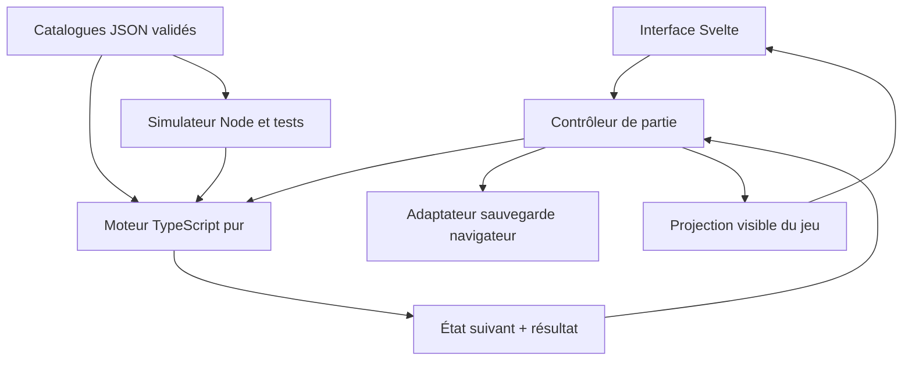

# La République, c’est moi ! — Architecture technique

**Version 0.1 — 24 novembre 2026**  
**Statut :** proposition d’implémentation avant prototype  
**Référence fonctionnelle :** [GAME_DESIGN.md](GAME_DESIGN.md)  
**Assistants de développement :** Codex et Claude Code, sans dépendance à l’un ou l’autre dans le jeu.

## 1. Objectifs et décisions

Construire un jeu solo de gestion narrative de carrière politique, jouable dans un navigateur desktop, déployable comme site statique. Le moteur doit permettre une carrière complète, une simulation accélérée, des tests reproductibles et l’ajout régulier d’événements sans modifier son code. La cible de durée est 45–60 minutes de jeu actif, à valider par playtests.

| Décision | Choix |
|---|---|
| Frontend | SvelteKit + TypeScript strict + Tailwind CSS + Lucide |
| Moteur | TypeScript pur, sans Svelte, DOM, stockage ni réseau |
| Déploiement | SvelteKit adapter-static, page racine prérendue, assets statiques ; hébergement GitHub Pages (sous-répertoire ou domaine personnalisé) |
| Contenu | JSON validé par schémas et contrôles de références |
| État | Un seul état de partie sérialisable, transitions explicites |
| Sauvegarde | localStorage versionné, export/import JSON recommandé |
| Tests | Vitest, Playwright pour parcours critiques, simulations Node |
| Dépendances | npm, lockfile Git, version Node LTS fixée à l’initialisation |
| IA | Assistance au développement uniquement ; aucune API IA en jeu |

Les versions exactes des bibliothèques seront sélectionnées ensemble lors de l’initialisation, puis verrouillées. Pas de backend, base distante, compte utilisateur, progression hors ligne, multijoueur, gestion de pays exhaustive ni méta-progression V1. Ne pas introduire de serveur Node en production pour une fonctionnalité locale. Les valeurs numériques de gameplay restent provisoires ; le GDD est la référence en cas d’écart fonctionnel.

## 2. Architecture et frontières



Le moteur reçoit les données, l’état précédent et une commande. Il renvoie un nouvel état et un résultat de transition, sans modifier ses arguments. Le contrôleur valide, persiste, publie l’état puis expose une projection à l’interface. Les composants n’écrivent jamais directement dans les ressources ni dans l’historique. Les règles de simulation n’existent qu’à un seul endroit. Les tests et le simulateur importent exactement ce moteur.

L’interface de jeu sera une application à onglets plutôt qu’une multitude de routes ; les onglets ne changent pas le temps. L’écran d’accueil propose nouvelle partie, reprise et import. Les détails du design sont dans DESIGN.md.

## 3. Structure cible du dépôt

```text
/
  AGENTS.md                 # règles communes aux assistants
  CLAUDE.md                 # import des règles communes (compatibilité)
  GAME_DESIGN.md
  ARCHITECTURE.md
  DESIGN.md
  ROADMAP.md
  README.md                 # commandes et démarrage
  package.json
  package-lock.json
  .nvmrc
  src/
    routes/
      +layout.svelte
      +page.svelte          # coque accueil / partie / bilan
    lib/
      game/
        engine/
          index.ts          # API publique du moteur
          state.ts          # état et types fondamentaux
          commands.ts       # commandes et résultats
          calendar.ts
          random.ts
          turn.ts
          conditions.ts
          effects.ts
          actions.ts
          events.ts
          health.ts
          economy.ts
          selectors.ts      # calculs dérivés purs
          invariants.ts
          # Modules ajoutés au fur et à mesure :
          characters.ts, relations.ts, delegation.ts
          elections.ts, mandates.ts, world.ts
          promises.ts, justice.ts, institutions.ts, media.ts, assets.ts
        content/
          schemas.ts
          validate.ts
          load.ts
          data/
            actions.json
            upgrades.json
            events/
            world/
            balance.json
        app/
          controller.ts
          view-model.ts
          session.svelte.ts # état réactif (si Svelte 5 retenu)
        persistence/
          envelope.ts
          migrations.ts
          local-storage.ts
          import-export.ts
      components/
        shell/
        dashboard/
        agenda/
        events/
        common/
  scripts/
    validate-content.ts
    simulate.ts
  tests/
    unit/
    scenarios/
    fixtures/
    e2e/
  static/                   # portraits et illustrations facultatifs
```

### 3.1 Écarts avec l’arborescence cible (état après P2-01)

- `engine/actions.ts` est devenu `engine/plan.ts` (plan d’actions et d’achats : prévision et exécution) ; `characters.ts` et suivants viendront avec l’alpha.
- Ajouts : `content/types.ts` (types sans dépendance, seul module de contenu lisible par le moteur), `content/version.ts` (empreinte des catalogues), `content/load-node.ts` (frontière fichier des outils Node), `content/data/cast.json` (distribution fictive) ; `engine/acceleration.ts` ; `simulation/index.ts` ; `persistence/state-schema.ts` et `persistence/index.ts` ; `app/format.ts` et `app/browser.ts` (frontière navigateur) ; `components/organisation/`, `components/journal/` et `components/world/` ; `engine/world.ts` (monde autonome et effets politiques, P2-01), `engine/characters.ts` (personnages, P2-04) ; `content/data/traits.json` ; `components/people/` ; `scripts/base-path.ts`, `scripts/serve-static.ts` et `scripts/simulate.ts` ; `tests/e2e/support/`.
- Le monde tient en un seul catalogue `content/data/world.json` (axes, partis, noms des dirigeants) plutôt qu’un dossier `content/data/world/` ; l’actualité nationale est `content/data/events/national.json`.
- Tests non colocés : `tests/unit`, `tests/scenarios`, `tests/fixtures`, `tests/e2e`.

Arborescence cible et non exigence de créer des dossiers vides : commencer par les modules utiles au prototype. Les fichiers séparés par virgules ci-dessus sont des fichiers distincts. Les tests peuvent aussi être colocés si convention unique documentée. Pas de dépendance circulaire : types et utilitaires → règles métier → orchestrateur ; le moteur ne dépend jamais de l’application ou de l’UI. Le catalogue ne dépend pas du navigateur.

## 4. Modèle de données

### 4.1 État central

Les contrats suivants illustrent la cible ; le prototype utilise un sous-ensemble. Les structures finales sont définies dans le code et couvertes par tests, sans imposer les valeurs de départ.

```ts
type Id = string;
type Turn = number; // 0 = T1 2000
interface GameState {
  schemaVersion: number;
  turn: Turn;
  rng: { seed: string; state: number }; // PRNG choisi et versionné
  phase: 'planning' | 'decision' | 'ended';
  playerId: Id;
  resources: Resources;
  player: PlayerState;
  world: WorldState;
  characters: Record<Id, Character>;
  relationships: Record<Id, Relationship>;
  organization: Organization;
  mandates: Record<Id, MandateInstance>;
  elections: Record<Id, ElectionInstance>;
  campaigns: Record<Id, Campaign>;
  promises: Record<Id, PromiseRecord>;
  assets: Record<Id, AssetInstance>;
  cases: Record<Id, LegalCase>;
  events: EventState;
  history: HistoryEntry[];
  stats: CareerStats;
  end: EndState | null;
}
interface Resources {
  influence: number;
  politicalBudgetCents: number;
  personalCashCents: number;
}
```

`player` contient notamment la date de naissance, la santé, le stress, la notoriété, les soutiens, l’affiliation, les contraintes d’éligibilité et les convictions internes. Pas de score moral présenté au joueur. Les actes et leurs conséquences restent dans l’historique. `personalCashCents` représente la liquidité ; la valeur nette du patrimoine est dérivée de la liquidité, des actifs et des dettes si celles-ci sont introduites. Les fonds détournés cumulés sont une statistique historique distincte, pas une monnaie ni un synonyme de fortune.

Les personnages ont des identifiants stables, un nom fictif, une naissance, des rôles, des compétences, des traits réels et des informations connues par le joueur. Les liens sont orientés (A peut faire confiance à B sans réciprocité). Les souvenirs retiennent les faits importants et leurs dates. Les proches et adversaires utilisent le même modèle. Les employés non nommés sont agrégés. Ne jamais confondre identifiant d’une définition (`role.mayor`) et identifiant d’une instance (`mandate.42`).

Les `CareerStats` conservent les agrégats nécessaires au bilan (plus haute fonction, argent détourné, promesses, etc.). Les faits durables — décisions, affaires et relations — sont conservés même si les nouvelles ordinaires sont compactées. Pas besoin d’event sourcing intégral ni de reconstruire l’état depuis tout le journal.

### 4.2 Monde et politique

`WorldState` contient les instances des partis, médias et règles institutionnelles, ainsi que les indicateurs nationaux abstraits. Les définitions initiales sont stables entre parties ; les noms, traits et relations des dirigeants sont tirés à la création. Les évolutions sont déclenchées par le moteur et des événements, même sans action du joueur. Les calendriers sont représentés par des instances d’élection dotées d’une échéance et d’une clôture de candidature. Une élection anticipée ne réécrit pas silencieusement une instance passée.

Un mandat référence son titulaire, sa fonction, son début, sa fin et son mode d’accès. La fonction principale est dérivée des mandats actifs selon une priorité de présentation (à définir), distincte des droits. Les incompatibilités sont évaluées par les règles institutionnelles actuelles. Une réforme précise explicitement son moment d’application et le sort des mandats existants. Les nominations et mandats électifs sont distincts.

### 4.3 Unités et invariants

- Dates métier : entiers en trimestres ; année = 2000 + floor(turn / 4), trimestre = turn % 4 + 1. Âge calculé depuis la naissance ; pas de compteur d’âge indépendant susceptible de dériver.
- Argent : centimes entiers sûrs JavaScript ; convention d’arrondi unique documentée ; aucune fusion implicite entre budget politique et patrimoine. Coûts validés avant achat. Insuffisance de trésorerie : suspension des charges non payées et alerte dans le prototype ; dette éventuelle traitée explicitement plus tard.
- Jauges bornées : par exemple 0–100 pour santé et stress ; convention unique pour probabilités 0–1. Aucun NaN, Infinity ou nombre hors plage. L’influence n’est pas nécessairement une jauge bornée.
- Budget de temps : 100 points indicatifs par trimestre, entier et non cumulable ; les actions manuelles ne dépassent jamais la disponibilité. Le temps délégué possède une capacité distincte.
- Références stables, acteurs actifs et éligibles, mandats compatibles, une seule résolution par événement, état terminal immuable, et aucun tour avancé avec choix bloquant en suspens.
- Utiliser une seule fonction de contrôle des invariants après chaque transition en tests et aux frontières de chargement ; ne pas masquer des bugs par des clamps indiscriminés.

## 5. API du moteur et résolution des tours

```ts
// Signatures de principe, non du code déjà implémenté.
createGame(config: NewGameConfig, content: Content): GameState;
previewPlan(state: GameState, plan: TurnPlan, content: Content): PlanPreview;
transition(state: GameState, command: GameCommand, content: Content): TransitionResult;
projectView(state: GameState, content: Content): PlayerView;
```

Signatures réellement implémentées (P1-08) : `createGame(config, content)`, `previewPlan(state, plan, content)` et `transition(state, command, content)` dans `engine/` ; la projection est `projectView(state, plan, content)` dans `app/view-model.ts`, car elle intègre le brouillon de plan de l’interface et le formatage français, qui ne relèvent pas du moteur.

Les commandes sont des unions discriminées : `commitTurn(plan)`, `chooseEvent(instanceId, choiceId)`, et ultérieurement changements de missions, candidatures et nominations lorsqu’elles sont permises. Les opérations de planification sont modifiables avant validation ; leurs previews ne consomment aucun aléatoire. Un plan contient actions ordonnées, cibles, achats, consignes et coûts dérivés du catalogue. Validation et exécution réutilisent les mêmes règles, sur un état de travail simulant les prérequis déterministes du plan. Aucun effet partiel sur commande rejetée. Les effets aléatoires des actions sont résolus seulement à la validation et ne financent pas d’autres actions du même plan dans le prototype.

### 5.1 Ordre de résolution proposé, à verrouiller par tests

1. Vérifier la phase `planning`, les références, l’éligibilité, les coûts et les limites ; refuser sans modifier l’état ni le PRNG en cas d’erreur.
2. Capturer les producteurs, mandats et charges déjà actifs au début de T ; réserver temps et coûts. Appliquer les actions planifiées dans l’ordre annoncé, y compris achats et recrutements. Les producteurs nouvellement recrutés ou acquis ne démarrent qu’en T+1, sauf effet ponctuel explicite.
3. Résoudre la délégation des équipes actives et leurs productions ; appliquer les revenus, charges et effets récurrents prévus pour T. Les règles d’insolvabilité et de départ d’un acteur s’appliquent explicitement. Pas de production d’un acteur devenu inactif avant sa mission ; les droits déjà acquis sont distingués des tâches non exécutées.
4. Actualiser le contexte national, les relations et les personnages ; appliquer stress, récupération et vieillissement à la frontière T/T+1. Vérifier les décès et autres causes terminales avant d’attribuer un nouveau mandat au joueur. Les événements terminaux découlant des choix sont également vérifiés après leur application.
5. Résoudre les échéances arrivant à la fin de T (scrutin, mandat, affaire, promesse), selon un ordre fixe : fins de droits/mandats, scrutins et nominations, autres échéances. Des réformes différées deviennent actives à la frontière prévue. Les candidats sont revalidés à la date de l’échéance.
6. Passer à T+1 exactement une fois ; produire le journal du trimestre T. Sélectionner les événements éligibles à la frontière, créer leurs instances, figer leurs acteurs et les mettre en file selon priorité. Une conséquence future porte un `dueTurn` explicite. Une fin de partie interrompt immédiatement les opérations ultérieures et clôt le bilan.
7. Publier l’état `decision` s’il existe un choix bloquant, sinon `planning`. La résolution d’un choix ne réexécute jamais les étapes 1–6. Elle applique les effets, actualise la file, vérifie la fin, puis retourne en phase `planning` lorsque les décisions sont traitées. Les événements suivants sont revalidés après tout changement ; une instance devenue impossible est annulée avec motif de journal.

Convention : si un effet terminal arrive pendant la résolution de T avant la frontière, le bilan enregistre le tour de décès/fin T ; après la frontière, T+1. Le moteur conserve explicitement la date de fin. Les actions institutionnelles narratives sont des choix à la frontière, pas une réécriture rétroactive du scrutin déjà résolu. Une décision prévue avant scrutin doit donc être présentée au plus tard au tour précédent. Les alertes calendaires sont calculées avant chaque engagement de tour.

### 5.2 Accélération

L’accélérateur est une boucle de `commitTurn` utilisant un plan récurrent valide (ou un plan vide si autorisé) et les mêmes règles qu’un tour manuel. Il s’arrête **avant** une échéance exigeant préparation selon sa fenêtre configurée, **après** un tour produisant un choix bloquant, une alerte critique ou une fin, ou à la limite demandée. Le résultat contient `turnsAdvanced` et `stopReason`. Les alertes déjà reconnues sont identifiées pour éviter un blocage infini. Une décision bloquante n’est jamais choisie automatiquement dans le jeu interactif. Le simulateur de tests peut la choisir selon sa stratégie explicite.

L’UI exécute des lots courts et rend la main au navigateur pour permettre l’annulation ; sauvegarder chaque tour validé ou chaque lot borné avec état cohérent. Pas de temps réel ni de progression hors ligne. Un Web Worker n’est envisagé que si un profilage démontre un besoin.

### 5.2 bis Décisions de P1-09 : accélération minimale (24 novembre 2026)

- **Moteur :** `engine/acceleration.ts` expose `accelerate(state, { plan, maxTurns }, content)`. La fonction est pure et répète exclusivement `transition(state, commitTurn(plan), content)` ; elle n’a aucun raccourci de résolution. Le résultat contient l’état cohérent atteint, `turnsAdvanced`, `stopReason`, les alertes nouvelles et les éventuels problèmes du plan.
- **Arrêts :** limite demandée, décision bloquante, nouvelle alerte, fin de carrière ou plan récurrent devenu invalide. Les alertes métier sont les avertissements de `previewPlan` (stress élevé, charges menacées) et la santé sous le seuil de fragilité. Les alertes déjà visibles au lancement sont considérées comme reconnues ; si elles disparaissent puis reviennent pendant le même lot, elles redeviennent nouvelles.
- **Contrôleur :** l’interface exécute des lots d’un seul trimestre. Après chaque lot, le contrôleur sauvegarde l’état complet, publie l’avancement puis cède une frame au navigateur (`requestAnimationFrame`) avant de poursuivre. Un échec de sauvegarde ou un conflit d’onglets interrompt immédiatement la boucle ; sans stockage, le comportement explicite de P1-08 reste inchangé.
- **Annulation :** un jeton d’exécution invalide la boucle entre deux trimestres ; aucun tour commencé n’est partiellement annulé. Le plan reste dans le brouillon après l’accélération afin d’être compris, corrigé ou relancé.
- **Interface :** « Année suivante » demande au plus quatre tours ; « Jusqu’à une alerte » utilise une borne de sécurité de quarante tours ; « Interrompre » remplace les commandes d’avance pendant l’exécution. Le motif d’arrêt et le nombre de trimestres simulés sont annoncés dans la barre permanente.
- **Versions et tests :** `RULES_VERSION = '0.7.0'`. `GameState` et l’enveloppe de sauvegarde ne changent pas (`SAVE_VERSION = 1`). Les scénarios comparent accélération et tours unitaires et couvrent décision, alerte, fin et plan invalide ; le contrôleur couvre sauvegarde par tour, annulation et échec d’écriture ; Playwright couvre année, annulation et reprise d’une décision.

### 5.2 ter Décisions de P2-09 : accélération complète et interface (25 novembre 2026)

- **Arrêts motivés :** `accelerationAlerts` porte désormais un genre (`plan`, `health`, `deadline`, `career`, `staff`, `finance`) et ajoute aux alertes de P1-09 : candidatures ouvertes à une élection accessible (`filing:<ballot>`, à `alertLeadTurns` trimestres au plus de la clôture, seulement si `candidacyIssue` ne s’y oppose pas : une élection inaccessible n’arrête pas le temps), dernier trimestre d’une campagne du joueur (`vote:`), résultat d’une campagne (`result:`), nomination (`mandate:`) ou fin de mandat (`mandate_end:`), élections anticipées (`early:`), départ d’un collaborateur (`staff_left:`, poste vacant), candidatures reçues (`shortlist:`) et budget politique inférieur aux salaires de l’entourage (`payroll_at_risk`). Les alertes de carrière et d’entourage sont lues dans le trimestre qui vient d’être résolu : elles ne valent que pour lui. La règle des alertes reconnues est inchangée.
- **Plan reconduit (dette du playtest P1-10, avancée de P3-08) :** `carryOverPlan` reporte le plan au trimestre suivant, avec la même règle après un tour manuel, un choix et chaque trimestre accéléré : les achats sont ponctuels et retirés ; une action dont la cible n’a plus d’objet (`invalid_target`, par exemple candidat recruté, candidature déposée) ou dont l’action ou l’amélioration a disparu est retirée ; les autres étapes restent même invalides (ressources, temps, condition) et le joueur corrige. Conséquence : une accélération n’achète plus la même amélioration à chaque trimestre. Le contrôleur signale les étapes retirées par une notice d’information. Le brouillon reste non sauvegardé.
- **Résumé groupé :** `summarizeSpan(from, to, content)` (projection) résume les trimestres simulés : période, variations nettes (ressources, santé, stress, popularité), nombre d’événements et de décisions, faits marquants (lignes de carrière, de personnes, de décision et de fin, huit au plus) et journal détaillé de la période. Le contrôleur le calcule à la fin d’une accélération (`AccelerationStatus.summary`, avec les messages des alertes nouvelles) ; le tableau de bord l’affiche en tête jusqu’à ce que le joueur le masque ou avance de nouveau. Le résumé survit à la réponse à la décision qui a arrêté le temps.
- **Journal :** les départs de collaborateurs, présélections, héritages, veuvages, dépenses des enfants et famille délaissée de la frontière ont désormais leurs lignes ; les indemnités des mandats passent en ligne économique.
- **Alertes du tableau de bord :** les alertes de carrière, d’entourage et de budget du moteur s’y ajoutent ; une échéance s’affiche dès que la clôture des candidatures entre dans la fenêtre d’alerte, même si le scrutin est plus loin.
- **Versions :** `RULES_VERSION = '0.16.0'`, format d’état inchangé (version 1) ; rapport de simulation v10 (les épisodes d’alerte incluent les nouvelles alertes).
- **Mesure :** 500 carrières (seed `p2-09`) : aucune erreur ni violation ; 175 trimestres, 32,8 décisions et 1,4 épisode d’alerte par an en moyenne. Accélération « Jusqu’à une alerte » avec un plan vide sur le catalogue réel (30 carrières, premier choix disponible) : un arrêt tous les 5,2 trimestres en moyenne, dont 764 arrêts de candidature (≈ 25 par carrière), 418 décisions, 9 alertes de santé. Le nombre d’arrêts électoraux est à juger en playtest : piste si trop fréquent, ne s’arrêter que pour les élections où le joueur a déjà été candidat ou que son parti peut lui confier.
- **Tests :** `tests/unit/acceleration-alerts.test.ts` (arrêt avant la clôture d’une élection accessible et pas d’une inaccessible, candidature retirée du plan, dernier trimestre de campagne, résultat, départ et présélection, salaires, résumé de période) ; scénarios (plan invalide par ressources, achat unique et équivalence avec les tours manuels reportés) ; contrôleur (plan reconduit, notice, résumé, masquage) ; E2E (arrêt avant les législatives, résumé et détail, année complète, annulation, décision).

## 6. Aléatoire et reproductibilité

Choisir un PRNG simple à état 32 bits avec algorithme et conversion seed→état documentés, par exemple Mulberry32 ; tester avec vecteurs de référence. Toute opération aléatoire passe par ce module, avec état sérialisé. Seed de nouvelle partie issue de `crypto.getRandomValues` à la frontière navigateur, ou fournie explicitement pour tests. Le moteur n’utilise jamais `Math.random()`, `Date.now()` ni des UUID aléatoires externes. Les identifiants de simulation proviennent d’un compteur d’instances sauvegardé (ou d’une dérivation déterministe équivalente).

Trier les candidats par identifiant stable avant un tirage pondéré ; fixer l’ordre de parcours des entités. Préviews, sélecteurs, rendu et actualisations n’avancent pas le PRNG. Même seed + mêmes commandes + mêmes versions moteur/contenu = même état et même journal métier. Ce contrat n’implique pas qu’un changement de catalogue reproduise une ancienne carrière. Sauvegarder la version de règles et la version de contenu ; les tests de régression utilisent des fixtures de contenu figées.

### 6.1 Décisions de P1-01 (24 novembre 2026)

- **PRNG :** Mulberry32, état entier non signé 32 bits sérialisé `{ seed, algorithm: 'mulberry32', state }`. Seed → état : FNV-1a 32 bits des octets UTF-8 de la seed. Fonctions pures `nextUint32`, `nextFloat` ([0, 1)) et `nextInt` (bornes incluses), qui renvoient `{ value, rng }`. Vecteurs de référence dans `tests/unit/random.test.ts` ; les modifier impose une nouvelle version de règles.
- **Seed :** chaîne de 1 à 64 caractères, sans espace en bordure ni caractère de contrôle. `createGame` exige une seed explicite ; la frontière navigateur la tirera de `crypto.getRandomValues` (P1-08).
- **Calendrier :** `Turn` entier, 0 = T1 2000, tours négatifs pour les dates antérieures. La naissance est un tour (`player.birthTurn`) ; l’âge en années révolues est dérivé (`ageAt`) et l’anniversaire tombe au trimestre de naissance. Profil fixe du prototype : 25 ans, né au T1 1975.
- **État :** `STATE_SCHEMA_VERSION = 1`, `RULES_VERSION = '0.1.0'`. Sous-ensemble actuel : `schemaVersion`, `turn`, `rng`, `phase`, `player.birthTurn`, `history`, `end`. Objet JSON pur, immuable par convention (`readonly`) ; ressources, santé et événements arrivent avec P1-02 à P1-05.
- **Commandes :** `transition(state, command)` pure. Seule `commitTurn(plan)` existe ; faute de catalogue (P1-02), seul un plan vide est accepté. Refus typés (`game_ended`, `decision_pending`, `invalid_phase`, `unknown_command`, `invalid_plan`, `unknown_action`) avec message français, et état d’entrée renvoyé à l’identique, PRNG compris. Un succès avance d’exactement un trimestre et ajoute `{ type: 'turn.resolved', turn: T }` au journal.
- **Invariants :** `checkInvariants` / `assertInvariants` dans `invariants.ts` (tour, phase, PRNG, seed, naissance, un journal par trimestre écoulé, cohérence de fin). Appelés après chaque transition dans les scénarios.
- **Reproductibilité :** aucun tirage n’est encore consommé par un tour (pas de règle aléatoire avant P1-02). Les scénarios vérifient déjà l’égalité structurelle à seed et commandes identiques, et la reprise depuis JSON.

## 7. Contenu déclaratif et moteur d’événements

Utiliser JSON et un validateur runtime (Zod recommandé) avec unions discriminées ; la validation des références croisées, templates, fenêtres temporelles et poids est une seconde étape. Le catalogue est importé au build puis indexé par identifiant. Séparer données fonctionnelles et textes seulement si le volume le justifie. Identifiants stables, français pour les textes, anglais pour les clés et le code. Pas de JavaScript embarqué, `eval`, expression libre ou script téléchargé.

### 7.1 Contrat indicatif d’événement

```json
{
  "id": "personal.rest_request",
  "category": "personal",
  "title": "Un agenda bien rempli",
  "text": "Votre médecin vous conseille de lever le pied.",
  "availableFromTurn": 0,
  "weight": 10,
  "priority": 20,
  "blocking": true,
  "cooldownTurns": 8,
  "unique": false,
  "when": { "op": "gte", "stat": "player.stress", "value": 70 },
  "choices": [
    {
      "id": "rest",
      "label": "Lever le pied",
      "preview": ["Moins de stress", "Influence en baisse"],
      "effects": [
        { "op": "addStat", "stat": "player.stress", "value": -12 },
        { "op": "addResource", "resource": "influence", "value": -3 }
      ]
    },
    {
      "id": "continue",
      "label": "Maintenir le cap",
      "preview": ["Stress en hausse"],
      "effects": [
        { "op": "addStat", "stat": "player.stress", "value": 5 }
      ]
    }
  ]
}
```

Chiffres fictifs de prototypage, non calibrés. La version finale du schéma est validée dans le dépôt. Les conditions supportent `all`, `any`, `not`, comparaisons typées et prédicats métier autorisés ; les effets supportent additions de ressources, variations de jauges, faits historiques, relations et suites différées. Ajouter une opération seulement quand plusieurs situations concrètes la justifient. Ne pas autoriser des chemins arbitraires vers l’état. Un registre typé des statistiques autorisées remplace tout accès dynamique non vérifié.

### 7.1 bis Décisions de P1-02 : actions, conditions et effets (24 novembre 2026)

- **Fichiers :** `content/types.ts` (types et vocabulaire, sans dépendance, seul module de contenu importable par le moteur), `content/schemas.ts` (Zod, typé contre `types.ts`), `content/validate.ts` (schémas puis contrôles croisés : identifiants uniques, coûts non dupliqués, temps ≤ budget trimestriel ; tous les problèmes sont renvoyés), `content/load.ts` (import au build, validation au chargement), `content/data/actions.json` et `balance.json`. Zod 4.6.7 ajouté en dépendance.
- **Action :** `id` stable `famille.nom`, `label`, `description`, `timeCost`, `maxPerTurn`, `costs` certains (payés avant les effets), `requires` facultatif accompagné obligatoirement d’un `unavailableReason`, `effects` (au moins un). Objets stricts : tout champ inconnu est refusé.
- **Conditions :** `all`, `any`, `not`, `gte`, `lte`, `eq` sur le registre `STAT_IDS` (`resources.*`, `player.age`, `calendar.year`, `calendar.quarter`), lu par un switch exhaustif. **Effets :** `addResource` (valeur fixe non nulle) et `addResourceRandom` (entier tiré dans [min, max] à la validation du trimestre, un tirage par effet dans l’ordre du plan).
- **Ressources :** `influence`, `politicalBudgetCents`, `personalCashCents` dans `GameState.resources`, entiers ≥ 0, jamais fusionnés ; valeurs de départ et budget de temps (100) dans `balance.json`.
- **Plan :** `previewPlan(state, plan, content)` pure (sans PRNG) ; `commitTurn` réutilise exactement la même validation. Simulation dans l’ordre sur un état de travail : les coûts et gains certains comptent pour la suite du plan ; un effet aléatoire ne compte que pour `min(0, min)`, il ne finance ni ne débloque jamais une autre action. Une action fautive est signalée (`unknown_action`, `repeat_limit`, `condition_not_met`, `time_exceeded`, `insufficient_resource`, `invalid_plan`) puis ignorée pour la suite, afin de lister tous les problèmes. Un plan invalide est refusé avec ces problèmes (`CommandError.issues`), sans modifier l’état.
- **Journal :** l’entrée `turn.resolved` porte les actions exécutées et leurs variations nettes réelles par ressource. `createGame(config, content)` et `transition(state, command, content)` reçoivent désormais le contenu. `RULES_VERSION = '0.2.0'` ; `STATE_SCHEMA_VERSION` reste 1 tant qu’aucune sauvegarde n’existe (figé à P1-07).
- **Tests :** le moteur est testé sur un contenu figé (`tests/fixtures/content.ts`) ; le catalogue réel a ses propres tests et un scénario de dix ans. Le catalogue initial (6 actions) et ses chiffres sont des hypothèses de prototypage. Les actions de recrutement, d’organisation et de repos arriveront avec les producteurs (P1-03) et la santé (P1-04).

### 7.2 Sélection et instances

Filtrer par date, phase, préconditions, acteurs valides, unicité et cooldown. Traiter les suites dues, puis événements exceptionnels, puis un nombre plafonné de tirages ordinaires ; priorité et règles de concurrence sont configurables. Une suite peut attendre une condition jusqu’à expiration si prévu, sinon être annulée avec motif. Chaque occurrence enregistre identifiant de définition, identifiant unique, tour, acteurs résolus, choix autorisés et données nécessaires. Les personnages décédés ou rôles perdus rendent les choix incohérents inéligibles ; prévoir un choix de repli lorsque nécessaire. Les templates n’accèdent qu’aux variables déclarées. Les textes sont échappés par Svelte, jamais injectés via HTML non fiable.

Les événements peuvent être non bloquants (effets automatiques et article) ou bloquants (choix). Le joueur voit tendances et fourchettes selon les compétences de ses conseillers, non l’état caché ni les tirages futurs. Les estimations utilisent une projection déterministe, éventuellement bruitée à la création d’une instance puis stockée ; les rafraîchir ne doit pas permettre de sonder le RNG. Les mêmes conditions et effets alimentent actions, améliorations et événements quand possible, sans créer de langage généraliste.

Le prototype cible 20–30 événements écrits, dont quelques suites.

### 7.3 Décisions de P1-05 : moteur d’événements (24 novembre 2026)

- **Catalogues :** chaque fichier `data/events/*.json` (`{ "events": [...] }`) et `data/cast.json`. Un événement a `id`, `category`, `title`, `text`, `trigger` (`random` ou `followUp`), `weight`, `priority`, fenêtre facultative `availableFromTurn`/`availableUntilTurn`, `cooldownTurns`, `unique`, condition `when` facultative, rôles `actors` ; puis soit `blocking: true` et `choices`, soit `blocking: false` et `effects` (liste éventuellement vide depuis P1-06 : simple brève). Un choix a `id`, `label`, `hints` (tendances rédigées), `costs` certains, prérequis facultatif, `effects` (éventuellement vides) et `followUp` facultatif (`eventId`, `delayTurns` ≥ 1).
- **Validation croisée :** identifiants uniques avec actions et améliorations ; variables `{rôle}` déclarées et aucune accolade isolée (titre, texte, libellés, tendances) ; suites existantes ; toute suite `followUp` atteignable par un choix ; au moins un choix de repli (sans prérequis ni coût) par événement bloquant ; chaque rôle pourvu par au moins un membre de la distribution.
- **Acteurs (prototype) :** une distribution fictive (`cast.json` : `id`, `name`, `tags`). Chaque rôle prend un membre distinct portant toutes ses étiquettes, tiré parmi les candidats triés par identifiant ; une suite réutilise l’acteur du même rôle. Ces personnages ne vieillissent ni n’ont de relations : le modèle complet arrive avec P2-04.
- **Frontière T/T+1 (étape 6, `events.ts`), sauf décès à l’étape 4 :** suites dues d’abord (créées si fenêtre et condition tiennent, sinon annulées avec motif), puis au plus `ordinaryDrawsPerTurn` tirages, chacun réussissant avec `ordinaryEventChance` puis choisissant au poids parmi les événements `random` éligibles triés par identifiant (fenêtre, condition, `unique`, `cooldownTurns` depuis la dernière occurrence, aucune instance en attente, acteurs disponibles, pas deux fois le même événement dans le trimestre). Paramètres dans `balance.json > events`.
- **Instances :** `event.N` (compteur commun avec les améliorations), acteurs figés, occurrences comptées par définition. Informatif : effets appliqués aussitôt. Bloquant : file `events.pending` triée par priorité décroissante puis ordre de création ; phase `decision`. Suites en attente dans `events.scheduled`.
- **Choix (`chooseEvent`)** : uniquement en phase `decision` et pour la tête de file ; prérequis et coûts vérifiés ; l’instance est retirée de la file en même temps que les effets sont appliqués (aucune double application possible) ; la suite est programmée ; les autres événements en attente sont revalidés (condition) et annulés avec motif si besoin ; retour en `planning` quand la file est vide. Nouveaux codes : `no_pending_decision`, `unknown_event_instance`, `not_next_event`, `unknown_choice`, `choice_unavailable`.
- **Effets automatiques** (événements, choix) : une ressource ne descend jamais sous zéro (perte limitée au disponible, variation réelle journalisée) ; les jauges restent bornées. Un décès dû à un événement de la frontière ou à un choix est daté du trimestre en cours (T+1) ; l’invariant devient `end.turn ≤ turn`.
- **Journal :** `turn.resolved.events` (instances `queued`, `applied` ou suites `cancelled`) et entrées `event.resolved` (choix, variations, suite programmée, annulations). Le journal est désormais une union `JournalEntry` ; `TransitionSuccess` n’a plus de `resolvedTurn`.
- **Vue :** `describePendingEvent` donne l’événement en tête de file avec textes résolus, acteurs, choix (tendances, coûts certains, disponibilité et motif). Elle n’expose ni effets, ni suites, ni probabilités.
- **Tests :** la fixture désactive les tirages ordinaires par défaut ; `withEvents` les active pour un sous-ensemble. Le scénario du catalogue réel répond aux événements par une politique déterministe (premier choix disponible). `RULES_VERSION = '0.5.0'`. Le catalogue réel de P1-05 ne contenait qu’un échantillon (4 événements) ; voir §7.4 pour P1-06. Les ajouts se font par fichiers et validation. Les exemples satiriques utilisent des personnages inventés ; les contenus ne sont pas une simulation de personnes réelles.

### 7.4 Décisions de P1-06 : premier catalogue narratif (24 novembre 2026)

- **Catalogue :** 30 événements dans `data/events/` (`personal`, `press`, `finance`, `organization`, `opportunity`, `world`) : 14 bloquants, 16 informatifs (dont 3 brèves sans effet), 5 suites. Chaînes : portrait → parution ; embauche familiale → rumeur ; note de frais → indiscrétion ; donateur généreux → service demandé → enquête (trois étapes). Distribution de 18 personnages fictifs (`cast.json`), médias fictifs (Courrier du Bocage, Radio Bocage FM, La Gazette fouineuse) et parti fictif. Aucun nom réel.
- **Principes d’écriture :** chaque événement bloquant garde un choix de repli neutre ; les choix opportunistes apportent un gain immédiat et une conséquence différée, sans garantie ; les tendances (`hints`) décrivent sans chiffres ; typographie française. La carrière honnête reste jouable.
- **Moteur (`RULES_VERSION = '0.6.0'`) :** nouvelle statistique `upgrades.owned` (taille de l’organisation), utilisée par plusieurs événements d’organisation et de famille ; un événement informatif peut n’avoir aucun effet.
- **Validation automatisée :** en plus de `content:validate`, `tests/unit/narrative-catalog.test.ts` vérifie la taille (20–30), les thèmes, les chaînes, des textes résolus pour **toutes** les distributions d’acteurs possibles, un choix de repli partout, des longueurs lisibles et la typographie ; `tests/scenarios/real-catalog.test.ts` vérifie que chaque événement est réellement atteint au fil de 60 carrières simulées (3 stratégies, politique de choix variée).
- **Mesure (40 carrières par stratégie, provisoire) :** prudente → ≈ 201 trimestres, 82 événements et 40 décisions par carrière ; organisatrice → ≈ 206, 88 et 52 ; surmenage → ≈ 94, 41 et 26. Un même événement revient au plus 13 fois dans une carrière (8 en moyenne pour le plus fréquent) après allongement des délais de réapparition (18 auparavant). La répétition et le nombre de décisions par carrière sont à revoir avec le simulateur (P1-10) et des playtests, au regard de la cible de 45–60 minutes.

## 8. Économie, santé, personnages et systèmes futurs

### 8.1 Économie et temps

Calculer les flux par producteur et par trimestre, avec détail pour l’interface. Une dépense est imputée à sa trésorerie autorisée ; les transferts entre budgets sont des effets explicitement définis par une situation de jeu, pas un mécanisme comptable universel. Les coûts de fonctionnement et limites de capacité freinent la croissance. Les actifs possèdent définition, instance, prix, charges et revenus ; la valeur nette reste dérivée. Toutes les constantes ajustables résident dans `balance.json` ou les définitions de contenu, pas dispersées dans les composants.

### 8.1 bis Décisions de P1-03 : économie, producteurs et améliorations (24 novembre 2026)

- **Catalogue :** `upgrades.json` validé comme les actions. Une amélioration a une famille (`organization`, `communication`, `network`, `personal`), une **trésorerie** (`politicalBudgetCents` ou `personalCashCents`), un coût en temps (0 autorisé), un nombre maximal d’exemplaires, un `price`, des charges `upkeep` et une `production` (au moins une) par trimestre, et un prérequis facultatif. Le prix et les charges monétaires ne peuvent utiliser que la trésorerie déclarée (contrôle croisé) : budget politique et patrimoine ne se mélangent jamais. Actions et améliorations partagent un même espace d’identifiants.
- **Plan :** `TurnPlan = { steps: PlanStep[] }`, avec `PlanStep = { kind: 'action' | 'purchase', id }`, exécuté dans l’ordre. Un achat vérifie le prérequis, le temps, le prix et `maxOwned` (exemplaires possédés + achats précédents du plan). Nouveaux codes : `unknown_upgrade`, `owned_limit`.
- **État :** `upgrades: OwnedUpgrade[]` (`instanceId`, `upgradeId`, `acquiredTurn`) dans l’ordre d’acquisition, et `nextInstanceNumber` (identifiants `upgrade.N`, jamais réutilisés).
- **Résolution (étape 3) :** un exemplaire acheté en T est en attente pendant T et produit à partir de T+1. Toutes les charges sont prélevées d’abord, exemplaire par exemplaire dans l’ordre d’acquisition ; un exemplaire dont les charges ne sont pas entièrement couvertes est **suspendu** pour le trimestre (rien prélevé, rien produit, statut au journal ; pas de dette). Les exemplaires actifs produisent ensuite : une production ne paie pas les charges du même trimestre. Les étapes du plan passent avant les charges.
- **Prévision :** `previewPlan` calcule aussi l’économie du trimestre sur le pire cas du plan (`producers` actifs, suspendus ou en attente, instance prévue pour chaque achat) et émet un avertissement non bloquant `upkeep_at_risk`. `resourceChanges` inclut charges et production.
- **Journal :** `turn.resolved` contient `steps` (actions et achats, avec l’instance créée) et `economy` (producteurs actifs ou suspendus et variation nette). Les invariants contrôlent les instances (format, unicité, compteur, date d’acquisition antérieure au tour, ordre) et, avec le contenu, les références et `maxOwned`. `RULES_VERSION = '0.3.0'`.
- **Provisoire :** catalogue de 5 améliorations et chiffres non calibrés. Aucun coût de la vie personnel n’est encore prélevé ; l’insolvabilité ne vient donc que des charges. Question d’équilibrage ouverte (GDD §17, « Économie »).

### 8.1 ter Départ d’un élément de l’organisation et affichage regroupé (25 novembre 2026)

Demandé par le créateur après le premier essai de l’alpha publiée : une carte par militant rendait l’écran Organisation illisible et la base militante ne pouvait pas être réduite.

- **Règle :** action ciblée `organization.release` (`target: 'upgrade'`, effet `releaseUpgrade`), gratuite, 2 points de temps (le schéma exige un coût en temps positif), au plus dix par trimestre. Elle vise un exemplaire possédé avant le trimestre (pas un achat du même plan) ; l’exemplaire quitte l’organisation pendant l’exécution du plan, donc sans charge ni production ce trimestre, et peut être racheté ensuite. Les effets propres du départ sont déclarés par amélioration (`releaseEffects`, limités aux ressources, jauges et soutiens) : un militant bénévole parti retire 2 points de soutien des militants (décision du créateur : départ gratuit, petit effet militant) ; les autres départs n’ont pas d’effet propre. La prévision montre ces effets ; l’étape sort du plan reconduit (`invalid_target`).
- **État :** l’exemplaire est retiré de `upgrades` ; format d’état inchangé, les sauvegardes existantes restent lisibles. Le journal retrouve le nom d’un exemplaire parti grâce à son achat.
- **Contenu :** chaque amélioration a un `ownedLabel` (« Militant bénévole », « Permanence »…) pour les exemplaires possédés, distinct du libellé d’achat.
- **Interface :** l’écran Organisation regroupe les exemplaires par type (« Militant bénévole × 3 »), avec statuts comptés, charges et production cumulées du trimestre, effet d’un départ et bouton « Se séparer d’un exemplaire » (le plus récent part en premier ; départ annulable dans le plan).
- **Versions et tests :** `RULES_VERSION = '0.17.0'`. `tests/unit/organisation.test.ts` (départ sans charge ni production, effet militant, journal, cibles refusées, prévision, plan reconduit, regroupement, validation) ; E2E du départ d’un militant.

### 8.2 Stress, santé et fin

La santé et le stress sont mis à jour une fois par trimestre, avec des contributions identifiables : charge de travail, mandats, événements, repos, confort et âge. L’âge affecte la vulnérabilité ; décès et fins sont testés par une règle commune qui produit un motif explicite et un bilan. Les probabilités et courbes sont des hypothèses de tuning. Le modèle n’a pas de prétention médicale. Toute transition terminale interdit de poursuivre la carrière, mais permet de consulter le bilan et démarrer une nouvelle partie indépendante.

### 8.2 bis Décisions de P1-04 : santé, stress, vieillissement et fin (24 novembre 2026)

- **Jauges :** `player.health` et `player.stress`, entiers de 0 à 100, lisibles par les conditions (`STAT_IDS`). Nouvel effet `addStat` (variation fixe non nulle) : la jauge est maintenue dans ses bornes et le journal retient la variation réellement appliquée (`StepRecord.gauges`). Ce maintien est propre aux jauges ; les ressources restent contrôlées sans écrêtage.
- **Résolution (étape 4, `health.ts`)**, avec l’âge atteint en T, dans cet ordre : stress + charge de travail (`floor((temps − seuil) / 10) × pas`) puis − récupération ; santé − perte si stress ≥ seuil élevé, sinon + gain si stress < seuil de calme, sans dépasser le plafond de la tranche d’âge ; vieillissement (tirage, perte selon la tranche) ; décès si santé nulle (`health_failure`), sinon tirage du risque de la tranche, multiplié si la santé est sous le seuil de fragilité (`natural_causes`). Un tirage n’a lieu que si la probabilité est non nulle. Chaque contribution non nulle est journalisée (`WellbeingRecord`).
- **Paramètres :** `balance.json > wellbeing` (valeurs de départ, seuils, pas, tranches d’âge triées commençant à 0 avec `maxHealth`, `ageingChance`, `ageingHealthLoss`, `mortalityChance`), validés par schéma. Probabilités en [0, 1], jamais exposées.
- **Fin :** un décès clôt la carrière au trimestre T : entrée de journal de T, `end = { turn: T, reason: 'death', cause }`, phase `ended`, compteur à T+1 ; toute commande est ensuite refusée (`game_ended`). Invariants : jauges bornées, santé > 0 pour un personnage vivant, `end.turn < turn`. `careerSummary` (`selectors.ts`) produit le bilan minimal depuis l’état et le journal.
- **Prévision :** `previewPlan` donne `wellbeing` : stress certain de fin de trimestre et fourchette de santé (perte de vieillissement possible), avec l’avertissement `stress_high`. Aucune probabilité n’y figure (test dédié).
- **Tests :** les tests d’actions et d’économie utilisent un modèle de santé neutre (`neutralWellbeing`) ; les tests de santé activent chaque mécanisme via `withWellbeing`. `RULES_VERSION = '0.4.0'`.
- **Tuning provisoire et première mesure (200 seeds, stratégies naïves sur le catalogue réel) :** prudente (avec repos) → âge médian au décès 80 (p10–p90 : 61–90), environ 210 trimestres ; équilibrée (≈ 65 % du temps) → 82 ; surmenage sans repos → 49. Une première version (seuil 50, +3 par tranche, perte 2) faisait mourir la stratégie prudente vers 51 ans ; elle a été adoucie. À recalibrer avec le simulateur (P1-10) et des playtests.

### 8.3 Alpha : personnages et élections

Les personnages nommés sont peu nombreux et simulés via règles, traits et événements, pas via agents IA autonomes. Les postes clés confèrent une capacité de délégation, des flux et une qualité de conseil ; la loyauté est relationnelle et évolutive. Les actions déléguées passent par des missions persistantes et des prérequis. Les adversaires utilisent le même modèle de personnage, avec des transitions simples de rôle et de carrière. Les groupes de soutien distinguent électeurs et acteurs d’influence, sans double comptage dans la popularité agrégée.

Les candidatures sont librement initiées avant la clôture si éligible. Une campagne conserve sa date de déclaration, son financement, sa préparation, ses promesses et ses adversaires. Une déclaration précoce augmente à la fois le temps de préparation et l’exposition ; une tardive réduit les possibilités. L’algorithme fictif de scrutin sera documenté avec tests de sensibilité et d’incertitude bornée. Pas de prévisions électorales réelles. La défaite ne termine pas automatiquement le jeu. Les règles précises restent ouvertes dans le GDD.

### 8.3 bis Décisions de P2-01 : partis et contexte national (24 novembre 2026)

- **Catalogue :** `world.json` décrit trois axes (économie, société, souveraineté ; adjectifs qualitatifs), huit partis fictifs satiriques (identifiant `party.*`, nom, sigle, famille, description, positions internes de -100 à 100, force de référence) et le parti au gouvernement en 2000 ; il fournit aussi les prénoms et noms des dirigeants générés. Validation : identifiants uniques, forces de référence dans les bornes, gouvernement existant, au moins dix combinaisons de noms par parti.
- **État :** `GameState.world` (indicateurs `economy`, `socialClimate`, `stability` de 0 à 100 ; force et dirigeant de chaque parti ; parti au gouvernement), `GameState.characters` (dirigeants minimaux : nom, naissance, parti ; enrichis en P2-04) et, dans `player`, `partyId` et l’historique `affiliations` (une seule adhésion en cours, chronologie contrôlée). Les personnages sont numérotés `character.N` par rang de création, sans compteur séparé, pour ne pas décaler les identifiants d’instance existants ; ils ne sont jamais supprimés.
- **Création :** le paysage est identique à chaque partie ; seuls les dirigeants (nom, âge de 42 à 66 ans) sont tirés avec le PRNG de la partie, avant tout trimestre. Un dirigeant n’a jamais l’homonyme d’un dirigeant en place.
- **Évolution autonome (étape 4 bis de l’ordre de tour, après la santé, avant les événements ; rien après un décès en 4) :** indicateurs puis forces dans l’ordre du catalogue — retour partiel vers la référence (`…ReversionPercent`) et variation bornée (`…Volatility`) ; la référence du parti au gouvernement est corrigée par l’écart de l’économie et du climat social (`governingIndicatorDivisor`), d’où l’usure ou l’état de grâce. Puis les directions : retraite d’office à `leaderRetirementAge`, sinon renouvellement avec `leaderChangeChance` par parti et par trimestre. Le journal du trimestre porte un `WorldRecord` (variations et changements de direction). Le gouvernement ne change pas encore : les alternances viendront avec les élections (P2-02).
- **Contenu politique :** conditions `world.*`, `player.affiliated`, `player.partyStrength`, `player.partyGoverning` et `memberOf` ; effets déterministes `addIndicator`, `addPartyStrength` (parti ou référence `governing`, `player`, `opposition`), `joinParty` et `leaveParty`. Une action peut déclarer `target: 'party'` : l’étape du plan porte alors un identifiant de parti, validé (`invalid_target`), et `joinParty` avec `target` l’utilise. Adhérer à un autre parti fait d’abord quitter le parti actuel. Prévision et exécution appliquent les mêmes effets politiques, visibles des étapes suivantes du plan. Les journaux d’étapes, d’événements et de choix portent leurs variations politiques (`politics`).
- **Textes :** variables du monde `{governing_party}`, `{governing_leader}`, `{opposition_party}`, `{opposition_leader}`, `{player_party}`, `{player_party_leader}`, figées dans les acteurs de l’instance comme les rôles (une suite conserve les valeurs héritées). Les variables `player_party*` exigent une condition imposant l’adhésion ; un rôle ne peut porter le nom d’une variable du monde.
- **Interface :** onglet « Monde politique » (contexte national, étiquette du joueur, partis avec intentions de vote, direction, positions qualitatives et bouton d’adhésion qui ajoute l’étape ciblée au plan) ; étiquette dans l’en-tête ; carte « Contexte national » au tableau de bord ; changements de direction et variations politiques au journal. Les actions ciblées n’apparaissent pas dans l’agenda générique.
- **Versions :** `RULES_VERSION = '0.8.0'`. Format d’état et `SAVE_VERSION` inchangés à 1 (politique de l’alpha, ROADMAP §4.1) : une sauvegarde de développement antérieure est refusée comme `invalid_state`, jamais réparée ni effacée.
- **Simulateur (rapport v2) :** les ambitieux adhèrent au parti le plus fort, les profils mixtes au parti au gouvernement, l’aléatoire à un parti tiré de la seed ; prudents et patrimoniaux restent sans étiquette. Nouvelles mesures : parti final, adhésions, trimestres encartés, changements de direction, extrêmes des indicateurs.
- **Mesure (500 carrières, seed `p2-01`) :** 500 fins, aucun plafond, aucune erreur ni violation ; 188,7 trimestres et 31,5 décisions en moyenne (35,8 avant P2-01 : l’actualité nationale, souvent informative, dilue les décisions). Indicateurs observés entre 16 et 84 ; environ 26 changements de direction par carrière (tous partis confondus). Réglages provisoires : volatilité des indicateurs 4, retour 5 %, `leaderChangeChance` 0,012 (0,02 donnait près de 40 changements, jugé trop bavard).
- **Tests :** `tests/unit/world.test.ts` (paysage, reproductibilité, évolution bornée, usure, retraite, épuisement des noms, adhésion ciblée, transfuge, conditions, variables de texte, validation, invariants, projection) ; scénario du catalogue réel avec un militant encarté ; refus d’une sauvegarde du prototype ; E2E d’adhésion depuis le monde politique.

### 8.3 ter Décisions de P2-04 : personnages nommés et relations (24 novembre 2026)

- **Modèle commun :** `Character` réunit la distribution initiale (identifiant `cast.*`, nom, étiquettes et âge du catalogue), les dirigeants de parti et les successeurs générés (`character.N`, rang de création). Champs : fonction affichée (`epithet`), étiquettes, fonction transmise au successeur (`renewal`), traits réels et traits connus, statut (`active`, `retired`, `dead`), date de départ et prédécesseur. Un personnage n’est jamais supprimé ; seul un personnage actif peut être acteur.
- **Traits :** catalogue `traits.json` (dix traits : quatre publics, six cachés), substantifs sans accord de genre. Deux traits tirés par personnage avec le PRNG de la partie ; les traits publics sont connus d’emblée. Un trait caché se révèle par l’effet `revealTraits` ou, à chaque décision concernant un acteur actif, avec la probabilité `revealChancePerEncounter` (0,3). Les traits modulent les variations d’attitude (`positiveRelationPercent`, `negativeRelationPercent`) : la rancune double les vexations, la loyauté amplifie la gratitude.
- **Vieillissement (étape 4 bis, avant le monde) :** par identifiant trié, décès selon les tranches d’âge du modèle de santé ; retraite à `retirementAge` (70 ans) pour les personnages professionnels ; successeur généré (26 à 55 ans) qui reprend étiquettes et fonction. La famille et les amis ne sont pas remplacés. Le monde remplace ensuite un dirigeant décédé (motif `death`) ; un dirigeant parti à la retraite prend le statut `retired`. Journal : `CharactersRecord` (départs et arrivées) ; l’interface ne cite que les personnages déjà rencontrés.
- **Relations :** `GameState.relationships` ne contient que les personnages rencontrés (acteurs d’un événement créé). Attitude du personnage envers le joueur de -100 à 100, jamais affichée en chiffre (tendance : très favorable, favorable, neutre, réservée, hostile). Effet `addRelation` (rôle, valeur, souvenir facultatif à variables) ; seuls les `maxMemories` (6) souvenirs les plus récents sont gardés, avec leur date et leur tonalité. Les journaux d’événements et de choix portent `people` (rencontres, variations, révélations).
- **Acteurs :** un rôle peut exiger des traits réels, une attitude minimale ou maximale et une rencontre préalable (`met`). L’attribution choisit, rôle par rôle, parmi les candidats qui laissent une distribution complète possible pour les rôles suivants (recherche avec retour arrière) ; la validation du contenu vérifie de même qu’une distribution complète existe avec la distribution initiale.
- **Contenu :** souvenirs et variations d’attitude ajoutés aux choix existants qui mettent en scène un personnage ; sept événements `relations.*` (rancune d’un journaliste, avertissement amical, ami fidèle, donateur vénal, bénévole indiscret, pique d’un rival, promotion en section avec enquête préalable).
- **Interface :** onglet « Relations » (personnages rencontrés, rôle, âge, statut, tendance, traits connus avec leur description, nombre de traits encore inconnus, souvenirs). Aucun trait caché ni attitude chiffrée n’est projeté (test dédié).
- **Versions :** `RULES_VERSION = '0.9.0'`, format d’état toujours en version 1 (politique de l’alpha) ; rapport de simulation v3 (personnages rencontrés, départs, traits révélés).
- **Mesure (500 carrières, seed `p2-04`) :** 500 fins, aucune erreur ni violation ; 187,8 trimestres et 31,7 décisions en moyenne ; environ 17 personnages rencontrés, 7 traits cachés révélés et 42 départs (dirigeants compris) par carrière.
- **Tests :** `tests/unit/characters.test.ts` (distribution, traits, attribution non gloutonne, retraite et succession, décès et dirigeants, relations, souvenirs bornés, révélations, filtres d’acteurs, projection sans fuite, invariants) ; E2E de l’onglet Relations.

### 8.3 quater Décisions de P2-02 : calendrier électoral et mandats (24 novembre 2026)

- **Catalogue `career.json` :** élections (calendrier régulier fictif : premier scrutin, cycle, clôture des candidatures, échelle, effet sur le gouvernement), mandats (rang, élection qui y met fin ou fin avec le gouvernement, prérequis, temps réservé, revenus, stress) et règles du cumul (paires incompatibles, nombre maximal). Valeurs provisoires : municipales T1 2001 tous les 6 ans, sénatoriales T3 2001 tous les 6 ans, législatives T2 2002 tous les 5 ans (elles désignent le gouvernement), régionales T1 2004 tous les 6 ans ; six fonctions (conseil municipal, mairie, conseil régional, Assemblée, Sénat, ministère) ; Assemblée et Sénat incompatibles, ministère incompatible avec les deux, trois mandats au plus, mairie réservée aux membres du conseil municipal.
- **État :** `ballots` (échéances `ballot.N` : programmées, tenues avec parts de voix et vainqueur, ou annulées), `mandates` (exemplaires `term.N` : début, mode d’accès, fin et motif) et `institutions` (règles du cumul copiées du catalogue, prérequis compris, pour qu’une réforme puisse les modifier). Les rangs de création servent d’identifiants : aucun compteur partagé, les autres identifiants d’instance ne bougent pas. Les libellés de fonction sont des noms de sièges, sans accord de genre.
- **Ordre de tour :** étape 3 bis, revenus et stress des mandats exercés pendant T (une démission du plan les arrête aussitôt) ; le temps réservé par les mandats en début de trimestre est retiré du temps disponible et compte dans la charge de travail. Étape 5, après santé, personnages et monde : fins des mandats liés aux scrutins de T, puis scrutins dans l’ordre du catalogue (parts tirées autour des forces avec un aléa borné, plus forts restes pour totaliser 100), élan du vainqueur, sanction du gouvernement battu à une élection intermédiaire, alternance éventuelle (stabilité d’un nouveau gouvernement, fin des fonctions ministérielles), puis échéance suivante un cycle plus tard. Rien après un décès en étape 4.
- **Effets et conditions :** `grantMandate` (événements seulement ; avec `replaceIncompatible`, les mandats incompatibles passent aux suppléants), `endMandate` (définition, ou `target` pour l’action ciblée de démission ; la perte d’un prérequis entraîne celle du mandat qui en dépend), `callEarlyElection` (événements seulement : annule l’échéance régulière si elle est plus lointaine, crée une échéance anticipée et relance le cycle à partir d’elle) ; conditions `holdsMandate`, `canHoldMandate` et statistique `player.mandates`. Un choix dont l’attribution enfreindrait le cumul est indisponible, avec la raison.
- **Contenu :** cooptation au conseil municipal, succession à la mairie, siège régional, appel au gouvernement, remaniement, surcharge du cumul et dissolution (élection anticipée). Les candidatures aux élections arrivent en P2-03 : d’ici là, un mandat électif prend fin à son scrutin.
- **Interface :** onglet « Carrière » (fonction principale, mandats avec temps, indemnités, échéance et démission, règles du cumul, calendrier avec clôture des candidatures, derniers résultats, mandats passés) ; fonction principale dans l’en-tête ; temps réservé dans le plan ; alerte d’information dans les `alertLeadTurns` trimestres précédant une échéance ; scrutins, alternances et fins de mandat au journal.
- **Versions :** `RULES_VERSION = '0.10.0'`, format d’état toujours en version 1 (politique de l’alpha) ; rapport de simulation v4 (mandats exercés, plus haute fonction, scrutins, alternances) : les mandats ne sont plus déclarés indisponibles.
- **Mesure (500 carrières, seed `p2-02`) :** 500 fins, aucune erreur ni violation ; 184,2 trimestres et 33,5 décisions en moyenne ; environ 3 mandats exercés et 3 alternances par carrière ; plus haute fonction : conseil municipal 267, aucune 118, ministère 54, conseil régional 39, mairie 22.
- **Tests :** `tests/unit/career.test.ts` (calendrier, scrutin, alternance et fin des ministères, terme des mandats, élection anticipée, reproductibilité, cumul, conditions, temps réservé, indemnités, démission en cascade, nomination indisponible ou avec remplacement, alerte, validation, invariants) ; E2E de l’onglet Carrière.

### 8.3 quinquies Décisions de P2-07 : groupes de soutien et popularité (24 novembre 2026)

- **Catalogue `supports.json` :** six groupes provisoires (GDD §4.4). Électoraux, pondérés dans la popularité : classes populaires (40), classes moyennes (40), électeurs aisés (20). D’influence, sans voix : militants, appareil du parti, milieux d’affaires. Chaque groupe a un soutien de départ (qui sert aussi de référence pour un inconnu sans étiquette), des attentes sur les trois axes, et des bonus de référence : affinité avec le parti du joueur (`judgesParty`), adhésion (`affiliationBonus`) et mandats exercés (`mandateBonus`).
- **État :** `player.supports` (entiers de 0 à 100, publics comme des sondages) et `player.popularity`, moyenne pondérée des seuls groupes électoraux, recalculée à chaque variation (invariant de cohérence). Aucun soutien ne dépend des traits des personnages : le détail affiché ne peut donc rien révéler de caché.
- **Évolution (étape 4 ter, après le monde, avant les échéances) :** chaque soutien résorbe `reversionPercent` (6 %) de l’écart à sa référence, au moins un point tant qu’un écart subsiste, sans tirage. Référence = départ + affinité de parti (au plus ±12 : 1 − écart moyen de positions / 100) + bonus d’adhésion + bonus par mandat + notoriété pour les groupes électoraux (un point par tranche de 5 d’influence, au plus 30). Une action ou un choix (`addSupport`) peut porter un soutien au-delà de sa référence ; il y revient ensuite progressivement.
- **Contenu :** effets sur les groupes ajoutés aux actions (tracts, réunion publique, collecte, rencontre d’élus, adhésion, réunion de section, départ du parti) et aux choix qui opposent des groupes (donateurs, embauche familiale, réforme impopulaire, congrès, nomination) ; trois événements `supports.*` (sondage flatteur, dîner du patronat, base qui gronde). Conditions `support` (groupe, comparaison, valeur) et `player.popularity`.
- **Interface :** jauge de popularité dans l’en-tête ; carte « Soutiens et popularité » dans l’onglet Carrière (électorat avec poids, appuis d’influence séparés, descriptions) ; variations de soutien dans la prévision et le journal.
- **Versions :** `RULES_VERSION = '0.11.0'`, format d’état toujours en version 1 ; rapport de simulation v5 (popularité finale et maximale).
- **Mesure (500 carrières, seed `p2-07`) :** 500 fins, aucune erreur ni violation ; 186 trimestres et 34,5 décisions en moyenne ; popularité maximale médiane 50 (prudente 44, ambitieuse 62). Une première version sans notoriété plafonnait vers 29 : trop bas pour donner du sens aux scrutins de P2-03.
- **Tests :** `tests/unit/supports.test.ts` (popularité pondérée, effets bornés, conditions, affinité, référence, retour sans tirage, projection sans fuite, validation, invariants) ; E2E de la carte Soutiens.

### 8.3 sexies Décisions de P2-03 : candidatures, campagne et scrutin (24 novembre 2026)

- **Éligibilité (catalogue des élections) :** âge minimal au jour du scrutin (18 ans pour les municipales et régionales, 23 pour les législatives, 30 pour les sénatoriales), mandat brigué (`grants`), mandat supplémentaire au-delà d’un score (la tête de liste municipale devient maire à partir de 55 %), mandats exigés (un siège local pour les sénatoriales, grands électeurs) et force de l’adversaire principal. Une candidature se dépose par l’action ciblée « Déclarer sa candidature » (cible : échéance) jusqu’au trimestre de clôture inclus ; les règles du cumul s’appliquent au mandat brigué, les mandats qui s’achèvent à ce scrutin étant réputés libérés (un sortant peut se représenter).
- **Investiture :** un candidat encarté est investi si le soutien de l’appareil du parti atteint `investitureMinApparatus` (15) ; sinon il part sans investiture (dissident). Un indépendant n’a jamais la part du parti.
- **Campagne (`campaigns`, instances `campaign.N`) :** préparation accumulée par les actions de campagne (porte-à-porte, meeting) et chaque trimestre (`passivePreparation`), stress d’exposition chaque trimestre ; trois événements réservés aux candidats (vieille photo, débat télévisé, tract anonyme). Se déclarer tôt donne plus de temps de préparation mais allonge l’exposition. Une élection anticipée reprend les candidatures déposées pour l’échéance annulée, préparation comprise.
- **Sondage :** fourchette publiée du score face à l’adversaire principal, calculée sans aléa ni information cachée (popularité, part actuelle du parti si investi, préparation, prime de sortant), élargie de l’aléa maximal du scrutin.
- **Scrutin (étape 5, après les parts des partis) :** candidature revalidée (mandats exigés, cumul) ; sinon invalidée. Score = popularité × 40 % + part du parti au scrutin × 60 % si investi + préparation plafonnée à 30 × 50 % + prime de sortant 6, plus un aléa de ±8 ; l’adversaire a sa force ±8. Le joueur l’emporte au-delà de 50 % des deux scores. Victoire : mandat(s) et influence ; défaite : un peu d’influence (notoriété) et du stress, jamais une fin de carrière.
- **Interface :** dans le calendrier de l’onglet Carrière, l’enjeu de chaque scrutin, le bouton « Se présenter » ou la raison d’inéligibilité, puis la campagne en cours (investiture, préparation, sondage) ; historique « Vos campagnes » ; alerte de clôture des candidatures ; résultat au journal.
- **Versions :** `RULES_VERSION = '0.12.0'`, format d’état toujours en version 1 ; rapport de simulation v6 (candidatures, victoires, défaites). Les politiques automatiques se présentent selon leur profil (prudente : municipales ; mixte : municipales et législatives ; ambitieuse et aléatoire : tout). Le repos passe désormais en tête des politiques prudente et mixte : une fois élu, le temps manque et une politique qui sacrifiait le repos mourait de surmenage vers 60 ans, ce qui ne reflète pas une stratégie prudente.
- **Mesure (500 carrières, seed `p2-03`) :** 500 fins, aucune erreur ni violation ; 171,7 trimestres et 32,2 décisions en moyenne ; victoires de 35 % (aléatoire) à 69 % (mixte, parti au gouvernement) ; plus haute fonction : Assemblée 172, mairie 124, conseil municipal 110, ministère 49, Sénat 37, aucune 8. Âge médian de fin : prudente 83, mixte 82, ambitieuse 46.
- **Tests :** `tests/unit/campaigns.test.ts` (éligibilité, déclaration et investiture, préparation, sondage, victoire et mairie, défaite non terminale, réélection du sortant, invalidation, report sur une élection anticipée, reproductibilité, invariants) ; scénario du catalogue réel avec un candidat ; E2E de candidature et de sondage.

### 8.3 septies Décisions de P2-06 : adversaires récurrents (24 novembre 2026)

- **Attribution (étape 5, avant les scrutins) :** toute campagne en cours sans adversaire actif en reçoit un : d’abord celui déjà affronté au même type d’élection s’il reste éligible (rival récurrent), sinon un personnage portant l’étiquette `rival` tiré au sort, sinon un nouveau personnage politique généré (étiquettes `politician` et `rival`, membre du parti le plus fort hors celui du joueur). Éligible : actif, d’un autre parti que le joueur, âge entre le minimum de l’élection et `opponentMaxAge` (72) au jour du scrutin, pas déjà adversaire dans une autre campagne en cours. L’adversaire apparaît donc au trimestre qui suit la déclaration ; un adversaire parti à la retraite ou décédé est remplacé avant le scrutin (invariant : aucune campagne en cours face à un personnage parti).
- **Force :** force de base de l’élection, plus `rivalExperienceBonus` (2) par victoire passée contre le joueur (au plus `rivalExperienceCap`, 2), plus le `campaignBonus` de ses traits (charisme +4, carnet d’adresses +3, ambition et opportunisme +2, vénalité −2…). Le sondage publié n’utilise que les traits connus du joueur : un trait caché peut fausser l’estimation.
- **Relation :** l’adversaire devient un personnage rencontré ; chaque affrontement baisse son attitude (`rivalryAttitude`, −8, modulée par ses traits) et laisse un souvenir daté (« Élections municipales (T1 2001) : votre victoire. »). L’événement « Une poignée de main au marché » permet d’apaiser une rivalité ou de l’envenimer.
- **Réglages :** forces de base abaissées de 2 points pour compenser le bonus moyen des traits ; expérience réduite de 3 à 2 points et plafonnée à deux victoires après mesure (l’effet boule de neige faisait tomber la stratégie prudente de 48 à 25 % de victoires).
- **Interface :** adversaire, étiquette et bilan des affrontements dans la carte de campagne ; adversaire cité dans « Vos campagnes » et le journal. Correction au passage : le journal et le plan nomment désormais l’élection ou le mandat ciblé au lieu de leur identifiant technique.
- **Versions :** `RULES_VERSION = '0.13.0'`, format d’état toujours en version 1 ; rapport de simulation v7 (adversaires distincts, plus grand nombre d’affrontements avec un même rival).
- **Mesure (500 carrières, seed `p2-06`) :** 500 fins, aucune erreur ni violation ; 177 trimestres et 33 décisions en moyenne ; 99 % des carrières candidates retrouvent au moins deux fois le même adversaire (4 affrontements au plus en médiane) ; victoires de 31 % (aléatoire) à 68 % (mixte), prudente 38 %, ambitieuse 48 %.
- **Tests :** `tests/unit/rivals.test.ts` (attribution et rencontre, adversaire généré d’un autre parti, rival récurrent, remplacement d’un adversaire décédé, force et sondage sans traits cachés, attitude et souvenir) ; E2E de l’adversaire affiché.

### 8.3 octies Décisions de P2-05 : entourage et délégation (24 novembre 2026)

- **Catalogue `entourage.json` :** cinq postes clés (direction de cabinet, communication, trésorerie, conseil politique, affaires juridiques), chacun avec un salaire trimestriel sur le budget politique, une condition de déblocage (influence, étiquette, mandat), les catégories d’événements sur lesquelles il conseille et deux missions ; trois profils de candidats (parcours solide au franc-parler, piston peu qualifié au carnet d’adresses, brillant ambitieux) avec une fourchette de compétence et des traits imposés, connus d’emblée.
- **Personnages :** tout personnage a désormais une compétence (0–100, tirée entre 20 et 80, ou selon le profil pour un candidat), visible sur le CV ; loyauté (attitude) et traits non imposés restent cachés.
- **Présélection (frontière, après le monde) :** pour chaque poste débloqué, vacant et sans candidat encore disponible, des candidats générés selon les profils, dans l’ordre du catalogue. Les candidats non retenus ne sont pas comptés dans les relations.
- **Embauche et renvoi :** actions ciblées du plan (`target: 'candidate'` et `'staff'`). On ne recrute que sur un poste débloqué et vacant, et si le budget couvre le premier salaire (règle ajoutée après mesure : sans elle, les impayés provoquaient des démissions en chaîne, jusqu’à 76 embauches par carrière). L’embauche donne l’étiquette du poste (pour les événements), une attitude de départ (+10) et un souvenir ; le renvoi en laisse un autre (−20).
- **Production (étape 3 ter) :** collaborateurs embauchés avant T, dans l’ordre d’embauche : salaire, sinon mission suspendue et loyauté en baisse ; puis effets de la mission proportionnels à la compétence (référence 60) — ressources, soutiens, stress, préparation de campagne. Une mission peut rendre du temps au joueur (direction de cabinet) ou resserrer la fourchette des sondages selon la compétence (conseil politique).
- **Missions :** commande hors tour `assignMission` (phase de planification, sans coût ni tirage), persistante. **Départs (frontière) :** collaborateur décédé ou retraité, ou attitude tombée sous `resignAttitude` (−30) ; débauchage par événement (`staffLeaves`).
- **Conseils :** sur un événement de sa catégorie, le collaborateur le plus compétent donne son avis par choix, sur les seuls effets chiffrables (ressources, jauges, soutiens, indicateurs, forces de parti ; jamais relations ni traits). Compétence ≥ 70 : chiffres exacts ; ≥ 45 : tendances ; en dessous, des tendances qui se trompent de sens dans 35 % des cas, de façon déterministe (empreinte de l’instance et du choix : aucun tirage).
- **Événements autonomes :** initiative d’un conseiller opportuniste, comptabilité créative d’un trésorier vénal, confidence d’un communicant indiscret, direction de cabinet loyale qui protège, offre concurrente pour un collaborateur mal considéré. La validation du contenu admet les rôles réservés aux étiquettes attribuées en cours de partie (postes, `staff`, `candidate`, `party_leader`).
- **Interface :** onglet « Entourage » (postes, titulaires avec compétence, traits connus, attitude, missions à cocher et départ, candidats avec CV et recrutement, anciens collaborateurs) ; avis des collaborateurs dans la fenêtre de décision.
- **Versions :** `RULES_VERSION = '0.14.0'`, format d’état toujours en version 1 ; rapport de simulation v8 (recrutements, départs). Le test de couverture du catalogue réel joue désormais 40 carrières par stratégie (au lieu de 20) : chaque nouvelle règle décalait le PRNG et rendait instable l’atteinte des événements rares.
- **Mesure (500 carrières, seed `p2-05`) :** 500 fins, aucune erreur ni violation ; 171 trimestres et 31,4 décisions en moyenne ; recrutements par carrière de 4 (patrimoniale) à 16 (mixte).
- **Tests :** `tests/unit/staff.test.ts` (présélection, embauche et production en T+1, refus, impayés et démission, mission et temps rendu, renvoi, débauchage, décès, conseils précis, indicatifs ou trompeurs) ; E2E de l’onglet Entourage.

### 8.3 nonies Décisions de P2-08 : origines, professions et famille (24 novembre 2026)

- **Catalogue `profiles.json` :** quatre origines (milieu populaire, classe moyenne, grande bourgeoisie, dynastie politique) et six professions (usine et chantiers, enseignement, barreau, presse, entreprise, haute administration), chacune avec une description et des effets de départ limités à `addResource`, `addSupport` et `addStat`. Profil par défaut : classe moyenne et enseignement. L’origine décrit aussi la famille générée (parents, fratrie, attitudes et étiquettes, par exemple un parent `politician` dans une dynastie) et un héritage total. L’âge de départ reste fixé à 25 ans.
- **Création :** `createGame` applique les effets de l’origine puis de la profession (ressources bornées à 0, stress borné, soutiens via la popularité), puis génère la famille. `NewGameConfig` reçoit `origin` et `profession` facultatifs. Écran « Qui êtes-vous ? » avant le premier trimestre ; aucune option n’est présentée comme meilleure.
- **Famille (`player.family`) :** partenaire, enfants, parents, fratrie et anciens partenaires, tous des personnages du moteur de relations, avec l’étiquette `kin` et leur lien (`parent`, `sibling`, `partner`, `child`), distincte de la famille élargie de la distribution (`family`). Effets réservés aux événements : `familyJoins` (rencontre, naissance — sans effet si déjà en couple ou sans partenaire), `separate` ; `familyAttitude` est aussi permis dans les actions (vacances). Conditions `origin` et `profession`, statistiques `player.hasPartner` et `player.children`.
- **Frontière (après le personnel, avant les soutiens) :** héritage au décès d’un parent (part de l’héritage total), veuvage, dépense par enfant à charge de moins de 20 ans (400 € par trimestre, sans descendre sous zéro), famille délaissée si temps utilisé et réservé ≥ 90 (attitude −2), puis partenaire qui apaise (attitude ≥ 15 : stress −1) ou stresse (≤ −15 : +1). Résultat consigné dans `HistoryEntry.family`.
- **Contenu :** six actions de profession (`requires: profession`) et six événements familiaux (rencontre, naissance, dispute et séparation, adoubement dynastique, déjeuner du dimanche, réunion parents-professeurs).
- **Interface :** carte « Profil » du tableau de bord ; les proches ouvrent la liste des relations avec le libellé « Famille — … ».
- **Versions :** `RULES_VERSION = '0.15.0'`, format d’état toujours en version 1 ; rapport de simulation v9 (origine, profession, enfants, séparations ; profil tiré de l’empreinte du seed). Le test de couverture du catalogue réel fait tourner origines et professions.
- **Mesure (500 carrières, seed `p2-08`) :** 500 fins, aucune erreur ni violation ; 175 trimestres et 33,2 décisions en moyenne ; par origine, 6,5 à 7,1 victoires par carrière et âge médian de fin de 67 à 72 ans (aucune origine ne domine). Vie de famille encore rare dans les stratégies automatiques : 0,10 enfant et 0,01 séparation par carrière — à revoir en P2-10 et par playtest (fréquence des rencontres et naissances).
- **Tests :** `tests/unit/family.test.ts` (profil par défaut, effets et famille générée, options de création, couple, naissance et séparation, action familiale, héritage, enfants à charge, négligence et stress du partenaire, veuvage, invariants, projection du profil et des relations) ; E2E de l’écran de création.

### 8.3 decies Décisions de P2-10 : contenu et tests de l’alpha (25 novembre 2026)

- **Contenu :** nouveau fichier `events/mandates.json`, douze événements sur la vie des mandats et des campagnes (rond-point et poubelles du marché pour les élus municipaux, amendement de nuit, questions au gouvernement et buvette pour les parlementaires, TER régional, petit-déjeuner de lobby et gaffe télévisée pour les ministres, commission des fêtes, marché du dimanche en campagne, pétition locale, plateau régional) ; catégories `career`, `campaign` et `supports`, sans nouveau mécanisme. Catalogue : 86 événements. `entourage.creative_accounting` passe à un poids 5 : il restait trop rare pour être atteint par le test de couverture.
- **Sauvegardes :** politique de l’alpha confirmée (format en version 1, aucune version publiée) et rendue explicite : une enveloppe dont les règles (`rulesVersion`) diffèrent des règles courantes et dont l’état ne passe plus le schéma, les invariants ou les références au catalogue est refusée avec le code `outdated_rules` et un message qui nomme les deux versions, au lieu de « endommagée ». Elle reste conservée telle quelle (aucun effacement) et n’est remplacée qu’après confirmation. Une sauvegarde invalide des règles courantes reste `invalid_state`. Dès la première publication, toute modification de format incrémentera `SAVE_VERSION` avec une migration testée.
- **Critères de sortie testés (`tests/scenarios/alpha.test.ts`, catalogue réel) :** 30 carrières (cinq stratégies × six seeds) sans erreur ni violation, toutes distinctes (durée, âge, sommet, parti, victoires, ressources), avec au moins quatre sommets de carrière, trois étiquettes finales et toutes les origines ; écarts de stratégie vérifiés (le patrimonial ne fait pas campagne, le mixte plus que le prudent, l’ambitieux s’use plus vite, le mixte délègue davantage). Cumul vérifié après chaque trimestre et chaque choix de 18 carrières : plafond de trois mandats, aucune paire incompatible, invariants respectés, et au moins trois combinaisons de cumul effectivement rencontrées. Lecture d’une sauvegarde courante, refus explicite d’un état du prototype sans effacement. E2E : refus affiché à l’accueil, sauvegarde intacte.
- **Mesure (500 carrières, seed `p2-10`) :** 500 fins, aucune erreur ni violation ; 174 trimestres, 33,8 décisions et 56,5 événements par carrière ; un même événement revient au plus 8 fois (9 en P2-09). Âge médian de fin : 46 ans (ambitieuse), 62 (aléatoire), 81–82 (prudente, patrimoniale, mixte). Sommets les plus fréquents : mairie (prudente), Assemblée (ambitieuse, mixte), Sénat (aléatoire), conseil municipal (patrimoniale).
- **Interface :** la barre d’état de l’accueil indique « Alpha ».

### 8.4 V1 : médias, justice, patrimoine et institutions

Les dossiers judiciaires sont des machines à états avec échéances, références aux faits et issues, plutôt qu’un tirage de condamnation à chaque tour. Les transitions permises sont explicites ; des dossiers simultanés peuvent concerner le joueur ou son entourage. Une enquête et une culpabilité sont des états distincts. Les médias génèrent des articles à partir de faits et du contexte ; les actifs médias n’annulent pas les autres médias. Les promesses sont des objets historisés et réutilisables dans les événements. Les réformes institutionnelles modifient des paramètres du monde et persistent après changement de gouvernement. Aucun de ces modules n’est requis pour commencer le prototype.

## 9. Interface, projection et informations cachées

L’état réactif de session contient la partie courante, le brouillon de plan, les erreurs et la navigation. Une projection `PlayerView` fournit les valeurs publiques et prévisions autorisées. Les composants ne lisent pas les traits cachés, le RNG, les probabilités secrètes ou les issues futures. Les données existent localement et restent inspectables par un utilisateur technique : il s’agit d’une règle d’expérience de jeu, pas d’une protection anti-triche.

Afficher le temps restant, les coûts, la production prévue, les alertes et les boutons d’avance en permanence. Distinguer conséquences certaines d’une action et tendances incertaines d’un événement. Toute erreur de sauvegarde ou de validation est lisible ; le joueur peut réessayer ou exporter. Ne pas bloquer l’écran en simulant des centaines de tours synchrones. Navigation clavier et contrastes corrects ; pas d’indicateurs fondés exclusivement sur les couleurs.

### 9.1 Décisions de P1-08 : interface jouable (24 novembre 2026)

- **Couche application `src/lib/game/app/`** : `format.ts` (euros et nombres `fr-FR`, variations signées, jauges décrites par un mot), `view-model.ts` (`projectView(state, plan, content)` → `PlayerView`, pure), `controller.ts` (`GameController`, TypeScript pur à dépendances injectées), `session.svelte.ts` (`GameSession`, instantané réactif `$state.raw`) et `browser.ts` (seule frontière navigateur : stockage, horloge d’affichage, seed `crypto.getRandomValues`, événement `storage`, téléchargement).
- **`PlayerView`** : seule source des composants. Contient date, âge, ressources avec variation prévue, jauges, plan prévisualisé (étapes, erreurs localisées, avertissements, fourchettes, stress et santé de fin de trimestre), catalogues avec disponibilité et motif (évalués par `previewPlan`), producteurs et statut, décision en attente (tendances, coûts certains, disponibilité), journal groupé par trimestre, presse, alertes et bilan. Ne contient ni PRNG, ni seed, ni probabilités, ni effets ou suites des choix (test dédié).
- **Contrôleur** : le brouillon de plan reste local et non validé ; chaque transition réussie est sauvegardée aussitôt (nouvelle partie, trimestre, choix, fin) ; tant qu’une sauvegarde a échoué, aucune transition n’est permise, sauf « Continuer sans sauvegarder » explicite ; « Réessayer » et « Exporter » restent disponibles. Une sauvegarde existante, lisible ou non, n’est remplacée (nouvelle carrière, import) qu’après confirmation. Un événement `storage` sur la clé de sauvegarde (autre onglet) bloque écritures et transitions jusqu’au rechargement. Sans stockage utilisable, la partie reste jouable et exportable, avec un avertissement.
- **Écrans** (DESIGN.md §3–§6) : accueil (reprendre avec date du jeu et de sauvegarde, nouvelle carrière, import), puis coque à quatre onglets réels — Tableau de bord, Agenda, Organisation, Journal (cinquième onglet « Monde politique » ajouté en P2-01) — avec en-tête (date, âge, ressources, santé et stress), panneau Alertes et presse (replié dans le contenu sous 1 100 px) et barre d’avance permanente (temps, état de sauvegarde, motif de blocage, « Trimestre suivant »). Décision bloquante dans un `<dialog>` modal qu’Échap ne ferme pas ; bilan de fin sous forme de nécrologie avec « Nouvelle carrière ». Aucun écran ne modifie le moteur directement.
- **Paramètre d’essai** : `?seed=…` dans l’adresse impose la seed d’une nouvelle carrière (tests, reproduction) ; il n’a aucun effet sur une partie reprise.
- **Chargement** : la page reste prérendue ; le catalogue est chargé et validé côté client après montage (≈ 65 Ko compressés pour la page, Zod compris). Une validation au seul build pourra alléger le paquet si nécessaire.
- **Tests** : `tests/unit/controller.test.ts` (16 cas : accueil, confirmations, plan, refus lisibles, décisions, échecs et reprise de sauvegarde, onglets concurrents, import/export, absence d’informations cachées) ; `tests/e2e/game.e2e.ts` (planification et journal, achat actif au trimestre suivant, décision conservée au rechargement et choisie au clavier, import menant au bilan puis nouvelle carrière confirmée, fichier invalide, absence de défilement horizontal sur chaque onglet), à 1280 × 720 et 1440 × 900, à la racine et sous sous-répertoire.

## 10. Sauvegarde et compatibilité

```ts
interface SaveEnvelope {
  format: 'republique-save';
  saveVersion: number;
  rulesVersion: string;
  contentVersion: string;
  savedAt: string; // métadonnée UI, exclue de la simulation
  state: GameState;
}
```

Une clé localStorage dédiée au projet, préfixée pour éviter les collisions sur le même domaine : sur GitHub Pages, tous les sites de projet d’un même compte partagent l’origine `<compte>.github.io`, donc le même localStorage. Sauvegarder l’état complet, y compris RNG, compteurs, phase, instances d’événement en attente, effets différés, missions et historique. La planification non validée peut être perdue dans le prototype ; ne jamais la présenter comme validée. Autosave après nouvelle partie, tour, choix bloquant et fin. L’état en attente et le résultat d’un choix doivent être écrits dans une même enveloppe, pas dans plusieurs clés métier indépendantes. Le contrôleur persiste avant d’autoriser une nouvelle transition ; en cas d’échec, afficher un état non sauvegardé, proposer réessai/export et ne pas avancer silencieusement.

Garder une copie précédente valide si possible. Une écriture localStorage est synchrone et peut échouer (quota, restrictions) : capturer l’erreur, ne pas prétendre avoir sauvegardé. Validation stricte à l’import, taille maximale raisonnable, contrôle des références. Les migrations sont pures, séquentielles et testées ; rejeter les versions futures inconnues sans écraser l’existant. Le stockage est local à l’origine web et au navigateur, non synchronisé. Détecter si possible une session concurrente via événement `storage` et demander de recharger avant d’écraser ; le prototype n’a pas besoin de fusion multi-onglets.

Pour ajouter du contenu sans casser les sauvegardes : ne jamais recycler un identifiant, conserver les définitions historiques nécessaires ou des alias/migrations, sauvegarder les faits et paramètres des instances déjà créées. Un changement de règles qui invalide une ancienne partie nécessite une migration explicite ou un message de compatibilité, jamais une réparation silencieuse. Les nouveaux événements peuvent rejoindre les parties existantes au prochain tour compatible, sans promesse de reproduction avec l’ancienne version. Export/import manuel recommandé avant diffusion aux amis.

### 10.1 Décisions de P1-07 : sauvegarde locale (24 novembre 2026)

- **Module `src/lib/game/persistence/`** (hors moteur, sans dépendance au navigateur sauf `browserStorage()`) : `envelope.ts`, `migrations.ts`, `state-schema.ts`, `local-storage.ts`, `import-export.ts`, `index.ts`.
- **Enveloppe :** `format: 'republique-save'`, `saveVersion: 1`, `rulesVersion` (moteur), `contentVersion` (empreinte FNV-1a de la sérialisation canonique des catalogues, `content.version`, à titre informatif), `savedAt` (ISO 8601, métadonnée d’interface jamais lue par la simulation) et `state` complet (PRNG, compteur d’instances, décisions en attente, suites, occurrences, journal).
- **Lecture validée, dans l’ordre :** taille ≤ 5 Mo → JSON → format → version (future : refus `future_version` sans rien modifier ; ancienne : migrations pures et séquentielles `N → N+1`, refus `unsupported_version` si un maillon manque) → schéma Zod strict typé contre `GameState` (`invalid_state`) → invariants internes (`invalid_state`) → références au catalogue (`incompatible_content`). Depuis P2-10, un échec de ces trois contrôles sur une sauvegarde écrite par d’autres règles devient `outdated_rules`. Aucune réparation silencieuse. Les invariants sont désormais séparés en `checkInvariants(state)` (cohérence interne) et `checkContentReferences(state, content)` ; `checkInvariants(state, content)` combine les deux comme avant.
- **Stockage :** clés `la-republique-cest-moi:save` et `la-republique-cest-moi:save:previous` (origine partagée sur GitHub Pages). Avant écriture, la sauvegarde courante valide devient la copie précédente (son échec n’empêche pas d’enregistrer). Une sauvegarde existante illisible, endommagée, incompatible ou future n’est **jamais écrasée** sans `overwriteUnreadable: true`, décision explicite du joueur. Quota dépassé, stockage inaccessible ou échec d’écriture sont renvoyés (`quota_exceeded`, `storage_unavailable`, `write_failed`) : rien n’est présenté comme sauvegardé. À la lecture, une sauvegarde courante endommagée cède la place à la copie précédente valide, avec avertissement, sans être effacée.
- **Export / import :** fichier `la-republique-cest-moi-AAAA-Tn.json` (l’enveloppe JSON) ; l’import applique la même validation et n’écrit rien : l’interface décide ensuite.
- **Reprise :** un scénario joue trois carrières de 300 commandes en sauvegardant puis rechargeant depuis le stockage après chaque commande (décisions en attente comprises) et obtient l’état exact d’une partie sans rechargement ; une décision rechargée ne peut être appliquée qu’une fois. Taille mesurée d’une carrière complète : ≈ 250 Ko (max. 273 Ko sur 10 carrières).
- **Reporté au contrôleur et à l’interface (P1-08) :** autosauvegarde après nouvelle partie, tour, choix et fin ; persistance avant d’autoriser la transition suivante ; affichage des erreurs avec réessai et export ; détection d’un autre onglet via l’événement `storage`.

## 11. Tests et équilibrage

| Niveau | Ce qui doit être couvert |
|---|---|
| Unitaire (Vitest) | Calendrier, PRNG, validation, coût/production, bornes, santé, prédicats et effets |
| Scénario moteur | Carrière complète, événement bloquant/reprise, recrutement T+1, décès, délégation, élection, règles institutionnelles selon phase de développement |
| Contenu | Schémas, identifiants uniques, références, templates, choix de repli, poids et fenêtres |
| Sauvegarde | Round-trip, migration, données invalides, événement en attente, quota simulé, non-double application |
| E2E (Playwright) | Nouvelle partie, plan invalide, avance, choix, rechargement, accélération, fin ; ajouter les systèmes au fil de l’eau |
| Simulation Node | Rejouer une seed ; lancer des lots de carrières avec stratégies et rapport machine-readable |

Cas incontournables : même seed et commandes → égalité structurelle ; preview → aucun changement d’état ; plan rejeté → aucun coût ; 4 tours → un an ; achat T → production T+1 ; accélération = tours unitaires équivalents jusqu’à arrêt ; choix bloquant sauvegardé puis résolu une seule fois ; un personnage décédé n’est pas recruté ; impossibilité d’avancer après fin. Les modules futurs ajoutent cas d’incompatibilité de mandats, retrait de candidature, chaîne judiciaire et réformes non rétroactives.

### 11.1 Simulateur automatique

Exécutable Node via un script TypeScript (par exemple tsx) appelant `transition`. Entrées : seed ou plage de seeds, nombre de parties, stratégie, plafond de tours de sécurité. Stratégies simples : prudente/intègre, ambitieuse, patrimoniale, mixte, et aléatoire valide pour explorer les erreurs. Les stratégies n’accèdent pas aux informations cachées pour choisir, sauf mode de test explicitement séparé. Un tour sans choix reste valide si le jeu le permet. Les décisions bloquantes sont résolues par politique automatisée déterministe.

Rapport JSON/CSV : durée en tours, interventions significatives, causes de fin, ressources, mandats, promesses, fréquence/répétition des événements, violations d’invariants et seeds problématiques. Une carrière arrêtée par le plafond technique est un cas à analyser, pas une mort normale. Aucune estimation de durée humaine déduite uniquement de la vitesse CPU ; le rythme de 45–60 minutes est mesuré en playtests. Lancer un petit lot reproductible en CI et des lots plus larges à la demande.

### 11.1 bis Décisions et première mesure de P1-10 (24 novembre 2026)

- **Orchestration :** `simulation/index.ts` appelle exclusivement `createGame`, `previewPlan` et `transition` avec `commitTurn` ou `chooseEventCommand`. Le simulateur ne possède aucune résolution alternative. Les invariants sont contrôlés après chaque transition.
- **Politiques publiques :** `prudent`, `ambitious`, `patrimonial`, `mixed` et `random-valid`. Les plans sont assemblés gloutonnement depuis les catalogues et la prévision publique. Les choix narratifs ne reçoivent que `PendingEventView` ; le tirage de la politique aléatoire est dérivé de la seed du lot sans lire ni avancer le PRNG de la carrière.
- **Plafond :** une carrière qui atteint `maxTurns` reçoit le statut `capped`, sans cause de décès, et sa seed apparaît dans `problemSeeds`. Les erreurs de transition et violations d’invariants ont un statut distinct. Le CLI renvoie un code non nul dès qu’une seed problématique existe.
- **Rapports :** le JSON contient configuration, versions, agrégats par stratégie et détails par carrière ; le CSV contient une ligne par carrière. Tours, âge, décisions, épisodes d’alerte, fins, ressources, améliorations, suspensions et occurrences d’événements sont mesurés. Les promesses sont explicitement déclarées indisponibles tant que ce système n’existe pas, plutôt que remplies de zéros trompeurs (les mandats sont mesurés depuis P2-02).
- **Exécution :** `npm run simulate -- --runs 100 --seed 42 --strategy all --max-turns 400 --format json`. `--format csv` fournit le second format et `--output` écrit dans un fichier. La CI lance 25 carrières réparties entre les cinq stratégies.
- **Mesure avant réglage :** 500 carrières (`p1-10-baseline`, 100 par stratégie) : 500 fins, aucun plafond, aucune erreur ni violation ; 188,52 trimestres et 47,18 décisions en moyenne. La stratégie prudente atteint un âge médian de 83 ans ; la stratégie ambitieuse finit à 94 % par défaillance de santé, vers 45 ans. Les stratégies patrimoniale et aléatoire accumulent environ 180 trimestres de producteurs suspendus : l’absence de revente ou licenciement rend leur plan naïf durablement inefficace.
- **Réglage provisoire :** `ordinaryEventChance` passe de `0,40` à `0,30`. À seeds identiques, la moyenne descend de 47,18 à 36,54 décisions sans plafond ni violation et sans changement significatif de la durée simulée. Un second lot de 500 carrières avec le catalogue réglé confirme 500 fins, 0 problème, 183,70 trimestres et 35,84 décisions en moyenne. Ce réglage réduit les interruptions répétitives ; il ne préjuge pas de la qualité des textes ou du temps de lecture.
- **Validation humaine :** une carrière complète a été jouée jusqu’au bilan sans bug fonctionnel ; voir `PLAYTEST.md`. L’interface est réactive, mais lourde et trop textuelle, et la conservation du plan diffère entre avance manuelle et accélération. P1-10 et la phase 1 sont validées ; la cible chiffrée de 45–60 minutes reste à mesurer avec chronométrage lors de P3-09.

## 12. Outils de développement, build et hébergement

Scripts npm cibles, à créer et documenter lors du bootstrap :

| Commande | Fonction |
|---|---|
| `npm ci` | Installation reproductible après création du lockfile |
| `npm run dev` | Serveur de développement local |
| `npm run check` | TypeScript/Svelte et diagnostics |
| `npm run lint` | Vérification des conventions |
| `npm run test` | Tests unitaires et scénarios |
| `npm run test:e2e` | Tests navigateur |
| `npm run content:validate` | Validation exhaustive des catalogues |
| `npm run simulate -- --runs 100 --seed 42` | Lance le simulateur seedé (JSON par défaut, CSV avec `--format csv`) |
| `npm run build` | Build statique dans `build/` |
| `npm run preview` | Vérification du résultat local |

Le bootstrap crée les scripts réellement disponibles ; ne pas annoncer un test effectué si le script n’existe pas. CI simple : installation verrouillée, check/lint, validation contenu, tests, build ; E2E avec navigateur installé et artefacts de diagnostic. Les outils de développement ne sont pas des dépendances serveur de production.

### 12.1 Décisions de bootstrap (phase 0, 24 novembre 2026)

- Node.js **26.13.1** (LTS active) fixé dans `.nvmrc` ; `engines` + `engine-strict=true` ; npm 11. Dépendances épinglées en versions exactes (`save-exact=true`) et `package-lock.json`.
- Versions retenues : SvelteKit 3.4, Svelte 5.59 (runes imposées), Vite 8.3, TypeScript 6.0, Tailwind CSS 4.3 (plugin Vite), `@lucide/svelte` 1.79, Vitest 5.1, Playwright 1.65, ESLint 10 + typescript-eslint, Prettier 3. Projet généré avec `sv create` 1.7.0 puis adapté.
- SvelteKit 3 : configuration (adapter compris) dans `vite.config.ts`, plus de `svelte.config.js` ; alias `#lib/*` via le champ `imports` de `package.json` (remplace `$lib`).
- TypeScript : `strict`, `noUncheckedIndexedAccess`, `exactOptionalPropertyTypes`, `noImplicitOverride`, `noFallthroughCasesInSwitch` ; `svelte-check --fail-on-warnings`.
- Tests : non colocés. `tests/unit` et `tests/scenarios` (`*.test.ts`, Vitest en environnement Node) ; `tests/e2e` (`*.e2e.ts`, Playwright Chromium à 1440 × 900 et 1280 × 720) exécutés contre `build/` servi par `scripts/serve-static.ts`, sans serveur SvelteKit.
- Frontières du moteur vérifiées par analyse statique (`tests/unit/engine-boundaries.test.ts`) : pas d’import Svelte/`$app`/UI, ni `Math.random`, `Date.now`, `new Date`, stockage, DOM, réseau ou `eval`.
- Scripts `scripts/*.ts` exécutés directement par Node (suppression native des types), sans `tsx` ; syntaxe TypeScript effaçable uniquement. `content:validate` ne vérifiait alors que la syntaxe JSON ; depuis P1-02, il applique la validation complète des catalogues (§7.1 bis, §7.3).
- Scripts ajoutés au tableau ci-dessus : `format`, `test:watch`, `test:e2e:install` (Chromium), `serve:static`. `npm run test` n’exécute pas les tests navigateur.
- CI : voir §12.2 (GitHub Actions, ajoutée en extension de phase 0).

### 12.2 Hébergement GitHub Pages (extension de phase 0, 24 novembre 2026)

- **Compatibilité.** GitHub Pages sert des fichiers statiques : adapter-static avec `prerender = true` sur toutes les routes, `strict: true` et sans page de repli SPA convient. Aucune route dynamique, aucun en-tête HTTP personnalisé ni réécriture n’est requis. Les liens profonds non prérendus renverraient le 404 de GitHub : toute route ajoutée doit donc être prérendue (ou une page de repli décidée explicitement).
- **Base path.** `paths.base` vient de la variable `BASE_PATH`, normalisée et validée par `scripts/base-path.ts` (`''` ou `/segment[/segment]`, sans `/` final). `''` pour un domaine personnalisé ou `<compte>.github.io` ; `/<dépôt>` pour un site de projet. En déploiement, la valeur provient de `actions/configure-pages` (`base_path`), qui suit automatiquement l’ajout ou le retrait d’un domaine personnalisé. Le domaine personnalisé se configure dans Settings → Pages (pas de fichier `CNAME` nécessaire avec un déploiement par Actions).
- **Chemins des ressources.** `paths.relative: true` : le HTML prérendu référence `./_app/…` et `./favicon.svg`, valides quel que soit le sous-répertoire. Dans les composants, les fichiers de `static/` passent par `asset('fichier')` de `$app/paths` et les liens internes par `resolve()` ; jamais de chemin absolu codé en dur (`/…`). `static/.nojekyll` empêche Jekyll d’ignorer `_app/` si le site est un jour publié depuis une branche.
- **Vérification.** `scripts/serve-static.ts --base /<dépôt>` imite GitHub Pages (préfixe, redirection `/<dépôt>` → `/<dépôt>/`, `404.html` éventuel). Les tests E2E utilisent des URL relatives (`./`) et contrôlent que toutes les ressources sont servies sous le base path, sans erreur, et que l’URL reste stable après hydratation. Ils sont exécutés à la racine et sous `BASE_PATH=/la-republique-cest-moi`.
- **CI/CD** (`.github/workflows/ci-pages.yml`). À chaque push sur `main` et pull request : `npm ci`, check, lint, validation de contenu, tests unitaires, build, E2E Chromium sous `/<nom du dépôt>` ; rapport Playwright en artefact en cas d’échec. Déploiement **uniquement manuel** (`workflow_dispatch` avec l’option `deploy`, sur `main`, après succès des vérifications) : build avec le base path de `configure-pages`, `upload-pages-artifact`, `deploy-pages`. Actions épinglées par SHA ; permissions minimales par job. Prérequis : Settings → Pages → Source « GitHub Actions ».
- **Retour arrière.** Relancer le workflow de déploiement sur un commit antérieur (réexécution d’un run précédent ou dispatch depuis une révision rétablie sur `main`).

### 12.3 Infrastructure GitHub (24 novembre 2026)

| Élément | Valeur |
|---|---|
| Dépôt | `https://github.com/BenCorb/la-republique-cest-moi`, public, offre gratuite, sans licence pour le moment |
| Branche principale | `main` ; travail sur branches de tâche et pull requests (conventions dans `AGENTS.md`) |
| CI | GitHub Actions, `.github/workflows/ci-pages.yml`, à chaque push sur `main` et pull request |
| Pages | Source « GitHub Actions » (`build_type: workflow`), environnement `github-pages` |
| URL publique | `https://bencorb.github.io/la-republique-cest-moi/` (base path `/la-republique-cest-moi`) |
| Déploiement | Manuel : `gh workflow run ci-pages.yml --ref main -f deploy=true` ou onglet Actions |

Domaine personnalisé futur : le déclarer dans Settings → Pages (enregistrement DNS chez le registraire), puis relancer un déploiement ; `configure-pages` fournira un base path vide et le localStorage disposera de sa propre origine. Les sauvegardes existantes sur `bencorb.github.io` ne seront pas transférées automatiquement vers la nouvelle origine (export/import manuel).

Configurer `adapter-static` avec prérendu des routes nécessaires. L’interface initiale peut être prérendue sans état de partie ; lire localStorage uniquement côté client après montage. Pas de routes dynamiques non prérendues pour la V1. Le sous-chemin éventuel est configuré dans les chemins SvelteKit et testé avec assets relatifs au base path (§12.2). Hébergement retenu : GitHub Pages (décision du créateur, 24 novembre 2026), qui remplace l’hypothèse initiale d’un serveur statique personnel ; le dossier `build/` reste déployable tel quel sur tout serveur de fichiers statiques. Construire en CI (ou sur la machine de développement) ; aucun processus Node ou Python en production. Ne pas exposer de secrets dans le bundle. Les sauvegardes ne quittent pas le navigateur par défaut.

## 13. Travail partagé Codex / Claude Code

`AGENTS.md` est la source commune des consignes de dépôt ; `CLAUDE.md` importe ce fichier pour compatibilité. Les documents métier sont agnostiques à l’assistant. Pas de MCP, plugin, skill propriétaire, clé API ou configuration d’agent obligatoire pour construire le jeu. Les deux assistants utilisent les mêmes commandes npm, le même Git, les mêmes tests et conventions. Vérifier côté Claude Code avec `/memory` si les consignes sont bien chargées.

- Travailler par tâche verticale courte, avec critères d’acceptation, tests et documentation adaptée. Ne pas implémenter toute la V1 en un prompt.
- Avant toute tâche, lire les consignes et les sections pertinentes du GDD et de l’architecture ; consulter ROADMAP.md dès qu’il existe.
- Avant de passer d’un assistant à l’autre, terminer ou documenter la tâche, inspecter `git status`, conserver un commit cohérent ou une note de reprise. Pas de travail simultané sur les mêmes fichiers ; worktrees/branches distincts si nécessaire, puis revue des conflits et tests avant fusion.
- Les décisions techniques durables appartiennent au dépôt (architecture et décisions documentées), pas à la mémoire personnelle d’un outil. Les changements de gameplay exigent mise à jour du GDD et accord du créateur ; les hypothèses restent identifiées comme telles.
- Aucun changement destructif, publication, déploiement ou écrasement du travail d’un autre sans demande explicite. Les agents rapportent les commandes réellement exécutées, leurs résultats, les limites et les prochaines étapes.

Références pour les fichiers d’instructions : [Codex — AGENTS.md](https://developers.openai.com/codex/guides/agents-md), [Claude Code — mémoire et instructions](https://code.claude.com/docs/en/memory). Les mécanismes de chargement peuvent évoluer ; la source commune reste portable.

## 14. Ordre d’implémentation et critères techniques

| Étape | Livraison technique | Sortie attendue |
|---|---|---|
| Bootstrap | Projet SvelteKit statique, TS strict, tests, layout minimal, scripts et CI | Build statique vérifié, aucun serveur nécessaire |
| Prototype | État, calendrier, PRNG, actions, économie, santé, événements, sauvegarde, bilan et accélération minimale si nécessaire pour le rythme | Carrière complète avec profil fixe, 20–30 événements, reprise fiable, tests de déterminisme |
| Alpha | Personnages, relations, missions, élections, mandats, monde autonome, famille et profils, accélération complète | Plusieurs trajectoires divergentes, règles communes et alertes pertinentes |
| V1 | Justice, médias, patrimoine, promesses, institutions, âges de départ, contenu et UI aboutis | Carrières rejouables, équilibrage testé, catalogue extensible, build déployable |

Le plan de tâches détaillé sera dans ROADMAP.md. Les chiffres de gameplay, fréquences, conditions d’élection, liste des groupes et seuils de santé demeurent ouverts. Préférer une implémentation simple à une abstraction spéculative. Les choix techniques qui touchent les invariants (ordre de tour, RNG, schémas, migrations) doivent être fixés avant de multiplier les systèmes.

DESIGN.md et ROADMAP.md sont rédigés ; l’avancement réel est suivi dans ROADMAP.md, l’état technique dans les sections « Décisions » et au §15.

## 15. État après P1-08 : limites connues, dette technique et règles provisoires

Relevé du 24 novembre 2026, pendant P1-10. Rien de ce qui suit n’est un défaut bloquant connu : 381 tests unitaires et de scénarios et 28 tests E2E (racine et sous-répertoire) passent après installation propre.

### 15.1 Règles provisoires à confirmer

- **Format de sauvegarde.** `STATE_SCHEMA_VERSION = 1` et `SAVE_VERSION = 1`. Toute modification de `GameState` doit mettre à jour `persistence/state-schema.ts` (la compilation l’impose). Retenu pour l’alpha (ROADMAP §4.1, 24 novembre 2026) : tant qu’aucune version jouable n’est publiée, conserver la version 1 (une sauvegarde de développement devenue incompatible est signalée, jamais effacée) ; dès la première publication, toute modification de format incrémente `SAVE_VERSION` avec une migration testée. P2-01 a modifié l’état sans incrémenter la version : les sauvegardes du prototype sont refusées, avec le code explicite `outdated_rules` depuis P2-10 (§8.3 decies).
- **Version des règles.** `RULES_VERSION = '0.17.0'` (départ d’un élément de l’organisation, §8.1 ter), incrémentée à chaque changement de règle ; elle n’est qu’informative à la lecture d’une sauvegarde.
- **Paramètre `?seed=`.** Réservé aux essais et à la reproduction ; à masquer ou documenter auprès des joueurs avant diffusion large.

### 15.2 Limites fonctionnelles connues (prototype)

- Accélération minimale et simulateur par lots disponibles. Le premier réglage P1-10 réduit la mesure CPU à ≈ 184 trimestres et 36 décisions par carrière, mais la durée de jeu de 45–60 minutes reste non mesurée avec un joueur ; voir §11.1 bis et `PLAYTEST.md`.
- Jauges du GDD non encore modélisées : exposition médiatique, risque judiciaire (la popularité existe depuis P2-07) ; pas de mandats ni de « fonction principale » dans l’en-tête (DESIGN §3) ; pas de compteur de fonds détournés pour le bilan (GDD §12) : les choix opportunistes existent mais ne sont pas encore comptabilisés.
- Libellé « Argent personnel » dans l’interface pour la ressource `personalCashCents` (GDD : « Fortune personnelle », DESIGN : « Fortune ») : la fortune au sens du GDD inclura plus tard les actifs (V1).
- Aucun coût de la vie personnel : l’insolvabilité ne vient que des charges d’améliorations (question d’équilibrage ouverte, GDD §17).
- Mortalité de la première tranche d’âge non nulle : de rares carrières s’arrêtent dès 25–30 ans. Répétition des événements : jusqu’à 13 occurrences d’un même événement par carrière.
- Personnages (P2-04) : les dirigeants de parti ne sont pas encore acteurs d’événements (aucun événement ne cible `party_leader`) ; ils deviendront rivaux ou alliés avec P2-06. Pas de présidentielle ni de cohabitation (le gouvernement suit les législatives) ; un seul adversaire principal par scrutin, sans second tour ; les dirigeants de parti ne sont pas encore candidats contre le joueur.
- Accueil : pas de réglages, seed non affichée (DESIGN §4.1). Bilan minimal sans distinctions (DESIGN §6, V1). Pas de message `<noscript>` : sans JavaScript, la page reste sur « Ouverture du cabinet… ».
- « Accueil » abandonne le brouillon de plan non validé sans confirmation (permis par §10, mais perceptible). L’accueil ne se rafraîchit pas si un autre onglet modifie la sauvegarde pendant qu’il est affiché (le blocage ne s’applique qu’en partie).
- Plan reconduit de la même façon après un trimestre manuel ou accéléré depuis P2-09 (§5.2 ter). La finition V1 doit encore réduire la densité de texte, privilégier l’aide contextuelle et rendre l’accès à l’agenda plus direct (P3-08).
- Mise en page vérifiée à 1280 × 720 et 1440 × 900 ; repli sous 1 100 px et zoom à 125 % non testés automatiquement. Accessibilité vérifiée par tests clavier et rôles ARIA, sans audit automatisé (axe) ni lecteur d’écran.

### 15.3 Dette technique

- **Attribution des acteurs** : soldée en P2-04 (recherche avec retour arrière, au chargement comme à l’exécution ; voir §8.3 ter).
- **Projection recalculée en entier** à chaque changement du contrôleur (journal complet, une prévision par élément de catalogue) ; recherche quadratique des acteurs d’un choix dans le journal. Acceptable aux tailles actuelles (≈ 250 entrées), à mémoriser si le journal grossit.
- **Écriture de sauvegarde** : chaque écriture relit et valide entièrement la sauvegarde existante (≈ 250 Ko) pour décider de la copie précédente.
- **Paquet client** : catalogue et Zod validés côté navigateur (≈ 65 Ko compressés pour la page) ; une validation au seul build allégerait le paquet.
- **Tests dépendants du catalogue réel** : seuils des scénarios (`real-catalog.test.ts`, atteinte de chaque événement) et seed E2E `e2e-decision` (décision dans les 40 premiers trimestres). Un changement de tuning peut les faire échouer : les ajuster consciemment, sans masquer un événement devenu inatteignable.
- **Messages d’invariants** en français libre : les tests s’appuient sur des fragments de texte ; un code structuré serait plus robuste.
- **CI jamais exécutée sur le code de la phase 1** : le workflow ne tourne que sur `main` et les pull requests ; la première exécution aura lieu à la PR de fin de phase.

### 15.4 Environnement de développement

Le dépôt local du créateur se trouve dans `~/Documents`, synchronisé par iCloud Drive : des copies de conflit « nom 2.ext » apparaissent (tests, `build/`, `.svelte-kit/`, `node_modules/`, et une copie `.git/index 2` ignorée par Git ; `git fsck` sain au 24 novembre 2026). Aucune n’a été versionnée. Recommandation : déplacer le dépôt hors de tout dossier synchronisé ; sinon, avant chaque tâche, chercher ces copies et réinstaller (`npm ci`) si `node_modules` en contient.

