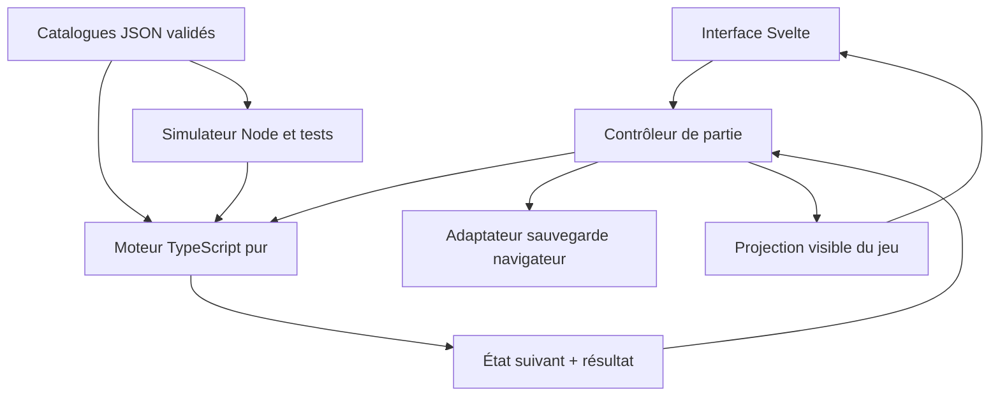

# La République, c’est moi ! — Architecture technique

**Version 0.1 — 24 novembre 2026**  
**Statut :** proposition d’implémentation avant prototype  
**Référence fonctionnelle :** [GAME_DESIGN.md](GAME_DESIGN.md)  
**Assistants de développement :** Codex et Claude Code, sans dépendance à l’un ou l’autre dans le jeu.

## 1. Objectifs et décisions

Construire un jeu solo de gestion narrative de carrière politique, jouable dans un navigateur desktop, déployable comme site statique. Le moteur doit permettre une carrière complète, une simulation accélérée, des tests reproductibles et l’ajout régulier d’événements sans modifier son code. La cible de durée est 45–60 minutes de jeu actif, à valider par playtests.

| Décision | Choix |
|---|---|
| Frontend | SvelteKit + TypeScript strict + Tailwind CSS + Lucide |
| Moteur | TypeScript pur, sans Svelte, DOM, stockage ni réseau |
| Déploiement | SvelteKit adapter-static, page racine prérendue, assets statiques ; hébergement GitHub Pages (sous-répertoire ou domaine personnalisé) |
| Contenu | JSON validé par schémas et contrôles de références |
| État | Un seul état de partie sérialisable, transitions explicites |
| Sauvegarde | localStorage versionné, export/import JSON recommandé |
| Tests | Vitest, Playwright pour parcours critiques, simulations Node |
| Dépendances | npm, lockfile Git, version Node LTS fixée à l’initialisation |
| IA | Assistance au développement uniquement ; aucune API IA en jeu |

Les versions exactes des bibliothèques seront sélectionnées ensemble lors de l’initialisation, puis verrouillées. Pas de backend, base distante, compte utilisateur, progression hors ligne, multijoueur, gestion de pays exhaustive ni méta-progression V1. Ne pas introduire de serveur Node en production pour une fonctionnalité locale. Les valeurs numériques de gameplay restent provisoires ; le GDD est la référence en cas d’écart fonctionnel.

## 2. Architecture et frontières



Le moteur reçoit les données, l’état précédent et une commande. Il renvoie un nouvel état et un résultat de transition, sans modifier ses arguments. Le contrôleur valide, persiste, publie l’état puis expose une projection à l’interface. Les composants n’écrivent jamais directement dans les ressources ni dans l’historique. Les règles de simulation n’existent qu’à un seul endroit. Les tests et le simulateur importent exactement ce moteur.

L’interface de jeu sera une application à onglets plutôt qu’une multitude de routes ; les onglets ne changent pas le temps. L’écran d’accueil propose nouvelle partie, reprise et import. Les détails du design restent dans DESIGN.md (à rédiger).

## 3. Structure cible du dépôt

```text
/
  AGENTS.md                 # règles communes aux assistants
  CLAUDE.md                 # import des règles communes (compatibilité)
  GAME_DESIGN.md
  ARCHITECTURE.md
  DESIGN.md                 # à rédiger
  ROADMAP.md                # à rédiger
  README.md                 # commandes et démarrage
  package.json
  package-lock.json
  .nvmrc
  src/
    routes/
      +layout.svelte
      +page.svelte          # coque accueil / partie / bilan
    lib/
      game/
        engine/
          index.ts          # API publique du moteur
          state.ts          # état et types fondamentaux
          commands.ts       # commandes et résultats
          calendar.ts
          random.ts
          turn.ts
          conditions.ts
          effects.ts
          actions.ts
          events.ts
          health.ts
          economy.ts
          selectors.ts      # calculs dérivés purs
          invariants.ts
          # Modules ajoutés au fur et à mesure :
          characters.ts, relations.ts, delegation.ts
          elections.ts, mandates.ts, world.ts
          promises.ts, justice.ts, institutions.ts, media.ts, assets.ts
        content/
          schemas.ts
          validate.ts
          load.ts
          data/
            actions.json
            upgrades.json
            events/
            world/
            balance.json
        app/
          controller.ts
          view-model.ts
          session.svelte.ts # état réactif (si Svelte 5 retenu)
        persistence/
          envelope.ts
          migrations.ts
          local-storage.ts
          import-export.ts
      components/
        shell/
        dashboard/
        agenda/
        events/
        common/
  scripts/
    validate-content.ts
    simulate.ts
  tests/
    unit/
    scenarios/
    fixtures/
    e2e/
  static/                   # portraits et illustrations facultatifs
```

Arborescence cible et non exigence de créer des dossiers vides : commencer par les modules utiles au prototype. Les fichiers séparés par virgules ci-dessus sont des fichiers distincts. Les tests peuvent aussi être colocés si convention unique documentée. Pas de dépendance circulaire : types et utilitaires → règles métier → orchestrateur ; le moteur ne dépend jamais de l’application ou de l’UI. Le catalogue ne dépend pas du navigateur.

## 4. Modèle de données

### 4.1 État central

Les contrats suivants illustrent la cible ; le prototype utilise un sous-ensemble. Les structures finales sont définies dans le code et couvertes par tests, sans imposer les valeurs de départ.

```ts
type Id = string;
type Turn = number; // 0 = T1 2000
interface GameState {
  schemaVersion: number;
  turn: Turn;
  rng: { seed: string; state: number }; // PRNG choisi et versionné
  phase: 'planning' | 'decision' | 'ended';
  playerId: Id;
  resources: Resources;
  player: PlayerState;
  world: WorldState;
  characters: Record<Id, Character>;
  relationships: Record<Id, Relationship>;
  organization: Organization;
  mandates: Record<Id, MandateInstance>;
  elections: Record<Id, ElectionInstance>;
  campaigns: Record<Id, Campaign>;
  promises: Record<Id, PromiseRecord>;
  assets: Record<Id, AssetInstance>;
  cases: Record<Id, LegalCase>;
  events: EventState;
  history: HistoryEntry[];
  stats: CareerStats;
  end: EndState | null;
}
interface Resources {
  influence: number;
  politicalBudgetCents: number;
  personalCashCents: number;
}
```

`player` contient notamment la date de naissance, la santé, le stress, la notoriété, les soutiens, l’affiliation, les contraintes d’éligibilité et les convictions internes. Pas de score moral présenté au joueur. Les actes et leurs conséquences restent dans l’historique. `personalCashCents` représente la liquidité ; la valeur nette du patrimoine est dérivée de la liquidité, des actifs et des dettes si celles-ci sont introduites. Les fonds détournés cumulés sont une statistique historique distincte, pas une monnaie ni un synonyme de fortune.

Les personnages ont des identifiants stables, un nom fictif, une naissance, des rôles, des compétences, des traits réels et des informations connues par le joueur. Les liens sont orientés (A peut faire confiance à B sans réciprocité). Les souvenirs retiennent les faits importants et leurs dates. Les proches et adversaires utilisent le même modèle. Les employés non nommés sont agrégés. Ne jamais confondre identifiant d’une définition (`role.mayor`) et identifiant d’une instance (`mandate.42`).

Les `CareerStats` conservent les agrégats nécessaires au bilan (plus haute fonction, argent détourné, promesses, etc.). Les faits durables — décisions, affaires et relations — sont conservés même si les nouvelles ordinaires sont compactées. Pas besoin d’event sourcing intégral ni de reconstruire l’état depuis tout le journal.

### 4.2 Monde et politique

`WorldState` contient les instances des partis, médias et règles institutionnelles, ainsi que les indicateurs nationaux abstraits. Les définitions initiales sont stables entre parties ; les noms, traits et relations des dirigeants sont tirés à la création. Les évolutions sont déclenchées par le moteur et des événements, même sans action du joueur. Les calendriers sont représentés par des instances d’élection dotées d’une échéance et d’une clôture de candidature. Une élection anticipée ne réécrit pas silencieusement une instance passée.

Un mandat référence son titulaire, sa fonction, son début, sa fin et son mode d’accès. La fonction principale est dérivée des mandats actifs selon une priorité de présentation (à définir), distincte des droits. Les incompatibilités sont évaluées par les règles institutionnelles actuelles. Une réforme précise explicitement son moment d’application et le sort des mandats existants. Les nominations et mandats électifs sont distincts.

### 4.3 Unités et invariants

- Dates métier : entiers en trimestres ; année = 2000 + floor(turn / 4), trimestre = turn % 4 + 1. Âge calculé depuis la naissance ; pas de compteur d’âge indépendant susceptible de dériver.
- Argent : centimes entiers sûrs JavaScript ; convention d’arrondi unique documentée ; aucune fusion implicite entre budget politique et patrimoine. Coûts validés avant achat. Insuffisance de trésorerie : suspension des charges non payées et alerte dans le prototype ; dette éventuelle traitée explicitement plus tard.
- Jauges bornées : par exemple 0–100 pour santé et stress ; convention unique pour probabilités 0–1. Aucun NaN, Infinity ou nombre hors plage. L’influence n’est pas nécessairement une jauge bornée.
- Budget de temps : 100 points indicatifs par trimestre, entier et non cumulable ; les actions manuelles ne dépassent jamais la disponibilité. Le temps délégué possède une capacité distincte.
- Références stables, acteurs actifs et éligibles, mandats compatibles, une seule résolution par événement, état terminal immuable, et aucun tour avancé avec choix bloquant en suspens.
- Utiliser une seule fonction de contrôle des invariants après chaque transition en tests et aux frontières de chargement ; ne pas masquer des bugs par des clamps indiscriminés.

## 5. API du moteur et résolution des tours

```ts
// Signatures de principe, non du code déjà implémenté.
createGame(config: NewGameConfig, content: Content): GameState;
previewPlan(state: GameState, plan: TurnPlan, content: Content): PlanPreview;
transition(state: GameState, command: GameCommand, content: Content): TransitionResult;
projectView(state: GameState, content: Content): PlayerView;
```

Les commandes sont des unions discriminées : `commitTurn(plan)`, `chooseEvent(instanceId, choiceId)`, et ultérieurement changements de missions, candidatures et nominations lorsqu’elles sont permises. Les opérations de planification sont modifiables avant validation ; leurs previews ne consomment aucun aléatoire. Un plan contient actions ordonnées, cibles, achats, consignes et coûts dérivés du catalogue. Validation et exécution réutilisent les mêmes règles, sur un état de travail simulant les prérequis déterministes du plan. Aucun effet partiel sur commande rejetée. Les effets aléatoires des actions sont résolus seulement à la validation et ne financent pas d’autres actions du même plan dans le prototype.

### 5.1 Ordre de résolution proposé, à verrouiller par tests

1. Vérifier la phase `planning`, les références, l’éligibilité, les coûts et les limites ; refuser sans modifier l’état ni le PRNG en cas d’erreur.
2. Capturer les producteurs, mandats et charges déjà actifs au début de T ; réserver temps et coûts. Appliquer les actions planifiées dans l’ordre annoncé, y compris achats et recrutements. Les producteurs nouvellement recrutés ou acquis ne démarrent qu’en T+1, sauf effet ponctuel explicite.
3. Résoudre la délégation des équipes actives et leurs productions ; appliquer les revenus, charges et effets récurrents prévus pour T. Les règles d’insolvabilité et de départ d’un acteur s’appliquent explicitement. Pas de production d’un acteur devenu inactif avant sa mission ; les droits déjà acquis sont distingués des tâches non exécutées.
4. Actualiser le contexte national, les relations et les personnages ; appliquer stress, récupération et vieillissement à la frontière T/T+1. Vérifier les décès et autres causes terminales avant d’attribuer un nouveau mandat au joueur. Les événements terminaux découlant des choix sont également vérifiés après leur application.
5. Résoudre les échéances arrivant à la fin de T (scrutin, mandat, affaire, promesse), selon un ordre fixe : fins de droits/mandats, scrutins et nominations, autres échéances. Des réformes différées deviennent actives à la frontière prévue. Les candidats sont revalidés à la date de l’échéance.
6. Passer à T+1 exactement une fois ; produire le journal du trimestre T. Sélectionner les événements éligibles à la frontière, créer leurs instances, figer leurs acteurs et les mettre en file selon priorité. Une conséquence future porte un `dueTurn` explicite. Une fin de partie interrompt immédiatement les opérations ultérieures et clôt le bilan.
7. Publier l’état `decision` s’il existe un choix bloquant, sinon `planning`. La résolution d’un choix ne réexécute jamais les étapes 1–6. Elle applique les effets, actualise la file, vérifie la fin, puis retourne en phase `planning` lorsque les décisions sont traitées. Les événements suivants sont revalidés après tout changement ; une instance devenue impossible est annulée avec motif de journal.

Convention : si un effet terminal arrive pendant la résolution de T avant la frontière, le bilan enregistre le tour de décès/fin T ; après la frontière, T+1. Le moteur conserve explicitement la date de fin. Les actions institutionnelles narratives sont des choix à la frontière, pas une réécriture rétroactive du scrutin déjà résolu. Une décision prévue avant scrutin doit donc être présentée au plus tard au tour précédent. Les alertes calendaires sont calculées avant chaque engagement de tour.

### 5.2 Accélération

L’accélérateur est une boucle de `commitTurn` utilisant un plan récurrent valide (ou un plan vide si autorisé) et les mêmes règles qu’un tour manuel. Il s’arrête **avant** une échéance exigeant préparation selon sa fenêtre configurée, **après** un tour produisant un choix bloquant, une alerte critique ou une fin, ou à la limite demandée. Le résultat contient `turnsAdvanced` et `stopReason`. Les alertes déjà reconnues sont identifiées pour éviter un blocage infini. Une décision bloquante n’est jamais choisie automatiquement dans le jeu interactif. Le simulateur de tests peut la choisir selon sa stratégie explicite.

L’UI exécute des lots courts et rend la main au navigateur pour permettre l’annulation ; sauvegarder chaque tour validé ou chaque lot borné avec état cohérent. Pas de temps réel ni de progression hors ligne. Un Web Worker n’est envisagé que si un profilage démontre un besoin.

## 6. Aléatoire et reproductibilité

Choisir un PRNG simple à état 32 bits avec algorithme et conversion seed→état documentés, par exemple Mulberry32 ; tester avec vecteurs de référence. Toute opération aléatoire passe par ce module, avec état sérialisé. Seed de nouvelle partie issue de `crypto.getRandomValues` à la frontière navigateur, ou fournie explicitement pour tests. Le moteur n’utilise jamais `Math.random()`, `Date.now()` ni des UUID aléatoires externes. Les identifiants de simulation proviennent d’un compteur d’instances sauvegardé (ou d’une dérivation déterministe équivalente).

Trier les candidats par identifiant stable avant un tirage pondéré ; fixer l’ordre de parcours des entités. Préviews, sélecteurs, rendu et actualisations n’avancent pas le PRNG. Même seed + mêmes commandes + mêmes versions moteur/contenu = même état et même journal métier. Ce contrat n’implique pas qu’un changement de catalogue reproduise une ancienne carrière. Sauvegarder la version de règles et la version de contenu ; les tests de régression utilisent des fixtures de contenu figées.

### 6.1 Décisions de P1-01 (24 novembre 2026)

- **PRNG :** Mulberry32, état entier non signé 32 bits sérialisé `{ seed, algorithm: 'mulberry32', state }`. Seed → état : FNV-1a 32 bits des octets UTF-8 de la seed. Fonctions pures `nextUint32`, `nextFloat` ([0, 1)) et `nextInt` (bornes incluses), qui renvoient `{ value, rng }`. Vecteurs de référence dans `tests/unit/random.test.ts` ; les modifier impose une nouvelle version de règles.
- **Seed :** chaîne de 1 à 64 caractères, sans espace en bordure ni caractère de contrôle. `createGame` exige une seed explicite ; la frontière navigateur la tirera de `crypto.getRandomValues` (P1-08).
- **Calendrier :** `Turn` entier, 0 = T1 2000, tours négatifs pour les dates antérieures. La naissance est un tour (`player.birthTurn`) ; l’âge en années révolues est dérivé (`ageAt`) et l’anniversaire tombe au trimestre de naissance. Profil fixe du prototype : 25 ans, né au T1 1975.
- **État :** `STATE_SCHEMA_VERSION = 1`, `RULES_VERSION = '0.1.0'`. Sous-ensemble actuel : `schemaVersion`, `turn`, `rng`, `phase`, `player.birthTurn`, `history`, `end`. Objet JSON pur, immuable par convention (`readonly`) ; ressources, santé et événements arrivent avec P1-02 à P1-05.
- **Commandes :** `transition(state, command)` pure. Seule `commitTurn(plan)` existe ; faute de catalogue (P1-02), seul un plan vide est accepté. Refus typés (`game_ended`, `decision_pending`, `invalid_phase`, `unknown_command`, `invalid_plan`, `unknown_action`) avec message français, et état d’entrée renvoyé à l’identique, PRNG compris. Un succès avance d’exactement un trimestre et ajoute `{ type: 'turn.resolved', turn: T }` au journal.
- **Invariants :** `checkInvariants` / `assertInvariants` dans `invariants.ts` (tour, phase, PRNG, seed, naissance, un journal par trimestre écoulé, cohérence de fin). Appelés après chaque transition dans les scénarios.
- **Reproductibilité :** aucun tirage n’est encore consommé par un tour (pas de règle aléatoire avant P1-02). Les scénarios vérifient déjà l’égalité structurelle à seed et commandes identiques, et la reprise depuis JSON.

## 7. Contenu déclaratif et moteur d’événements

Utiliser JSON et un validateur runtime (Zod recommandé) avec unions discriminées ; la validation des références croisées, templates, fenêtres temporelles et poids est une seconde étape. Le catalogue est importé au build puis indexé par identifiant. Séparer données fonctionnelles et textes seulement si le volume le justifie. Identifiants stables, français pour les textes, anglais pour les clés et le code. Pas de JavaScript embarqué, `eval`, expression libre ou script téléchargé.

### 7.1 Contrat indicatif d’événement

```json
{
  "id": "personal.rest_request",
  "category": "personal",
  "title": "Un agenda bien rempli",
  "text": "Votre médecin vous conseille de lever le pied.",
  "availableFromTurn": 0,
  "weight": 10,
  "priority": 20,
  "blocking": true,
  "cooldownTurns": 8,
  "unique": false,
  "when": { "op": "gte", "stat": "player.stress", "value": 70 },
  "choices": [
    {
      "id": "rest",
      "label": "Lever le pied",
      "preview": ["Moins de stress", "Influence en baisse"],
      "effects": [
        { "op": "addStat", "stat": "player.stress", "value": -12 },
        { "op": "addResource", "resource": "influence", "value": -3 }
      ]
    },
    {
      "id": "continue",
      "label": "Maintenir le cap",
      "preview": ["Stress en hausse"],
      "effects": [
        { "op": "addStat", "stat": "player.stress", "value": 5 }
      ]
    }
  ]
}
```

Chiffres fictifs de prototypage, non calibrés. La version finale du schéma est validée dans le dépôt. Les conditions supportent `all`, `any`, `not`, comparaisons typées et prédicats métier autorisés ; les effets supportent additions de ressources, variations de jauges, faits historiques, relations et suites différées. Ajouter une opération seulement quand plusieurs situations concrètes la justifient. Ne pas autoriser des chemins arbitraires vers l’état. Un registre typé des statistiques autorisées remplace tout accès dynamique non vérifié.

### 7.1 bis Décisions de P1-02 : actions, conditions et effets (24 novembre 2026)

- **Fichiers :** `content/types.ts` (types et vocabulaire, sans dépendance, seul module de contenu importable par le moteur), `content/schemas.ts` (Zod, typé contre `types.ts`), `content/validate.ts` (schémas puis contrôles croisés : identifiants uniques, coûts non dupliqués, temps ≤ budget trimestriel ; tous les problèmes sont renvoyés), `content/load.ts` (import au build, validation au chargement), `content/data/actions.json` et `balance.json`. Zod 4.6.7 ajouté en dépendance.
- **Action :** `id` stable `famille.nom`, `label`, `description`, `timeCost`, `maxPerTurn`, `costs` certains (payés avant les effets), `requires` facultatif accompagné obligatoirement d’un `unavailableReason`, `effects` (au moins un). Objets stricts : tout champ inconnu est refusé.
- **Conditions :** `all`, `any`, `not`, `gte`, `lte`, `eq` sur le registre `STAT_IDS` (`resources.*`, `player.age`, `calendar.year`, `calendar.quarter`), lu par un switch exhaustif. **Effets :** `addResource` (valeur fixe non nulle) et `addResourceRandom` (entier tiré dans [min, max] à la validation du trimestre, un tirage par effet dans l’ordre du plan).
- **Ressources :** `influence`, `politicalBudgetCents`, `personalCashCents` dans `GameState.resources`, entiers ≥ 0, jamais fusionnés ; valeurs de départ et budget de temps (100) dans `balance.json`.
- **Plan :** `previewPlan(state, plan, content)` pure (sans PRNG) ; `commitTurn` réutilise exactement la même validation. Simulation dans l’ordre sur un état de travail : les coûts et gains certains comptent pour la suite du plan ; un effet aléatoire ne compte que pour `min(0, min)`, il ne finance ni ne débloque jamais une autre action. Une action fautive est signalée (`unknown_action`, `repeat_limit`, `condition_not_met`, `time_exceeded`, `insufficient_resource`, `invalid_plan`) puis ignorée pour la suite, afin de lister tous les problèmes. Un plan invalide est refusé avec ces problèmes (`CommandError.issues`), sans modifier l’état.
- **Journal :** l’entrée `turn.resolved` porte les actions exécutées et leurs variations nettes réelles par ressource. `createGame(config, content)` et `transition(state, command, content)` reçoivent désormais le contenu. `RULES_VERSION = '0.2.0'` ; `STATE_SCHEMA_VERSION` reste 1 tant qu’aucune sauvegarde n’existe (figé à P1-07).
- **Tests :** le moteur est testé sur un contenu figé (`tests/fixtures/content.ts`) ; le catalogue réel a ses propres tests et un scénario de dix ans. Le catalogue initial (6 actions) et ses chiffres sont des hypothèses de prototypage. Les actions de recrutement, d’organisation et de repos arriveront avec les producteurs (P1-03) et la santé (P1-04).

### 7.2 Sélection et instances

Filtrer par date, phase, préconditions, acteurs valides, unicité et cooldown. Traiter les suites dues, puis événements exceptionnels, puis un nombre plafonné de tirages ordinaires ; priorité et règles de concurrence sont configurables. Une suite peut attendre une condition jusqu’à expiration si prévu, sinon être annulée avec motif. Chaque occurrence enregistre identifiant de définition, identifiant unique, tour, acteurs résolus, choix autorisés et données nécessaires. Les personnages décédés ou rôles perdus rendent les choix incohérents inéligibles ; prévoir un choix de repli lorsque nécessaire. Les templates n’accèdent qu’aux variables déclarées. Les textes sont échappés par Svelte, jamais injectés via HTML non fiable.

Les événements peuvent être non bloquants (effets automatiques et article) ou bloquants (choix). Le joueur voit tendances et fourchettes selon les compétences de ses conseillers, non l’état caché ni les tirages futurs. Les estimations utilisent une projection déterministe, éventuellement bruitée à la création d’une instance puis stockée ; les rafraîchir ne doit pas permettre de sonder le RNG. Les mêmes conditions et effets alimentent actions, améliorations et événements quand possible, sans créer de langage généraliste.

Le prototype cible 20–30 événements écrits, dont quelques suites.

### 7.3 Décisions de P1-05 : moteur d’événements (24 novembre 2026)

- **Catalogues :** chaque fichier `data/events/*.json` (`{ "events": [...] }`) et `data/cast.json`. Un événement a `id`, `category`, `title`, `text`, `trigger` (`random` ou `followUp`), `weight`, `priority`, fenêtre facultative `availableFromTurn`/`availableUntilTurn`, `cooldownTurns`, `unique`, condition `when` facultative, rôles `actors` ; puis soit `blocking: true` et `choices`, soit `blocking: false` et `effects` (liste éventuellement vide depuis P1-06 : simple brève). Un choix a `id`, `label`, `hints` (tendances rédigées), `costs` certains, prérequis facultatif, `effects` (éventuellement vides) et `followUp` facultatif (`eventId`, `delayTurns` ≥ 1).
- **Validation croisée :** identifiants uniques avec actions et améliorations ; variables `{rôle}` déclarées et aucune accolade isolée (titre, texte, libellés, tendances) ; suites existantes ; toute suite `followUp` atteignable par un choix ; au moins un choix de repli (sans prérequis ni coût) par événement bloquant ; chaque rôle pourvu par au moins un membre de la distribution.
- **Acteurs (prototype) :** une distribution fictive (`cast.json` : `id`, `name`, `tags`). Chaque rôle prend un membre distinct portant toutes ses étiquettes, tiré parmi les candidats triés par identifiant ; une suite réutilise l’acteur du même rôle. Ces personnages ne vieillissent ni n’ont de relations : le modèle complet arrive avec P2-04.
- **Frontière T/T+1 (étape 6, `events.ts`), sauf décès à l’étape 4 :** suites dues d’abord (créées si fenêtre et condition tiennent, sinon annulées avec motif), puis au plus `ordinaryDrawsPerTurn` tirages, chacun réussissant avec `ordinaryEventChance` puis choisissant au poids parmi les événements `random` éligibles triés par identifiant (fenêtre, condition, `unique`, `cooldownTurns` depuis la dernière occurrence, aucune instance en attente, acteurs disponibles, pas deux fois le même événement dans le trimestre). Paramètres dans `balance.json > events`.
- **Instances :** `event.N` (compteur commun avec les améliorations), acteurs figés, occurrences comptées par définition. Informatif : effets appliqués aussitôt. Bloquant : file `events.pending` triée par priorité décroissante puis ordre de création ; phase `decision`. Suites en attente dans `events.scheduled`.
- **Choix (`chooseEvent`)** : uniquement en phase `decision` et pour la tête de file ; prérequis et coûts vérifiés ; l’instance est retirée de la file en même temps que les effets sont appliqués (aucune double application possible) ; la suite est programmée ; les autres événements en attente sont revalidés (condition) et annulés avec motif si besoin ; retour en `planning` quand la file est vide. Nouveaux codes : `no_pending_decision`, `unknown_event_instance`, `not_next_event`, `unknown_choice`, `choice_unavailable`.
- **Effets automatiques** (événements, choix) : une ressource ne descend jamais sous zéro (perte limitée au disponible, variation réelle journalisée) ; les jauges restent bornées. Un décès dû à un événement de la frontière ou à un choix est daté du trimestre en cours (T+1) ; l’invariant devient `end.turn ≤ turn`.
- **Journal :** `turn.resolved.events` (instances `queued`, `applied` ou suites `cancelled`) et entrées `event.resolved` (choix, variations, suite programmée, annulations). Le journal est désormais une union `JournalEntry` ; `TransitionSuccess` n’a plus de `resolvedTurn`.
- **Vue :** `describePendingEvent` donne l’événement en tête de file avec textes résolus, acteurs, choix (tendances, coûts certains, disponibilité et motif). Elle n’expose ni effets, ni suites, ni probabilités.
- **Tests :** la fixture désactive les tirages ordinaires par défaut ; `withEvents` les active pour un sous-ensemble. Le scénario du catalogue réel répond aux événements par une politique déterministe (premier choix disponible). `RULES_VERSION = '0.5.0'`. Le catalogue réel de P1-05 ne contenait qu’un échantillon (4 événements) ; voir §7.4 pour P1-06. Les ajouts se font par fichiers et validation. Les exemples satiriques utilisent des personnages inventés ; les contenus ne sont pas une simulation de personnes réelles.

### 7.4 Décisions de P1-06 : premier catalogue narratif (24 novembre 2026)

- **Catalogue :** 30 événements dans `data/events/` (`personal`, `press`, `finance`, `organization`, `opportunity`, `world`) : 14 bloquants, 16 informatifs (dont 3 brèves sans effet), 5 suites. Chaînes : portrait → parution ; embauche familiale → rumeur ; note de frais → indiscrétion ; donateur généreux → service demandé → enquête (trois étapes). Distribution de 18 personnages fictifs (`cast.json`), médias fictifs (Courrier du Bocage, Radio Bocage FM, La Gazette fouineuse) et parti fictif. Aucun nom réel.
- **Principes d’écriture :** chaque événement bloquant garde un choix de repli neutre ; les choix opportunistes apportent un gain immédiat et une conséquence différée, sans garantie ; les tendances (`hints`) décrivent sans chiffres ; typographie française. La carrière honnête reste jouable.
- **Moteur (`RULES_VERSION = '0.6.0'`) :** nouvelle statistique `upgrades.owned` (taille de l’organisation), utilisée par plusieurs événements d’organisation et de famille ; un événement informatif peut n’avoir aucun effet.
- **Validation automatisée :** en plus de `content:validate`, `tests/unit/narrative-catalog.test.ts` vérifie la taille (20–30), les thèmes, les chaînes, des textes résolus pour **toutes** les distributions d’acteurs possibles, un choix de repli partout, des longueurs lisibles et la typographie ; `tests/scenarios/real-catalog.test.ts` vérifie que chaque événement est réellement atteint au fil de 60 carrières simulées (3 stratégies, politique de choix variée).
- **Mesure (40 carrières par stratégie, provisoire) :** prudente → ≈ 201 trimestres, 82 événements et 40 décisions par carrière ; organisatrice → ≈ 206, 88 et 52 ; surmenage → ≈ 94, 41 et 26. Un même événement revient au plus 13 fois dans une carrière (8 en moyenne pour le plus fréquent) après allongement des délais de réapparition (18 auparavant). La répétition et le nombre de décisions par carrière sont à revoir avec le simulateur (P1-10) et des playtests, au regard de la cible de 45–60 minutes.

## 8. Économie, santé, personnages et systèmes futurs

### 8.1 Économie et temps

Calculer les flux par producteur et par trimestre, avec détail pour l’interface. Une dépense est imputée à sa trésorerie autorisée ; les transferts entre budgets sont des effets explicitement définis par une situation de jeu, pas un mécanisme comptable universel. Les coûts de fonctionnement et limites de capacité freinent la croissance. Les actifs possèdent définition, instance, prix, charges et revenus ; la valeur nette reste dérivée. Toutes les constantes ajustables résident dans `balance.json` ou les définitions de contenu, pas dispersées dans les composants.

### 8.1 bis Décisions de P1-03 : économie, producteurs et améliorations (24 novembre 2026)

- **Catalogue :** `upgrades.json` validé comme les actions. Une amélioration a une famille (`organization`, `communication`, `network`, `personal`), une **trésorerie** (`politicalBudgetCents` ou `personalCashCents`), un coût en temps (0 autorisé), un nombre maximal d’exemplaires, un `price`, des charges `upkeep` et une `production` (au moins une) par trimestre, et un prérequis facultatif. Le prix et les charges monétaires ne peuvent utiliser que la trésorerie déclarée (contrôle croisé) : budget politique et patrimoine ne se mélangent jamais. Actions et améliorations partagent un même espace d’identifiants.
- **Plan :** `TurnPlan = { steps: PlanStep[] }`, avec `PlanStep = { kind: 'action' | 'purchase', id }`, exécuté dans l’ordre. Un achat vérifie le prérequis, le temps, le prix et `maxOwned` (exemplaires possédés + achats précédents du plan). Nouveaux codes : `unknown_upgrade`, `owned_limit`.
- **État :** `upgrades: OwnedUpgrade[]` (`instanceId`, `upgradeId`, `acquiredTurn`) dans l’ordre d’acquisition, et `nextInstanceNumber` (identifiants `upgrade.N`, jamais réutilisés).
- **Résolution (étape 3) :** un exemplaire acheté en T est en attente pendant T et produit à partir de T+1. Toutes les charges sont prélevées d’abord, exemplaire par exemplaire dans l’ordre d’acquisition ; un exemplaire dont les charges ne sont pas entièrement couvertes est **suspendu** pour le trimestre (rien prélevé, rien produit, statut au journal ; pas de dette). Les exemplaires actifs produisent ensuite : une production ne paie pas les charges du même trimestre. Les étapes du plan passent avant les charges.
- **Prévision :** `previewPlan` calcule aussi l’économie du trimestre sur le pire cas du plan (`producers` actifs, suspendus ou en attente, instance prévue pour chaque achat) et émet un avertissement non bloquant `upkeep_at_risk`. `resourceChanges` inclut charges et production.
- **Journal :** `turn.resolved` contient `steps` (actions et achats, avec l’instance créée) et `economy` (producteurs actifs ou suspendus et variation nette). Les invariants contrôlent les instances (format, unicité, compteur, date d’acquisition antérieure au tour, ordre) et, avec le contenu, les références et `maxOwned`. `RULES_VERSION = '0.3.0'`.
- **Provisoire :** catalogue de 5 améliorations et chiffres non calibrés. Aucun coût de la vie personnel n’est encore prélevé ; l’insolvabilité ne vient donc que des charges. Question d’équilibrage ouverte (GDD §17, « Économie »).

### 8.2 Stress, santé et fin

La santé et le stress sont mis à jour une fois par trimestre, avec des contributions identifiables : charge de travail, mandats, événements, repos, confort et âge. L’âge affecte la vulnérabilité ; décès et fins sont testés par une règle commune qui produit un motif explicite et un bilan. Les probabilités et courbes sont des hypothèses de tuning. Le modèle n’a pas de prétention médicale. Toute transition terminale interdit de poursuivre la carrière, mais permet de consulter le bilan et démarrer une nouvelle partie indépendante.

### 8.2 bis Décisions de P1-04 : santé, stress, vieillissement et fin (24 novembre 2026)

- **Jauges :** `player.health` et `player.stress`, entiers de 0 à 100, lisibles par les conditions (`STAT_IDS`). Nouvel effet `addStat` (variation fixe non nulle) : la jauge est maintenue dans ses bornes et le journal retient la variation réellement appliquée (`StepRecord.gauges`). Ce maintien est propre aux jauges ; les ressources restent contrôlées sans écrêtage.
- **Résolution (étape 4, `health.ts`)**, avec l’âge atteint en T, dans cet ordre : stress + charge de travail (`floor((temps − seuil) / 10) × pas`) puis − récupération ; santé − perte si stress ≥ seuil élevé, sinon + gain si stress < seuil de calme, sans dépasser le plafond de la tranche d’âge ; vieillissement (tirage, perte selon la tranche) ; décès si santé nulle (`health_failure`), sinon tirage du risque de la tranche, multiplié si la santé est sous le seuil de fragilité (`natural_causes`). Un tirage n’a lieu que si la probabilité est non nulle. Chaque contribution non nulle est journalisée (`WellbeingRecord`).
- **Paramètres :** `balance.json > wellbeing` (valeurs de départ, seuils, pas, tranches d’âge triées commençant à 0 avec `maxHealth`, `ageingChance`, `ageingHealthLoss`, `mortalityChance`), validés par schéma. Probabilités en [0, 1], jamais exposées.
- **Fin :** un décès clôt la carrière au trimestre T : entrée de journal de T, `end = { turn: T, reason: 'death', cause }`, phase `ended`, compteur à T+1 ; toute commande est ensuite refusée (`game_ended`). Invariants : jauges bornées, santé > 0 pour un personnage vivant, `end.turn < turn`. `careerSummary` (`selectors.ts`) produit le bilan minimal depuis l’état et le journal.
- **Prévision :** `previewPlan` donne `wellbeing` : stress certain de fin de trimestre et fourchette de santé (perte de vieillissement possible), avec l’avertissement `stress_high`. Aucune probabilité n’y figure (test dédié).
- **Tests :** les tests d’actions et d’économie utilisent un modèle de santé neutre (`neutralWellbeing`) ; les tests de santé activent chaque mécanisme via `withWellbeing`. `RULES_VERSION = '0.4.0'`.
- **Tuning provisoire et première mesure (200 seeds, stratégies naïves sur le catalogue réel) :** prudente (avec repos) → âge médian au décès 80 (p10–p90 : 61–90), environ 210 trimestres ; équilibrée (≈ 65 % du temps) → 82 ; surmenage sans repos → 49. Une première version (seuil 50, +3 par tranche, perte 2) faisait mourir la stratégie prudente vers 51 ans ; elle a été adoucie. À recalibrer avec le simulateur (P1-10) et des playtests.

### 8.3 Alpha : personnages et élections

Les personnages nommés sont peu nombreux et simulés via règles, traits et événements, pas via agents IA autonomes. Les postes clés confèrent une capacité de délégation, des flux et une qualité de conseil ; la loyauté est relationnelle et évolutive. Les actions déléguées passent par des missions persistantes et des prérequis. Les adversaires utilisent le même modèle de personnage, avec des transitions simples de rôle et de carrière. Les groupes de soutien distinguent électeurs et acteurs d’influence, sans double comptage dans la popularité agrégée.

Les candidatures sont librement initiées avant la clôture si éligible. Une campagne conserve sa date de déclaration, son financement, sa préparation, ses promesses et ses adversaires. Une déclaration précoce augmente à la fois le temps de préparation et l’exposition ; une tardive réduit les possibilités. L’algorithme fictif de scrutin sera documenté avec tests de sensibilité et d’incertitude bornée. Pas de prévisions électorales réelles. La défaite ne termine pas automatiquement le jeu. Les règles précises restent ouvertes dans le GDD.

### 8.4 V1 : médias, justice, patrimoine et institutions

Les dossiers judiciaires sont des machines à états avec échéances, références aux faits et issues, plutôt qu’un tirage de condamnation à chaque tour. Les transitions permises sont explicites ; des dossiers simultanés peuvent concerner le joueur ou son entourage. Une enquête et une culpabilité sont des états distincts. Les médias génèrent des articles à partir de faits et du contexte ; les actifs médias n’annulent pas les autres médias. Les promesses sont des objets historisés et réutilisables dans les événements. Les réformes institutionnelles modifient des paramètres du monde et persistent après changement de gouvernement. Aucun de ces modules n’est requis pour commencer le prototype.

## 9. Interface, projection et informations cachées

L’état réactif de session contient la partie courante, le brouillon de plan, les erreurs et la navigation. Une projection `PlayerView` fournit les valeurs publiques et prévisions autorisées. Les composants ne lisent pas les traits cachés, le RNG, les probabilités secrètes ou les issues futures. Les données existent localement et restent inspectables par un utilisateur technique : il s’agit d’une règle d’expérience de jeu, pas d’une protection anti-triche.

Afficher le temps restant, les coûts, la production prévue, les alertes et les boutons d’avance en permanence. Distinguer conséquences certaines d’une action et tendances incertaines d’un événement. Toute erreur de sauvegarde ou de validation est lisible ; le joueur peut réessayer ou exporter. Ne pas bloquer l’écran en simulant des centaines de tours synchrones. Navigation clavier et contrastes corrects ; pas d’indicateurs fondés exclusivement sur les couleurs.

## 10. Sauvegarde et compatibilité

```ts
interface SaveEnvelope {
  format: 'republique-save';
  saveVersion: number;
  rulesVersion: string;
  contentVersion: string;
  savedAt: string; // métadonnée UI, exclue de la simulation
  state: GameState;
}
```

Une clé localStorage dédiée au projet, préfixée pour éviter les collisions sur le même domaine : sur GitHub Pages, tous les sites de projet d’un même compte partagent l’origine `<compte>.github.io`, donc le même localStorage. Sauvegarder l’état complet, y compris RNG, compteurs, phase, instances d’événement en attente, effets différés, missions et historique. La planification non validée peut être perdue dans le prototype ; ne jamais la présenter comme validée. Autosave après nouvelle partie, tour, choix bloquant et fin. L’état en attente et le résultat d’un choix doivent être écrits dans une même enveloppe, pas dans plusieurs clés métier indépendantes. Le contrôleur persiste avant d’autoriser une nouvelle transition ; en cas d’échec, afficher un état non sauvegardé, proposer réessai/export et ne pas avancer silencieusement.

Garder une copie précédente valide si possible. Une écriture localStorage est synchrone et peut échouer (quota, restrictions) : capturer l’erreur, ne pas prétendre avoir sauvegardé. Validation stricte à l’import, taille maximale raisonnable, contrôle des références. Les migrations sont pures, séquentielles et testées ; rejeter les versions futures inconnues sans écraser l’existant. Le stockage est local à l’origine web et au navigateur, non synchronisé. Détecter si possible une session concurrente via événement `storage` et demander de recharger avant d’écraser ; le prototype n’a pas besoin de fusion multi-onglets.

Pour ajouter du contenu sans casser les sauvegardes : ne jamais recycler un identifiant, conserver les définitions historiques nécessaires ou des alias/migrations, sauvegarder les faits et paramètres des instances déjà créées. Un changement de règles qui invalide une ancienne partie nécessite une migration explicite ou un message de compatibilité, jamais une réparation silencieuse. Les nouveaux événements peuvent rejoindre les parties existantes au prochain tour compatible, sans promesse de reproduction avec l’ancienne version. Export/import manuel recommandé avant diffusion aux amis.

### 10.1 Décisions de P1-07 : sauvegarde locale (24 novembre 2026)

- **Module `src/lib/game/persistence/`** (hors moteur, sans dépendance au navigateur sauf `browserStorage()`) : `envelope.ts`, `migrations.ts`, `state-schema.ts`, `local-storage.ts`, `import-export.ts`, `index.ts`.
- **Enveloppe :** `format: 'republique-save'`, `saveVersion: 1`, `rulesVersion` (moteur), `contentVersion` (empreinte FNV-1a de la sérialisation canonique des catalogues, `content.version`, à titre informatif), `savedAt` (ISO 8601, métadonnée d’interface jamais lue par la simulation) et `state` complet (PRNG, compteur d’instances, décisions en attente, suites, occurrences, journal).
- **Lecture validée, dans l’ordre :** taille ≤ 5 Mo → JSON → format → version (future : refus `future_version` sans rien modifier ; ancienne : migrations pures et séquentielles `N → N+1`, refus `unsupported_version` si un maillon manque) → schéma Zod strict typé contre `GameState` (`invalid_state`) → invariants internes (`invalid_state`) → références au catalogue (`incompatible_content`). Aucune réparation silencieuse. Les invariants sont désormais séparés en `checkInvariants(state)` (cohérence interne) et `checkContentReferences(state, content)` ; `checkInvariants(state, content)` combine les deux comme avant.
- **Stockage :** clés `la-republique-cest-moi:save` et `la-republique-cest-moi:save:previous` (origine partagée sur GitHub Pages). Avant écriture, la sauvegarde courante valide devient la copie précédente (son échec n’empêche pas d’enregistrer). Une sauvegarde existante illisible, endommagée, incompatible ou future n’est **jamais écrasée** sans `overwriteUnreadable: true`, décision explicite du joueur. Quota dépassé, stockage inaccessible ou échec d’écriture sont renvoyés (`quota_exceeded`, `storage_unavailable`, `write_failed`) : rien n’est présenté comme sauvegardé. À la lecture, une sauvegarde courante endommagée cède la place à la copie précédente valide, avec avertissement, sans être effacée.
- **Export / import :** fichier `la-republique-cest-moi-AAAA-Tn.json` (l’enveloppe JSON) ; l’import applique la même validation et n’écrit rien : l’interface décide ensuite.
- **Reprise :** un scénario joue trois carrières de 300 commandes en sauvegardant puis rechargeant depuis le stockage après chaque commande (décisions en attente comprises) et obtient l’état exact d’une partie sans rechargement ; une décision rechargée ne peut être appliquée qu’une fois. Taille mesurée d’une carrière complète : ≈ 250 Ko (max. 273 Ko sur 10 carrières).
- **Reporté au contrôleur et à l’interface (P1-08) :** autosauvegarde après nouvelle partie, tour, choix et fin ; persistance avant d’autoriser la transition suivante ; affichage des erreurs avec réessai et export ; détection d’un autre onglet via l’événement `storage`.

## 11. Tests et équilibrage

| Niveau | Ce qui doit être couvert |
|---|---|
| Unitaire (Vitest) | Calendrier, PRNG, validation, coût/production, bornes, santé, prédicats et effets |
| Scénario moteur | Carrière complète, événement bloquant/reprise, recrutement T+1, décès, délégation, élection, règles institutionnelles selon phase de développement |
| Contenu | Schémas, identifiants uniques, références, templates, choix de repli, poids et fenêtres |
| Sauvegarde | Round-trip, migration, données invalides, événement en attente, quota simulé, non-double application |
| E2E (Playwright) | Nouvelle partie, plan invalide, avance, choix, rechargement, accélération, fin ; ajouter les systèmes au fil de l’eau |
| Simulation Node | Rejouer une seed ; lancer des lots de carrières avec stratégies et rapport machine-readable |

Cas incontournables : même seed et commandes → égalité structurelle ; preview → aucun changement d’état ; plan rejeté → aucun coût ; 4 tours → un an ; achat T → production T+1 ; accélération = tours unitaires équivalents jusqu’à arrêt ; choix bloquant sauvegardé puis résolu une seule fois ; un personnage décédé n’est pas recruté ; impossibilité d’avancer après fin. Les modules futurs ajoutent cas d’incompatibilité de mandats, retrait de candidature, chaîne judiciaire et réformes non rétroactives.

### 11.1 Simulateur automatique

Exécutable Node via un script TypeScript (par exemple tsx) appelant `transition`. Entrées : seed ou plage de seeds, nombre de parties, stratégie, plafond de tours de sécurité. Stratégies simples : prudente/intègre, ambitieuse, patrimoniale, mixte, et aléatoire valide pour explorer les erreurs. Les stratégies n’accèdent pas aux informations cachées pour choisir, sauf mode de test explicitement séparé. Un tour sans choix reste valide si le jeu le permet. Les décisions bloquantes sont résolues par politique automatisée déterministe.

Rapport JSON/CSV : durée en tours, interventions significatives, causes de fin, ressources, mandats, promesses, fréquence/répétition des événements, violations d’invariants et seeds problématiques. Une carrière arrêtée par le plafond technique est un cas à analyser, pas une mort normale. Aucune estimation de durée humaine déduite uniquement de la vitesse CPU ; le rythme de 45–60 minutes est mesuré en playtests. Lancer un petit lot reproductible en CI et des lots plus larges à la demande.

## 12. Outils de développement, build et hébergement

Scripts npm cibles, à créer et documenter lors du bootstrap :

| Commande | Fonction |
|---|---|
| `npm ci` | Installation reproductible après création du lockfile |
| `npm run dev` | Serveur de développement local |
| `npm run check` | TypeScript/Svelte et diagnostics |
| `npm run lint` | Vérification des conventions |
| `npm run test` | Tests unitaires et scénarios |
| `npm run test:e2e` | Tests navigateur |
| `npm run content:validate` | Validation exhaustive des catalogues |
| `npm run simulate -- --runs 100 --seed 42` | Exemple de commande cible du simulateur |
| `npm run build` | Build statique dans `build/` |
| `npm run preview` | Vérification du résultat local |

Le bootstrap crée les scripts réellement disponibles ; ne pas annoncer un test effectué si le script n’existe pas. CI simple : installation verrouillée, check/lint, validation contenu, tests, build ; E2E avec navigateur installé et artefacts de diagnostic. Les outils de développement ne sont pas des dépendances serveur de production.

### 12.1 Décisions de bootstrap (phase 0, 24 novembre 2026)

- Node.js **26.13.1** (LTS active) fixé dans `.nvmrc` ; `engines` + `engine-strict=true` ; npm 11. Dépendances épinglées en versions exactes (`save-exact=true`) et `package-lock.json`.
- Versions retenues : SvelteKit 3.4, Svelte 5.59 (runes imposées), Vite 8.3, TypeScript 6.0, Tailwind CSS 4.3 (plugin Vite), `@lucide/svelte` 1.79, Vitest 5.1, Playwright 1.65, ESLint 10 + typescript-eslint, Prettier 3. Projet généré avec `sv create` 1.7.0 puis adapté.
- SvelteKit 3 : configuration (adapter compris) dans `vite.config.ts`, plus de `svelte.config.js` ; alias `#lib/*` via le champ `imports` de `package.json` (remplace `$lib`).
- TypeScript : `strict`, `noUncheckedIndexedAccess`, `exactOptionalPropertyTypes`, `noImplicitOverride`, `noFallthroughCasesInSwitch` ; `svelte-check --fail-on-warnings`.
- Tests : non colocés. `tests/unit` et `tests/scenarios` (`*.test.ts`, Vitest en environnement Node) ; `tests/e2e` (`*.e2e.ts`, Playwright Chromium à 1440 × 900 et 1280 × 720) exécutés contre `build/` servi par `scripts/serve-static.ts`, sans serveur SvelteKit.
- Frontières du moteur vérifiées par analyse statique (`tests/unit/engine-boundaries.test.ts`) : pas d’import Svelte/`$app`/UI, ni `Math.random`, `Date.now`, `new Date`, stockage, DOM, réseau ou `eval`.
- Scripts `scripts/*.ts` exécutés directement par Node (suppression native des types), sans `tsx` ; syntaxe TypeScript effaçable uniquement. `content:validate` vérifie pour l’instant la syntaxe JSON ; schémas et références arrivent avec P1-02.
- Scripts ajoutés au tableau ci-dessus : `format`, `test:watch`, `test:e2e:install` (Chromium), `serve:static`. `npm run test` n’exécute pas les tests navigateur.
- CI : voir §12.2 (GitHub Actions, ajoutée en extension de phase 0).

### 12.2 Hébergement GitHub Pages (extension de phase 0, 24 novembre 2026)

- **Compatibilité.** GitHub Pages sert des fichiers statiques : adapter-static avec `prerender = true` sur toutes les routes, `strict: true` et sans page de repli SPA convient. Aucune route dynamique, aucun en-tête HTTP personnalisé ni réécriture n’est requis. Les liens profonds non prérendus renverraient le 404 de GitHub : toute route ajoutée doit donc être prérendue (ou une page de repli décidée explicitement).
- **Base path.** `paths.base` vient de la variable `BASE_PATH`, normalisée et validée par `scripts/base-path.ts` (`''` ou `/segment[/segment]`, sans `/` final). `''` pour un domaine personnalisé ou `<compte>.github.io` ; `/<dépôt>` pour un site de projet. En déploiement, la valeur provient de `actions/configure-pages` (`base_path`), qui suit automatiquement l’ajout ou le retrait d’un domaine personnalisé. Le domaine personnalisé se configure dans Settings → Pages (pas de fichier `CNAME` nécessaire avec un déploiement par Actions).
- **Chemins des ressources.** `paths.relative: true` : le HTML prérendu référence `./_app/…` et `./favicon.svg`, valides quel que soit le sous-répertoire. Dans les composants, les fichiers de `static/` passent par `asset('fichier')` de `$app/paths` et les liens internes par `resolve()` ; jamais de chemin absolu codé en dur (`/…`). `static/.nojekyll` empêche Jekyll d’ignorer `_app/` si le site est un jour publié depuis une branche.
- **Vérification.** `scripts/serve-static.ts --base /<dépôt>` imite GitHub Pages (préfixe, redirection `/<dépôt>` → `/<dépôt>/`, `404.html` éventuel). Les tests E2E utilisent des URL relatives (`./`) et contrôlent que toutes les ressources sont servies sous le base path, sans erreur, et que l’URL reste stable après hydratation. Ils sont exécutés à la racine et sous `BASE_PATH=/la-republique-cest-moi`.
- **CI/CD** (`.github/workflows/ci-pages.yml`). À chaque push sur `main` et pull request : `npm ci`, check, lint, validation de contenu, tests unitaires, build, E2E Chromium sous `/<nom du dépôt>` ; rapport Playwright en artefact en cas d’échec. Déploiement **uniquement manuel** (`workflow_dispatch` avec l’option `deploy`, sur `main`, après succès des vérifications) : build avec le base path de `configure-pages`, `upload-pages-artifact`, `deploy-pages`. Actions épinglées par SHA ; permissions minimales par job. Prérequis : Settings → Pages → Source « GitHub Actions ».
- **Retour arrière.** Relancer le workflow de déploiement sur un commit antérieur (réexécution d’un run précédent ou dispatch depuis une révision rétablie sur `main`).

### 12.3 Infrastructure GitHub (24 novembre 2026)

| Élément | Valeur |
|---|---|
| Dépôt | `https://github.com/BenCorb/la-republique-cest-moi`, public, offre gratuite, sans licence pour le moment |
| Branche principale | `main` ; travail sur branches de tâche et pull requests (conventions dans `AGENTS.md`) |
| CI | GitHub Actions, `.github/workflows/ci-pages.yml`, à chaque push sur `main` et pull request |
| Pages | Source « GitHub Actions » (`build_type: workflow`), environnement `github-pages` |
| URL publique | `https://bencorb.github.io/la-republique-cest-moi/` (base path `/la-republique-cest-moi`) |
| Déploiement | Manuel : `gh workflow run ci-pages.yml --ref main -f deploy=true` ou onglet Actions |

Domaine personnalisé futur : le déclarer dans Settings → Pages (enregistrement DNS chez le registraire), puis relancer un déploiement ; `configure-pages` fournira un base path vide et le localStorage disposera de sa propre origine. Les sauvegardes existantes sur `bencorb.github.io` ne seront pas transférées automatiquement vers la nouvelle origine (export/import manuel).

Configurer `adapter-static` avec prérendu des routes nécessaires. L’interface initiale peut être prérendue sans état de partie ; lire localStorage uniquement côté client après montage. Pas de routes dynamiques non prérendues pour la V1. Le sous-chemin éventuel est configuré dans les chemins SvelteKit et testé avec assets relatifs au base path (§12.2). Hébergement retenu : GitHub Pages (décision du créateur, 24 novembre 2026), qui remplace l’hypothèse initiale d’un serveur statique personnel ; le dossier `build/` reste déployable tel quel sur tout serveur de fichiers statiques. Construire en CI (ou sur la machine de développement) ; aucun processus Node ou Python en production. Ne pas exposer de secrets dans le bundle. Les sauvegardes ne quittent pas le navigateur par défaut.

## 13. Travail partagé Codex / Claude Code

`AGENTS.md` est la source commune des consignes de dépôt ; `CLAUDE.md` importe ce fichier pour compatibilité. Les documents métier sont agnostiques à l’assistant. Pas de MCP, plugin, skill propriétaire, clé API ou configuration d’agent obligatoire pour construire le jeu. Les deux assistants utilisent les mêmes commandes npm, le même Git, les mêmes tests et conventions. Vérifier côté Claude Code avec `/memory` si les consignes sont bien chargées.

- Travailler par tâche verticale courte, avec critères d’acceptation, tests et documentation adaptée. Ne pas implémenter toute la V1 en un prompt.
- Avant toute tâche, lire les consignes et les sections pertinentes du GDD et de l’architecture ; consulter ROADMAP.md dès qu’il existe.
- Avant de passer d’un assistant à l’autre, terminer ou documenter la tâche, inspecter `git status`, conserver un commit cohérent ou une note de reprise. Pas de travail simultané sur les mêmes fichiers ; worktrees/branches distincts si nécessaire, puis revue des conflits et tests avant fusion.
- Les décisions techniques durables appartiennent au dépôt (architecture et décisions documentées), pas à la mémoire personnelle d’un outil. Les changements de gameplay exigent mise à jour du GDD et accord du créateur ; les hypothèses restent identifiées comme telles.
- Aucun changement destructif, publication, déploiement ou écrasement du travail d’un autre sans demande explicite. Les agents rapportent les commandes réellement exécutées, leurs résultats, les limites et les prochaines étapes.

Références pour les fichiers d’instructions : [Codex — AGENTS.md](https://developers.openai.com/codex/guides/agents-md), [Claude Code — mémoire et instructions](https://code.claude.com/docs/en/memory). Les mécanismes de chargement peuvent évoluer ; la source commune reste portable.

## 14. Ordre d’implémentation et critères techniques

| Étape | Livraison technique | Sortie attendue |
|---|---|---|
| Bootstrap | Projet SvelteKit statique, TS strict, tests, layout minimal, scripts et CI | Build statique vérifié, aucun serveur nécessaire |
| Prototype | État, calendrier, PRNG, actions, économie, santé, événements, sauvegarde, bilan et accélération minimale si nécessaire pour le rythme | Carrière complète avec profil fixe, 20–30 événements, reprise fiable, tests de déterminisme |
| Alpha | Personnages, relations, missions, élections, mandats, monde autonome, famille et profils, accélération complète | Plusieurs trajectoires divergentes, règles communes et alertes pertinentes |
| V1 | Justice, médias, patrimoine, promesses, institutions, âges de départ, contenu et UI aboutis | Carrières rejouables, équilibrage testé, catalogue extensible, build déployable |

Le plan de tâches détaillé sera dans ROADMAP.md. Les chiffres de gameplay, fréquences, conditions d’élection, liste des groupes et seuils de santé demeurent ouverts. Préférer une implémentation simple à une abstraction spéculative. Les choix techniques qui touchent les invariants (ordre de tour, RNG, schémas, migrations) doivent être fixés avant de multiplier les systèmes.

**Prochaine étape de conception :** DESIGN.md, puis ROADMAP.md ; aucun code applicatif n’est livré par ce document.
