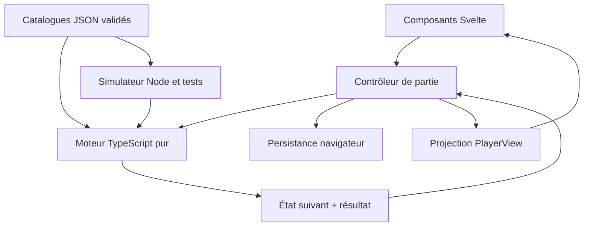

# La République, c’est moi ! — Architecture technique

**Version beta — 28 novembre 2026.** Contrats techniques **en vigueur**. L’historique complet des décisions, tâche par tâche (P0-01 à P3-42), est figé dans [archive/v1/ARCHITECTURE.md](archive/v1/ARCHITECTURE.md) (tag `v1.0.0`). Les règles propres à chaque système de jeu sont dans les fiches [features/](features/README.md).
**Référence fonctionnelle :** [GAME_DESIGN.md](GAME_DESIGN.md). **Interface :** [DESIGN.md](DESIGN.md).

> Numérotation conservée pour les §1, 2, 4, 5, 6, 7, 9, 10, 11 et 12, auxquels le code renvoie dans ses commentaires (`ARCHITECTURE.md §9`…). Un renvoi du type « §8.4 sexies » vise l’archive V1.

## 1. Objectifs et décisions

Jeu solo de gestion narrative de carrière politique, joué dans un navigateur desktop et livré comme site statique. Le moteur permet une carrière complète, une simulation accélérée, des tests reproductibles et l’ajout d’événements sans modifier son code. Durée cible : 60–90 minutes de jeu actif pour une carrière typique (décision du créateur, 27 novembre 2026), à vérifier par playtests.

| Décision     | Choix                                                                                   |
| ------------ | --------------------------------------------------------------------------------------- |
| Frontend     | SvelteKit 3 + Svelte 5 (runes) + TypeScript strict + Tailwind CSS 4 + Lucide            |
| Moteur       | TypeScript pur, sans Svelte, DOM, stockage, réseau ni hasard réel                        |
| Déploiement  | adapter-static, page racine prérendue ; GitHub Pages, déploiement manuel                 |
| Contenu      | JSON validé par schémas Zod et contrôles de références                                  |
| État         | Un seul `GameState` sérialisable, transitions pures                                      |
| Sauvegarde   | localStorage versionné (`SAVE_VERSION = 2`, conservé depuis la V1), export/import JSON   |
| Tests        | Vitest (unitaires, scénarios), Playwright (parcours), simulateur Node par lots           |
| IA           | Assistance au développement uniquement ; aucune API IA en jeu                            |

Pas de backend, compte, progression hors ligne, multijoueur ni méta-progression. Les valeurs numériques de gameplay restent provisoires ; le GDD fait foi en cas d’écart fonctionnel.

## 2. Architecture et frontières



Le moteur reçoit le contenu, l’état précédent et une commande ; il renvoie un nouvel état et un résultat sans modifier ses arguments. Le contrôleur valide, persiste, publie l’état puis expose une projection. **Les composants n’écrivent jamais dans l’état métier** ; ils lisent `PlayerView` et appellent le contrôleur. Les règles de simulation n’existent qu’à un seul endroit : tests et simulateur importent exactement ce moteur.

Dépendances à sens unique : types et utilitaires → règles métier → orchestrateur ; le moteur ne dépend jamais de l’application ou de l’interface ; le contenu ne dépend pas du navigateur. `tests/unit/engine-boundaries.test.ts` vérifie par analyse statique l’absence d’import Svelte/`$app`/UI et de `Math.random`, `Date.now`, `new Date`, stockage, DOM, réseau ou `eval` dans `engine/`.

## 3. Carte du dépôt

```text
src/
  routes/                 +layout.svelte, +page.svelte (accueil, création, partie), layout.css (jetons)
  lib/game/
    engine/               moteur pur — index.ts (API, RULES_VERSION), state.ts, commands.ts, turn.ts,
                          plan.ts, acceleration.ts, events.ts, effects.ts, conditions.ts, invariants.ts,
                          random.ts, calendar.ts, selectors.ts, + un module par système (voir fiches)
    content/              types.ts (seul module lisible par le moteur), schemas.ts (Zod), validate.ts
                          (contrôles croisés), load.ts / load-node.ts, version.ts, data/*.json, data/events/*.json
    persistence/          envelope.ts (SAVE_VERSION), migrations.ts, state-schema.ts, local-storage.ts,
                          import-export.ts
    app/                  view-model.ts (PlayerView, projectView, ré-exports), view/ (une projection par
                          système : agenda, career, entourage, justice, media, note, journal, shared…),
                          controller.ts, session.svelte.ts, format.ts, logbook.ts, browser.ts (frontière navigateur)
    simulation/           simulateur par lots (stratégies, rapports JSON/CSV)
  lib/components/         common/ (composants partagés, identity.ts), shell/ (coque, en-tête, plan, alertes),
                          un dossier par écran : dashboard, agenda, career, world, news, entourage,
                          people, organisation, wealth, journal, events
scripts/                  validate-content, simulate, benchmark, serve-static, base-path
tests/                    unit/, scenarios/, fixtures/ (contenu figé, save-v1.json), e2e/
docs/                     GDD, architecture, design, feuille de route, fiches, décisions, playtests, archive
```

Correspondance système → fichiers : voir la fiche du système dans [features/](features/README.md).

## 4. Modèle de données

L’état complet est défini dans `engine/state.ts` (`GameState`, `STATE_SCHEMA_VERSION = 1`) et son schéma de lecture dans `persistence/state-schema.ts`, typé contre lui : toute modification de `GameState` impose de mettre à jour le schéma (la compilation l’exige) **et** d’ajouter une migration (§10).

- **Ressources** : `influence`, `politicalBudgetCents`, `personalCashCents` ; entiers ≥ 0, jamais fusionnés. La valeur nette du patrimoine est dérivée (liquidités + actifs).
- **Joueur** : naissance (tour), santé, stress, notoriété, soutiens, affiliation, éligibilité, convictions internes. **Aucun score moral présenté au joueur** ; actes et conséquences vivent dans l’historique et le registre des faits.
- **Personnages** : identifiants stables, nom fictif, naissance, rôles, compétences, traits réels et traits connus du joueur ; liens orientés ; souvenirs datés. Ne jamais confondre identifiant de définition (`role.mayor`) et d’instance (`mandate.42`).
- **Monde** : partis, médias, règles institutionnelles, indicateurs nationaux, gouvernement ; scrutins comme instances datées (échéance, clôture des candidatures).
- **Journal** : union `JournalEntry` ; les faits durables (décisions, affaires, relations) sont conservés, les relevés ordinaires compactés.

### 4.3 Unités et invariants

- Dates : entiers en trimestres ; `turn` 0 = T1 2000 ; année = 2000 + floor(turn / 4), trimestre = turn % 4 + 1 ; âge dérivé de `player.birthTurn` (`ageAt`).
- Argent : centimes entiers ; coûts validés avant achat ; aucune fusion implicite budget politique / argent personnel.
- Jauges bornées (0–100 pour santé et stress), probabilités 0–1 ; jamais NaN ou Infinity ; pas de clamp masquant un bug.
- Temps : budget trimestriel entier non cumulable ; le temps délégué a sa propre capacité.
- Références stables, une seule résolution par événement, état terminal immuable, aucun tour avancé avec un choix bloquant en suspens.
- `checkInvariants(state)` (cohérence interne) et `checkContentReferences(state, content)` sont appelés après chaque transition dans les scénarios et à la lecture d’une sauvegarde.

## 5. API du moteur et résolution des tours

```ts
createGame(config, content): GameState;
previewPlan(state, plan, content): PlanPreview;          // pure, ne consomme aucun aléatoire
transition(state, command, content): TransitionResult;   // commitTurn(plan), chooseEvent(...), etc.
accelerate(state, { plan, maxTurns }, content);          // boucle de transition(commitTurn)
projectView(state, plan, content): PlayerView;           // app/view-model.ts, pas le moteur
```

Les commandes sont des unions discriminées. Validation et exécution d’un plan réutilisent les mêmes règles. Une commande refusée renvoie des erreurs typées en français et **l’état d’entrée à l’identique, PRNG compris** ; aucun effet partiel. Les effets aléatoires des actions ne sont résolus qu’à la validation et ne financent pas d’autres actions du même plan. `RULES_VERSION` (`engine/index.ts`) est incrémentée à chaque changement de règle.

### 5.1 Ordre de résolution d’un trimestre (verrouillé par tests)

1. Vérifier phase `planning`, références, éligibilité, coûts et limites ; refuser sans rien modifier.
2. Capturer producteurs, mandats et charges actifs au début de T ; appliquer les actions dans l’ordre du plan. **Un producteur recruté ou acquis en T ne produit qu’à partir de T+1.**
3. Délégation et productions ; revenus, charges et effets récurrents de T ; insolvabilité et départs explicites.
4. Contexte national, relations, personnages ; stress, récupération et vieillissement à la frontière T/T+1 ; décès et causes terminales vérifiés avant tout nouveau mandat.
5. Échéances de fin de T dans un ordre fixe : fins de droits/mandats, scrutins et nominations, autres échéances ; réformes différées activées à leur date ; candidats revalidés à l’échéance.
6. Passer à T+1 exactement une fois ; produire le journal de T ; sélectionner les événements éligibles, créer leurs instances, figer leurs acteurs, les mettre en file. Une fin de partie interrompt la suite et clôt le bilan.
7. Phase `decision` s’il existe un choix bloquant, sinon `planning`. Résoudre un choix ne réexécute jamais les étapes 1–6 ; les événements en attente sont revalidés et annulés avec motif s’ils deviennent impossibles.

Un effet terminal survenu avant la frontière est daté de T, après elle de T+1 (`end.turn ≤ turn`).

### 5.2 Accélération

`accelerate` répète exclusivement `transition(commitTurn)` : mêmes règles qu’un tour manuel. Arrêts : limite demandée, décision bloquante, nouvelle alerte (plan, santé, échéance, carrière, entourage, finances), fin de carrière, plan devenu invalide ou vide. Les alertes déjà visibles au lancement sont reconnues. Une décision n’est jamais choisie automatiquement en jeu. Le contrôleur exécute des lots d’un trimestre, sauvegarde après chacun et cède une frame au navigateur ; un jeton d’annulation interrompt entre deux trimestres. Détail des règles de plan et d’alertes : fiches [agenda](features/agenda.md) et [tour-et-acceleration](features/tour-et-acceleration.md).

## 6. Aléatoire et reproductibilité

- **PRNG** Mulberry32, état 32 bits sérialisé `{ seed, algorithm: 'mulberry32', state }` ; seed → état par FNV-1a 32 bits des octets UTF-8. Fonctions pures `nextUint32`, `nextFloat`, `nextInt` renvoyant `{ value, rng }`. Vecteurs de référence dans `tests/unit/random.test.ts` : les changer impose une nouvelle version de règles.
- **Seed** : chaîne de 1 à 64 caractères ; `createGame` l’exige ; le navigateur la tire de `crypto.getRandomValues` (`app/browser.ts`). `?seed=…` impose la seed d’une nouvelle carrière (paramètre public assumé, affiché au bilan).
- Identifiants d’instances issus d’un compteur sauvegardé. Candidats triés par identifiant stable avant tout tirage pondéré ; ordre de parcours fixé.
- Previews, sélecteurs, rendu et projection n’avancent jamais le PRNG.
- **Même seed + mêmes commandes + mêmes versions = même état et même journal.** Un changement de catalogue ne reproduit pas forcément une ancienne carrière ; les tests de moteur utilisent un contenu figé (`tests/fixtures/content.ts`).

## 7. Contenu déclaratif et moteur d’événements

- Catalogues JSON dans `content/data/` et `content/data/events/*.json`, validés en deux temps : schémas Zod stricts (`schemas.ts`, champs inconnus refusés), puis contrôles croisés (`validate.ts` : identifiants uniques, références, variables de texte déclarées, suites atteignables, choix de repli, capacités exigées, fenêtres et poids). `npm run content:validate` applique l’ensemble.
- Conditions (`all`, `any`, `not`, comparaisons) sur un **registre typé de statistiques** (`STAT_IDS`) lu par un switch exhaustif ; effets déclaratifs d’un vocabulaire fermé (`content/types.ts`). Ajouter une opération seulement quand plusieurs situations concrètes la justifient. Aucun chemin arbitraire vers l’état, aucun JavaScript embarqué, aucun `eval`.
- Événements : `trigger` aléatoire ou suite (`followUp`), fenêtre, poids, priorité, délai de réapparition, unicité, condition, rôles d’acteurs ; informatifs (effets immédiats) ou bloquants (choix avec tendances rédigées sans chiffres, coûts certains, prérequis, suite). Chaque événement bloquant garde un choix de repli sans coût ni prérequis.
- Sélection à la frontière : suites dues d’abord, puis un nombre plafonné de tirages ordinaires (paramètres dans `balance.json`), avec plafonds et pondération anti-répétition. La vue n’expose ni effets, ni suites, ni probabilités.
- Textes en français, identifiants en anglais, références entièrement fictives. Les textes sont échappés par Svelte, jamais injectés en HTML.

Règles d’écriture et catalogue : fiche [evenements-et-contenu](features/evenements-et-contenu.md).

## 8. Systèmes de jeu

Les règles de chaque système (économie, santé, scrutins, justice, presse…) ne sont plus détaillées ici : chacune a sa fiche dans [features/](features/README.md), avec ses fichiers, ses tests, ses renvois à l’archive et ses chantiers ouverts.

## 9. Interface, projection et informations cachées

- `PlayerView` (`app/view-model.ts`, `projectView(state, plan, content)`, pure) est **la seule source des composants**. Chaque système a son module de projection dans `app/view/` ; `view/shared.ts` regroupe pastilles, libellés et descriptions communs, et ne dépend d’aucun autre module. Les composants importent toujours depuis `view-model.ts`, qui ré-exporte l’API publique. Elle ne contient ni PRNG, ni seed de tirage, ni probabilités, ni effets ou suites des choix, ni traits cachés (test dédié). Les données restent inspectables par un utilisateur technique : règle d’expérience, pas protection anti-triche.
- `GameController` (`app/controller.ts`, TypeScript pur à dépendances injectées) : brouillon de plan local non sauvegardé ; chaque transition réussie est sauvegardée aussitôt ; tant qu’une sauvegarde a échoué, aucune transition sauf « Continuer sans sauvegarder » explicite ; une sauvegarde existante n’est remplacée qu’après confirmation ; un événement `storage` d’un autre onglet bloque les écritures jusqu’au rechargement.
- `GameSession` (`app/session.svelte.ts`) expose un instantané réactif ; `app/browser.ts` est la seule frontière navigateur (stockage, horloge d’affichage, seed, téléchargement).
- Toujours visibles : temps restant, coûts, production prévue, alertes, commandes d’avance. Distinguer conséquences certaines (actions) et tendances incertaines (événements). Navigation clavier, contrastes, pas d’information portée par la seule couleur. Décision bloquante dans un `<dialog>` qu’Échap ne ferme pas.
- Mise en page vérifiée automatiquement à 1 100, 1 280 et 1 440 px de large, sans défilement horizontal.

## 10. Sauvegarde et compatibilité

```ts
interface SaveEnvelope {
  format: 'republique-save';
  saveVersion: number;   // SAVE_VERSION = 2, premier format conservé (V1)
  rulesVersion: string;  // informatif
  contentVersion: string; // empreinte FNV-1a des catalogues, informative
  savedAt: string;       // métadonnée d’interface, jamais lue par la simulation
  state: GameState;
}
```

- **Lecture validée, dans l’ordre** : taille ≤ 5 Mo → JSON → format → version (future : refus `future_version` ; ancienne : migrations pures et séquentielles `N → N+1`) → schéma Zod strict → invariants → références au catalogue. Aucune réparation silencieuse. Une sauvegarde de préversion (format 1) est refusée avec un message explicite, jamais modifiée ni effacée.
- **Règle beta ([décision 0002](decisions/0002-sauvegardes-beta.md)) : toute évolution de `GameState` incrémente `SAVE_VERSION`, sans migration.** Une sauvegarde d’une version précédente est refusée avec un message (« version précédente de la beta »), proposée à l’export, jamais effacée ni modifiée. La sauvegarde témoin `tests/fixtures/save-v1.json` n’a plus à rester lisible. *Jusqu’à la livraison de B-03, le chargement applique encore la chaîne de migrations décrite ci-dessus.* Les migrations redeviennent obligatoires à partir de la 1.0 publique.
- **Stockage** : clés `la-republique-cest-moi:save` et `:save:previous` (origine partagée sur GitHub Pages). La sauvegarde courante valide devient la copie précédente avant écriture. Une sauvegarde illisible, incompatible ou future n’est jamais écrasée sans décision explicite du joueur. Quota et échecs d’écriture remontent (`quota_exceeded`, `storage_unavailable`, `write_failed`) : rien n’est présenté comme sauvegardé à tort.
- **Export / import** : fichier `la-republique-cest-moi-AAAA-Tn.json` ; l’import applique la même validation et n’écrit rien sans décision de l’interface.
- Ajout de contenu : ne jamais recycler un identifiant ; conserver les définitions historiques nécessaires ou prévoir alias et migration.
- Plus longue sauvegarde mesurée : ≈ 1,2 million de caractères, sous la moitié du quota usuel.

## 11. Tests et équilibrage

| Niveau             | Couverture                                                                                   |
| ------------------ | -------------------------------------------------------------------------------------------- |
| Unitaire (Vitest)  | Calendrier, PRNG, validation, plan, économie, santé, prédicats, effets, un fichier par système |
| Scénario moteur    | Déterminisme, carrière complète, reprise de sauvegarde, accélération, catalogue réel         |
| Contenu            | Schémas, références, textes résolus pour toutes les distributions d’acteurs, choix de repli  |
| Sauvegarde         | Aller-retour, migrations, données invalides, décision en attente, quota, non-double application |
| E2E (Playwright)   | Parcours de jeu contre le build statique, à la racine et sous `BASE_PATH`                    |
| Simulation Node    | Lots seedés par stratégie, rapport JSON/CSV, seeds problématiques                            |

Cas incontournables : même seed et commandes → égalité structurelle ; preview sans effet ; plan rejeté sans coût ; 4 tours = 1 an ; achat T → production T+1 ; accélération = tours unitaires ; choix bloquant résolu une seule fois après rechargement ; aucune commande après la fin.

**Simulateur** (`simulation/index.ts`, `npm run simulate`) : appelle exclusivement `createGame`, `previewPlan` et `transition` ; stratégies `prudent`, `ambitious`, `patrimonial`, `mixed`, `random-valid` ; elles ne lisent que la projection publique. Une carrière plafonnée, une erreur ou une violation d’invariant apparaît dans `problemSeeds` et fait échouer la commande. La CI lance un petit lot. La durée humaine se mesure en playtest ; le rapport n’en donne qu’une estimation provisoire. Méthode et derniers chiffres : fiche [equilibrage](features/equilibrage.md).

## 12. Outils de développement, build et hébergement

- Node **26.13.1** (`.nvmrc`, `engines`, `engine-strict`), npm 11, dépendances en versions exactes et lockfile. SvelteKit 3 : configuration dans `vite.config.ts` ; alias `#lib/*` (champ `imports` de `package.json`).
- TypeScript : `strict`, `noUncheckedIndexedAccess`, `exactOptionalPropertyTypes`, `noImplicitOverride`, `noFallthroughCasesInSwitch` ; `svelte-check --fail-on-warnings`.
- Scripts `scripts/*.ts` exécutés directement par Node (syntaxe TypeScript effaçable uniquement).
- `npm run verify` enchaîne `check`, `lint`, `content:validate`, `test` et `build` ; `npm run test:e2e` en plus dès que l’interface ou la sauvegarde change.
- **GitHub Pages** : prérendu complet, `paths.relative: true`, `BASE_PATH` normalisé par `scripts/base-path.ts` ; fichiers de `static/` via `asset()`, liens internes via `resolve()`, jamais de chemin absolu. Toute nouvelle route doit être prérendue.
- **CI** (`.github/workflows/ci-pages.yml`) à chaque push sur `main` et pull request, en trois jobs parallèles : check, lint et contenu ; tests et simulation ; build puis E2E sous `/<dépôt>` (Playwright sans second build, `PLAYWRIGHT_PREBUILT=1`). Les E2E tournent en parallèle à 1 440 px ; à 1 280 px, seuls les tests étiquetés `@layout`. Une modification limitée à `docs/`, `AGENTS.md` ou `CLAUDE.md` saute ces jobs. Le job « Vérifications et tests » les agrège : c'est le contrôle obligatoire avant fusion. **Déploiement manuel uniquement** (`gh workflow run ci-pages.yml --ref main -f deploy=true`), sur demande explicite du créateur ; retour arrière en relançant le workflow sur un commit antérieur.
- Dépôt `https://github.com/BenCorb/la-republique-cest-moi`, site `https://bencorb.github.io/la-republique-cest-moi/`.

## 13. Limites connues et dette technique

État au tag `v1.0.0` (1 072 tests unitaires et de scénarios, 86 tests E2E, `RULES_VERSION = '0.52.0'`). Les limites propres à un système sont dans sa fiche.

- **Projection recalculée en entier** à chaque changement du contrôleur ; acceptable aux tailles mesurées (quelques ms), à mémoriser si le journal grossit.
- **Écriture de sauvegarde** : relit et valide la sauvegarde existante pour décider de la copie précédente.
- **Paquet client** : catalogue et Zod validés dans le navigateur ; une validation au seul build allégerait la page.
- **Tests dépendants du catalogue réel** (seuils de `real-catalog.test.ts`, seeds E2E) : un changement de tuning peut les faire échouer ; les ajuster consciemment, sans masquer un événement devenu inatteignable.
- **Messages d’invariants** en français libre, testés par fragments de texte ; un code structuré serait plus robuste.
- **Accessibilité** : tests clavier et rôles ARIA, sans audit automatisé (axe) ni lecteur d’écran ; zoom à 125 % non testé.
- **Environnement** : ne pas travailler dans un dossier synchronisé (iCloud Drive, Dropbox) ; il crée des copies « nom 2.ext » qui cassent les vérifications. Vérifier avec `find . -path ./node_modules -prune -o -name '* [0-9].*' -print`.

## 14. Historique

Décisions tâche par tâche, mesures et corrections des phases 0 à 3 : [archive/v1/ARCHITECTURE.md](archive/v1/ARCHITECTURE.md). Ne la lire que pour retrouver le pourquoi d’une règle ; une décision encore en vigueur doit figurer dans ce document ou dans une fiche.
